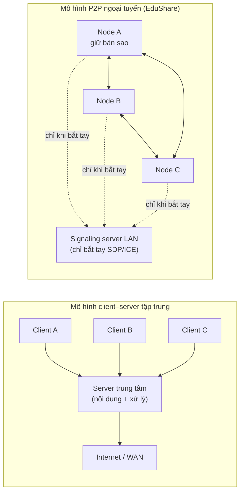
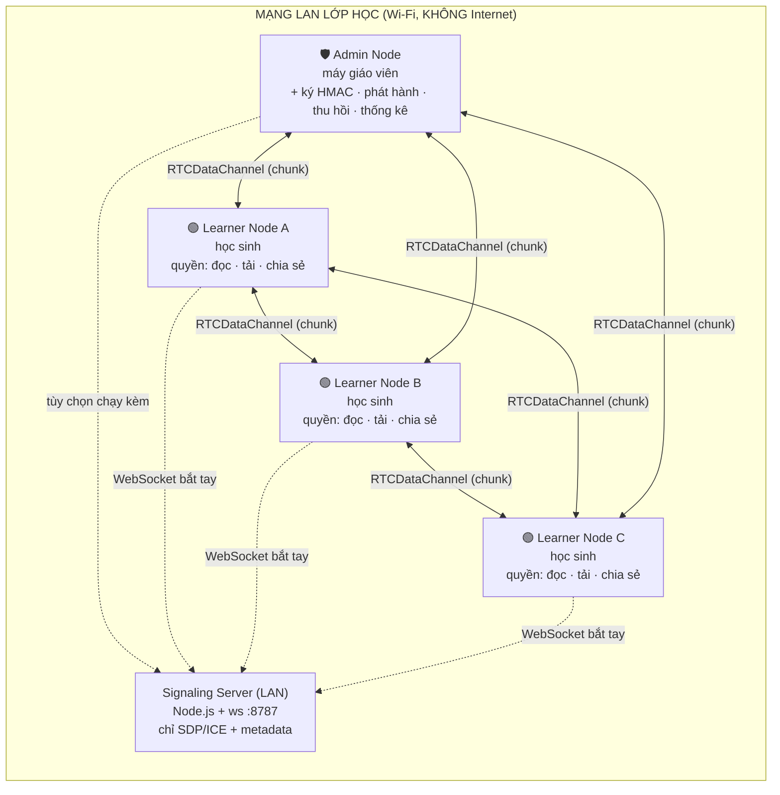
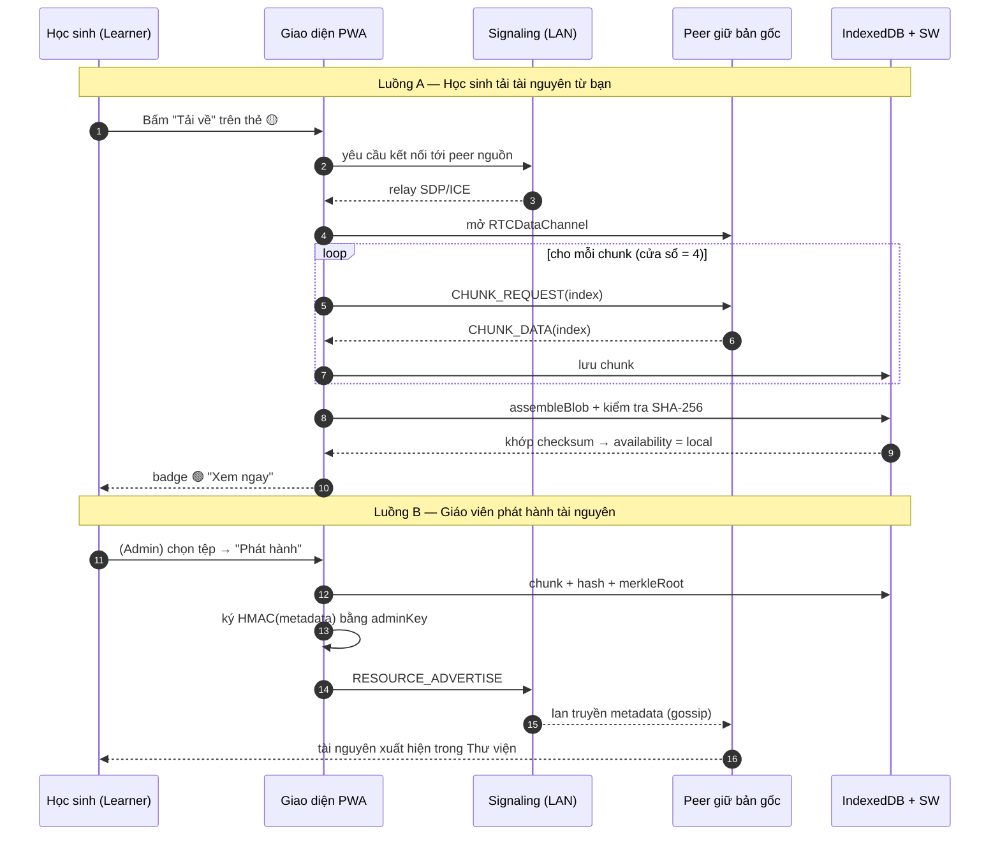
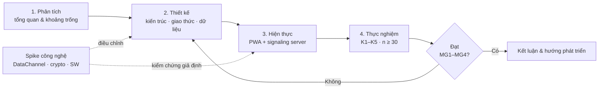

# Chương 1: MỞ ĐẦU

## Mục lục chương

- [1.1. Lý do chọn đề tài](#11-lý-do-chọn-đề-tài)
  - [1.1.1. Bức tranh khoảng trống số trong giáo dục](#111-bức-tranh-khoảng-trống-số-trong-giáo-dục)
  - [1.1.2. Hạn chế của mô hình client–server tập trung](#112-hạn-chế-của-mô-hình-clientserver-tập-trung)
  - [1.1.3. Tiềm năng của mô hình P2P ngoại tuyến](#113-tiềm-năng-của-mô-hình-p2p-ngoại-tuyến)
  - [1.1.4. Bảng so sánh sơ bộ hai mô hình](#114-bảng-so-sánh-sơ-bộ-hai-mô-hình)
- [1.2. Mục tiêu nghiên cứu](#12-mục-tiêu-nghiên-cứu)
- [1.3. Đối tượng và phạm vi nghiên cứu](#13-đối-tượng-và-phạm-vi-nghiên-cứu)
- [1.4. Câu hỏi nghiên cứu](#14-câu-hỏi-nghiên-cứu)
- [1.5. Ý nghĩa khoa học và thực tiễn](#15-ý-nghĩa-khoa-học-và-thực-tiễn)
- [1.6. Sản phẩm nghiên cứu](#16-sản-phẩm-nghiên-cứu)
- [1.7. Phương pháp nghiên cứu](#17-phương-pháp-nghiên-cứu)
- [1.8. Bố cục báo cáo](#18-bố-cục-báo-cáo)

---

## 1.1. Lý do chọn đề tài

### 1.1.1. Bức tranh khoảng trống số trong giáo dục

Trong hơn một thập niên qua, chuyển đổi số giáo dục được xem là một trong những ưu tiên
hàng đầu của nhiều quốc gia. Các nền tảng học trực tuyến, kho học liệu mở và hệ thống quản
lý học tập (LMS — Learning Management System) phát triển nhanh về số lượng lẫn chất lượng
nội dung. Tuy nhiên, phần lớn giá trị đó lại được thiết kế mặc định cho một điều kiện tiên
quyết: **luôn có kết nối Internet băng thông đủ lớn và ổn định**. Khi điều kiện tiên quyết
này không được bảo đảm — như ở nhiều trường học nông thôn, miền núi, vùng sâu vùng xa, khu
vực biên giới hoặc hải đảo — toàn bộ hệ sinh thái học liệu số trở nên vô dụng đối với người
dùng cuối. Nghịch lý nằm ở chỗ: **thiết bị đã có, nhu cầu đã có, nội dung số cũng đã tồn
tại, nhưng đường truyền lại là mắt xích đứt gãy**.

Hiện tượng này thường được mô tả bằng khái niệm **khoảng trống số (digital divide)** — sự
chênh lệch về khả năng tiếp cận và sử dụng công nghệ số. Khoảng trống số không chỉ là vấn
đề hạ tầng viễn thông, mà còn là vấn đề kinh tế, địa lý và xã hội. Ở cấp độ lớp học, nó
biểu hiện thành những tình huống rất cụ thể:

1. **Giáo viên muốn chia sẻ bài giảng nhưng không có kênh phân phối.** Bài giảng điện tử
   thường có dung lượng lớn (video bài giảng, bộ slide có hình ảnh, tệp PDF quét). Gửi qua
   email hoặc ứng dụng nhắn tin sẽ vấp phải giới hạn dung lượng và tiêu tốn dữ liệu di động
   của cả hai phía. Phương tiện phổ biến nhất vẫn là **USB hoặc thẻ nhớ** — thủ công, mất
   thời gian, không đồng bộ và dễ phát tán phần mềm độc hại.
2. **Học sinh muốn tải tài nguyên về để học ngoại tuyến nhưng không có cách tự động hóa.**
   Các nền tảng trực tuyến chỉ cho phép đọc khi có mạng; cơ chế tải ngoại tuyến (nếu có) lại
   phụ thuộc vào máy chủ của nhà cung cấp.
3. **Nhiều bản sao tài nguyên trùng lặp bị lãng phí.** Cùng một bài giảng có thể được tải đi
   tải lại qua đường truyền Internet đắt đỏ nhiều lần, trong khi các thiết bị trong cùng một
   lớp — vốn đã nằm sát nhau trên cùng một mạng Wi-Fi — lại hoàn toàn không tận dụng được
   lợi thế "ở gần nhau" đó.

Bảng 1.1 dưới đây hệ thống hóa các chỉ báo đặc trưng của bài toán. Các ô số liệu được để ở
dạng mẫu để điền trong quá trình khảo sát thực địa; báo cáo không sử dụng số liệu chưa kiểm
chứng.

**Bảng 1.1 — Các chỉ báo khoảng trống số ở cấp lớp học (mẫu — điền số liệu)**

| Chỉ báo | Cách đo | Giá trị (mẫu) | Ý nghĩa |
|---|---|---|---|
| Tỉ lệ thời gian có Internet ổn định | Khảo sát/ghi log trong 1 tuần | (mẫu — điền số liệu) | Mức độ sẵn sàng của hạ tầng |
| Số bản sao trùng lặp của một bài giảng | Đếm lượt tải/học sinh | (mẫu — điền số liệu) | Mức lãng phí băng thông |
| Thời gian chuyển 1 bài giảng 50 MB qua USB | Bấm giờ thủ công | (mẫu — điền số liệu) | Chi phí thời gian của phương án hiện tại |
| Số thiết bị/1 lớp cùng mạng Wi-Fi | Kiểm tra router | (mẫu — điền số liệu) | Quy mô tài nguyên P2P tiềm năng |
| Tỉ lệ học sinh có thiết bị Android/desktop | Khảo sát | (mẫu — điền số liệu) | Tính khả thi của giải pháp web |

Điểm mấu chốt cần nhấn mạnh: **tài nguyên mạng đã tồn tại ngay trong lớp học** (mạng Wi-Fi
nội bộ nối các thiết bị với nhau), chỉ có **phương thức sử dụng** nó để chia sẻ học liệu là
chưa được khai thác. Đây chính là khoảng trống mà đề tài hướng tới.

### 1.1.2. Hạn chế của mô hình client–server tập trung

Mô hình **client–server** là nền tảng của gần như toàn bộ dịch vụ web hiện đại. Trong mô
hình này, mọi yêu cầu của người dùng (client) đều phải đi qua một máy chủ trung tâm, nơi
lưu trữ nội dung, xử lý nghiệp vụ và điều phối dữ liệu. Ưu điểm của mô hình là tập trung,
dễ kiểm soát, dễ cập nhật và dễ bảo trì. Tuy nhiên, khi áp dụng cho bài toán phân phối nội
dung giáo dục trong điều kiện mạng không ổn định, mô hình này bộc lộ nhiều hạn chế mang
tính cấu trúc:

1. **Điểm lỗi duy nhất (single point of failure).** Khi đường truyền tới máy chủ bị đứt —
   dù do sự cố nhà mạng, mất điện máy chủ hay quá tải — toàn bộ hệ thống ngừng phục vụ. Với
   người dùng ở vùng sâu vùng xa, sự cố này diễn ra thường xuyên và không thể khắc phục từ
   phía người dùng.
2. **Điểm nghẽn băng thông (bottleneck).** Giả sử một lớp có `N` học sinh cùng tải một tệp
   kích thước `S`. Với mô hình tập trung, tổng lưu lượng phải đi qua máy chủ là `N·S`. Nếu
   tệp được đặt trên máy chủ đặt xa khu vực người học, độ trễ và chi phí băng thông tăng
   theo `N`, trong khi tuyến truyền vẫn chỉ có một. Ngược lại, nếu tải trực tiếp giữa các
   thiết bị trong LAN, lưu lượng chỉ còn khoảng `S` cho bản gốc cộng `(N−1)·S` truyền nội
   bộ, không phụ thuộc Internet.
3. **Chi phí vận hành tỉ lệ với số người dùng.** Lưu trữ, băng thông và nhân lực vận hành
   máy chủ đều tăng theo quy mô. Với các trường học có ngân sách hạn hẹp, đây là rào cản
   thực tế khiến việc duy trì một kho học liệu trực tuyến riêng gần như bất khả thi.
4. **Phụ thuộc Internet — mâu thuẫn với mục tiêu học tập ngoại tuyến.** Bản chất của nhiều
   tình huống học tập (ôn thi tại nhà, học ở vùng không phủ sóng) đòi hỏi nội dung phải
   **ở lại trên thiết bị**. Mô hình tập trung được thiết kế cho trạng thái "luôn kết nối",
   không được tối ưu cho trạng thái "thường xuyên mất kết nối".
5. **Rủi ro quyền riêng tư và an ninh.** Mọi dữ liệu học tập tập trung một chỗ tạo thành
   mục tiêu hấp dẫn cho tấn công và tạo rủi ro về quyền riêng tư.

Cần lưu ý rằng mô hình client–server **không sai**; nó phù hợp với phần lớn bài toán dịch
vụ. Vấn đề là ở **bối cảnh cụ thể** của đề tài — giáo dục ngoại tuyến, quy mô lớp học, mạng
LAN sẵn có — mô hình này không phát huy được lợi thế vị trí và không đáp ứng được yêu cầu
hoạt động khi mất Internet. Đây là lý do thứ hai để đề tài lựa chọn hướng tiếp cận khác.

### 1.1.3. Tiềm năng của mô hình P2P ngoại tuyến

Mô hình **peer-to-peer (P2P)** đảo ngược giả định trung tâm hóa: mỗi thiết bị vừa là
**người tiêu thụ** (consumer) vừa là **người cung cấp** (provider) tài nguyên. Trong bối
cảnh lớp học, điều này nghĩa là học sinh A sau khi tải một bài giảng có thể **trực tiếp
phục vụ lại** bài giảng đó cho học sinh B, C, D mà không cần bất kỳ máy chủ nào ở giữa.
Có ba nền tảng công nghệ then chốt biến ý tưởng này thành khả thi **ngay trong trình
duyệt web hiện đại**:

1. **WebRTC DataChannel** cho phép hai trình duyệt thiết lập một kênh dữ liệu P2P trực
   tiếp, có mã hóa, mà không cần cài đặt ứng dụng gốc (native app). Trong mạng LAN, hai
   trình duyệt có thể kết nối trực tiếp qua địa chỉ IP nội bộ nhờ cơ chế ICE với các
   *host candidate*, không cần STUN/TURN — tức là **hoạt động hoàn toàn ngoại tuyến**
   [2].
2. **Progressive Web App (PWA)** cùng **Service Worker** biến ứng dụng web thành một thực
   thể có thể cài lên màn hình chính và hoạt động khi không có mạng, nhờ cơ chế cache và
   phục vụ "app shell" ngoại tuyến [10], [12].
3. **IndexedDB** cho phép lưu trữ lượng lớn dữ liệu nhị phân (các chunk tệp) ngay trên
   thiết bị, đủ để tái dựng và xem lại tài nguyên mà không cần kết nối [11], [13].

Kết hợp ba nền tảng trên, ta có thể xây dựng một **mạng lưới chia sẻ tài nguyên giáo dục
P2P ngoại tuyến**: mỗi thiết bị là một **node** trong mạng LAN; tài nguyên được đánh địa
chỉ theo nội dung, lan truyền qua cơ chế gossip, truyền đi theo từng chunk và được kiểm
chứng bằng hàm băm mật mã. Điểm mạnh của thiết kế này so với các hệ thống học liệu cục bộ
hiện có (xem mục 2.6) là: **nội dung sống sót ngay cả khi thiết bị "máy chủ" của giáo viên
tắt**, bởi vì bản sao đã nằm rải rác trên chính thiết bị của người học.

Hình 1.1 minh họa sự dịch chuyển từ mô hình tập trung sang mô hình P2P phân tán.

**Hình 1.1 — So sánh định hướng lưu lượng: tập trung (trái) và P2P ngoại tuyến (phải).**
Trong mô hình P2P, signaling server chỉ tham gia giai đoạn bắt tay; sau khi kênh
DataChannel mở, dữ liệu chạy trực tiếp giữa các thiết bị.

### 1.1.4. Bảng so sánh sơ bộ hai mô hình

**Bảng 1.2 — So sánh sơ bộ mô hình client–server và P2P cho bài toán học liệu lớp học**

| Tiêu chí | Client–server tập trung | P2P ngoại tuyến (EduShare) |
|---|---|---|
| Điều kiện hoạt động | Bắt buộc có Internet tới máy chủ | Cần mạng LAN nội bộ; không cần Internet |
| Điểm lỗi duy nhất | Có (máy chủ) | Không (nội dung phân tán trên peer) |
| Khi "máy chủ" tắt | Ngừng phục vụ hoàn toàn | Mạng vẫn chạy nhờ DataChannel trực tiếp |
| Lưu lượng đường truyền ngoài | `N·S` qua máy chủ | ~0 cho Internet; `(N−1)·S` nội bộ LAN |
| Chi phí hạ tầng | Lưu trữ + băng thông + vận hành | ~0 (tận dụng thiết bị & router sẵn có) |
| Độ trễ | Phụ thuộc khoảng cách tới máy chủ | Rất thấp (cùng LAN) |
| Khả năng mở rộng | Tăng chi phí theo `N` | Tăng tài nguyên phân tán theo `N` |
| Kiểm soát nội dung | Tập trung, dễ áp đặt | Qua vai trò Admin Node (ký số) |
| Cài đặt | Web/app thông thường | PWA + signaling nhẹ |
| Rào cản triển khai | Cần hạ tầng mạng & máy chủ | Cần Node.js + router Wi-Fi |

Từ bảng so sánh trên, có thể thấy hai mô hình mang tính **bổ trợ** hơn là thay thế: P2P phù
hợp cho phân phối nội dung trong phạm vi hẹp, thường xuyên mất kết nối; client–server phù
hợp cho các dịch vụ cần đồng bộ toàn cầu. Đề tài chọn P2P làm trọng tâm, đồng thời dùng
một signaling server **rất nhẹ** chỉ cho giai đoạn bắt tay — một dạng **P2P lai (hybrid
P2P)** như sẽ phân tích tại mục 2.1.

---

## 1.2. Mục tiêu nghiên cứu

### 1.2.1. Mục tiêu tổng quát

**Xây dựng và đánh giá một hệ thống phần mềm chia sẻ tài nguyên giáo dục hoạt động hoàn
toàn không cần Internet**, trong đó người học trong cùng một lớp có thể tự phát hiện nhau,
tìm kiếm, chia sẻ và tải tài nguyên trực tiếp với nhau qua mạng LAN, đồng thời vẫn xem lại
được nội dung đã tải khi mọi kết nối mạng đều bị ngắt.

### 1.2.2. Mục tiêu cụ thể (định lượng được)

Các mục tiêu cụ thể được phát biểu dưới dạng **định lượng, kiểm chứng được** để làm cơ sở
đánh giá ở Chương 5.

**Bảng 1.3 — Mục tiêu cụ thể MG1–MG4 và tiêu chí đo**

| Mã | Mục tiêu | Tiêu chí đo | Cách kiểm chứng |
|---|---|---|---|
| **MG1** | Thiết kế giao thức phát hiện và kết nối peer trong mạng LAN | ≥ 90% số cặp peer thiết lập được DataChannel trong ≤ 10 s; tự phục hồi sau khi signaling đứt nhờ reconnect | Kịch bản K1/K2 (Chương 5); log `peer-open` |
| **MG2** | Xây dựng cơ chế lan truyền tài nguyên (gossip metadata + truyền chunk) | Metadata của một tài nguyên phủ tới toàn mạng trong ≤ 3 chu kỳ gossip (`DEFAULT_TTL = 3`); tải tệp thành công ≥ 99% khi còn ≥ 1 nguồn | Kịch bản K2/K3; đối chiếu `gossip.ts` |
| **MG3** | Đạt tốc độ truyền tối thiểu giữa hai thiết bị trong LAN | Throughput ≥ 5 MB/s khi tải tệp 50–100 MB trên Wi-Fi 5 GHz trong cùng lớp | Kịch bản K1 với `n ≥ 30` lần chạy |
| **MG4** | Ứng dụng hoạt động ngoại tuyến 100% sau lần cài đặt đầu tiên | Sau khi ngắt toàn bộ mạng, mở lại ứng dụng trong ≤ 3 s và xem được tài nguyên đã tải | Kịch bản K5; Service Worker + IndexedDB |

**Bảng 1.4 — Ánh xạ mục tiêu sang thành phần hiện thực trong mã nguồn**

| Mục tiêu | Module chính | Vị trí mã nguồn tiêu biểu |
|---|---|---|
| MG1 | Signaling client + PeerManager | `app/src/lib/signaling.ts`, `app/src/lib/peer.ts` |
| MG2 | GossipEngine + TransferManager | `app/src/lib/gossip.ts`, `app/src/lib/transfer.ts` |
| MG3 | Chunking + backpressure + cửa sổ song song | `app/src/lib/transfer.ts`, `app/src/lib/protocol.ts` |
| MG4 | Service Worker + IndexedDB | `app/src/sw.ts`, `app/src/lib/db.ts` |
| Bảo mật (xuyên suốt) | Crypto (SHA-256/Merkle/HMAC) | `app/src/lib/crypto.ts` |
| Replication (nâng cao) | ReplicationManager | `app/src/lib/replication.ts` |

### 1.2.3. Mục tiêu phụ (không bắt buộc, hướng phát triển)

- Thử nghiệm cơ chế replication tự động dựa trên độ phổ biến của tài nguyên (ngưỡng
  `θ = 3`) nhằm tăng khả năng sống sót của nội dung khi churn cao.
- Ghi nhận số liệu thực nghiệm (`stats`) phục vụ phân tích định lượng và trả lời câu hỏi
  nghiên cứu.

---

## 1.3. Đối tượng và phạm vi nghiên cứu

### 1.3.1. Đối tượng nghiên cứu

- **Các thuật toán và giao thức P2P** cho mạng LAN quy mô nhỏ: phát hiện peer, lan truyền
  metadata (gossip), lựa chọn nguồn tải, sao chép nội dung (replication).
- **Cơ chế truyền tệp P2P trong trình duyệt** qua WebRTC DataChannel: chia nhỏ (chunking),
  kiểm soát luồng (backpressure), kiểm chứng toàn vẹn (hashing).
- **Kỹ thuật offline-first** trên nền web: PWA, Service Worker, IndexedDB, Background Sync.
- **Mô hình phân quyền phi tập trung** với hai vai trò logic Learner Node và Admin Node.

### 1.3.2. Phạm vi trong (in-scope)

| Hạng mục | Phạm vi trong |
|---|---|
| Mạng | LAN/Wi-Fi nội bộ trong một lớp học (một miền quảng bá); có thể xem xét Wi-Fi Direct ở mức lý thuyết |
| Thiết bị | Điện thoại/máy tính bảng Android và desktop (laptop) chạy trình duyệt nhân Chromium hoặc Firefox hiện đại |
| Nền tảng | Web/PWA chạy trên trình duyệt; một codebase duy nhất |
| Loại tài nguyên | Tệp tĩnh: PDF, video, audio, hình ảnh, tài liệu văn phòng |
| Quy mô | Cỡ lớp (khoảng 3–10 thiết bị trong thực nghiệm, thiết kế chịu được 50–100 kết nối signaling) |
| Chế độ | Ngoại tuyến 100% (không có Internet; signaling chạy trong LAN) |

### 1.3.3. Phạm vi ngoài (out-of-scope) và lý do

Việc giới hạn phạm vi là cần thiết để đảm bảo tính khả thi và độ sâu học thuật. Các nội
dung dưới đây **nằm ngoài phạm vi** kèm lý do cụ thể:

1. **iOS/Safari.** Safari trên iOS có những hạn chế đáng kể và không đồng nhất về
   Service Worker chạy nền, `Background Sync`/`Periodic Background Sync`, và chính sách
   lưu trữ/quota. Việc mở rộng sang iOS đòi hỏi giải pháp riêng (đóng gói native hoặc
   PWA polyfill) vượt khuôn khổ đề tài; do đó iOS được liệt kê là hướng phát triển ở
   Chương 6.
2. **Mạng di động WAN và xuyên NAT.** Kết nối P2P xuyên NAT cần STUN/TURN [2] và hạ
   tầng máy chủ relay — trái với mục tiêu "không Internet, không hạ tầng". EduShare cấu
   hình `iceServers: []` để chạy thuần LAN, nên bài toán xuyên NAT được loại trừ.
3. **Thuật toán trí tuệ nhân tạo.** Gợi ý nội dung, cá nhân hóa, xử lý ngôn ngữ tự nhiên
   không thuộc phạm vi nghiên cứu về mạng P2P và lưu trữ ngoại tuyến.
4. **Streaming video thích ứng (adaptive streaming) đa nguồn.** Đây là bài toán mở rộng
   đáng quan tâm nhưng đòi hỏi cơ chế nhiều nguồn song song và bộ đệm phức tạp; đề tài
   chỉ hiện thực tải một nguồn với cửa sổ song song `WINDOW = 4`.
5. **Khảo sát pháp lý về bản quyền nội dung số.** Báo cáo tập trung vào khía cạnh kỹ
   thuật; vấn đề bản quyền học liệu thuộc lĩnh vực khác.

---

## 1.4. Câu hỏi nghiên cứu

Đề tài đặt ra ba câu hỏi nghiên cứu (Research Questions) tương ứng với ba thách thức cốt
lõi khi vận hành một mạng chia sẻ tài nguyên ngoại tuyến, không có máy chủ trung tâm.

- **RQ1 — Phát hiện và duy trì kết nối.** *Làm sao phát hiện và duy trì kết nối giữa các
  peer khi không có server định danh tập trung?* Câu hỏi này liên quan tới cơ chế
  signaling ngoài băng tần (out-of-band), chiến lược chọn bên khởi tạo offer tất định để
  tránh xung đột (glare), và khả năng tự phục hồi khi kết nối đứt. Đây là tiền đề cho
  toàn bộ hoạt động của mạng.

- **RQ2 — Hiệu quả lan truyền tài nguyên.** *Tài nguyên lan truyền trong mạng hiệu quả như
  thế nào (băng thông, thời gian, tỉ lệ thành công)?* Câu hỏi này đo lường qua ba chỉ số:
  tốc độ truyền (throughput), thời gian phủ sóng metadata/nội dung tới `N` peer, và tỉ lệ
  tải thành công trong điều kiện churn. Nó liên quan tới tham số gossip (`TTL`), kích thước
  chunk, cửa sổ song song và cơ chế chọn nguồn.

- **RQ3 — Toàn vẹn và tin cậy dữ liệu phi tập trung.** *Làm sao đảm bảo toàn vẹn dữ liệu
  khi không có máy chủ kiểm chứng?* Câu hỏi này tìm cách thay thế "niềm tin vào máy chủ"
  bằng "niềm tin vào toán học": định danh theo nội dung (content-addressing) bằng SHA-256,
  Merkle root cho từng chunk, chữ ký HMAC của Admin Node cho metadata, và cơ chế peer tự
  kiểm chứng.

**Bảng 1.5 — Ánh xạ câu hỏi nghiên cứu với mục tiêu và kịch bản thực nghiệm**

| Câu hỏi | Mục tiêu liên quan | Kịch bản thực nghiệm | Chỉ số chính |
|---|---|---|---|
| RQ1 | MG1 | K1, K2 | Thời gian bắt tay, tỉ lệ kết nối thành công |
| RQ2 | MG2, MG3 | K1, K2, K3, K4 | Throughput, thời gian phủ sóng, tỉ lệ thành công |
| RQ3 | MG1–MG4 (xuyên suốt) | K3, K5 | Kiểm chứng checksum, mở offline |

---

## 1.5. Ý nghĩa khoa học và thực tiễn

### 1.5.1. Ý nghĩa khoa học

1. **Đề xuất và kiểm chứng một mô hình kết hợp chưa phổ biến trong tài liệu:** WebRTC
   DataChannel (P2P trình duyệt) + Service Worker (offline-first) + gossip metadata (lan
   truyền cộng tác) áp dụng cho phân phối nội dung giáo dục trong môi trường **bị cô lập
   mạng hoàn toàn**. Các nghiên cứu P2P cổ điển (BitTorrent, Freenet, DHT) giả định có
   đường truyền Internet; các nghiên cứu DTN [15] tập trung vào mạng bị gián đoạn nhưng
   thường ở tầng giao vận thấp. Đề tài đưa các nguyên lý đó lên **tầng ứng dụng web**.
2. **Cung cấp bộ số liệu thực nghiệm** về throughput, thời gian phủ sóng, tỉ lệ thành công
   dưới churn, và so sánh P2P với mô hình server trung tâm cho bài toán phân phối học liệu
   cỡ lớp.
3. **Làm rõ các giới hạn kỹ thuật của nền tảng web hiện đại** khi dùng cho P2P ngoại tuyến:
   yêu cầu *secure context* của `crypto.subtle`/Service Worker, tính bất định của các API
   nền (Background Sync), và giới hạn quota — qua đó chỉ ra bài toán thiết kế cần giải
   quyết (ví dụ phương án SHA-256/HMAC thuần JavaScript khi thiếu `crypto.subtle`).

### 1.5.2. Ý nghĩa thực tiễn

1. **Chi phí triển khai gần như bằng không.** Hệ thống tận dụng laptop sẵn có của giáo
   viên làm signaling server và router Wi-Fi của trường; không cần mua máy chủ, không cần
   tên miền, không cần chứng chỉ SSL thương mại, không cần cơ sở dữ liệu.
2. **Một codebase, một quy trình cài đặt.** Giáo viên và học sinh dùng **cùng một ứng
   dụng**; khác biệt duy nhất là vai trò tài khoản. Quy trình cài đặt đơn giản: mở URL →
   "Thêm vào màn hình chính".
3. **Nâng cao khả năng tiếp cận học liệu.** Nội dung đã lan truyền tiếp tục phục vụ được
   ngay cả khi giáo viên tắt máy hoặc khi mất Internet; người học chủ động lưu nội dung để
   học ngoại tuyến.
4. **Giảm tải và chi phí băng thông.** Tải trực tiếp trong LAN tránh lặp lại lưu lượng
   Internet cho từng học sinh, tiết kiệm chi phí dữ liệu và giảm phụ thuộc hạ tầng ngoài.
5. **Mở ra mô hình "hạ tầng tối thiểu".** Bất kỳ máy tính cũ nào (thậm chí Raspberry Pi)
   có thể đóng vai signaling server, giúp việc nhân rộng ra nhiều trường trở nên khả thi.

---

## 1.6. Sản phẩm nghiên cứu

### 1.6.1. Tổng quan sản phẩm

Sản phẩm của đề tài là **phần mềm**, cụ thể là **một codebase duy nhất** tạo ra **hai
thành phần phần mềm** chạy trên thiết bị của người dùng:

**Bảng 1.6 — Hai thành phần phần mềm của hệ thống EduShare**

| Thành phần | Bản chất | Chạy ở đâu | Trách nhiệm |
|---|---|---|---|
| **EduShare PWA** (`app/`) | Ứng dụng web/PWA (React + Vite + TypeScript) gồm giao diện, P2P client, Service Worker, IndexedDB | Mọi thiết bị (điện thoại, máy tính bảng, laptop) của học sinh và giáo viên | Giao diện, kết nối P2P, lưu trữ, offline |
| **Signaling Server** (`signaling-server/`) | Chương trình Node.js + WebSocket nhẹ | Một máy bất kỳ trong LAN (thường là máy giáo viên), cổng mặc định 8787 | Trung gian trao đổi SDP/ICE + relay metadata; **không lưu nội dung** |

Cần nhấn mạnh rằng đây **không phải** hai sản phẩm tách biệt. Signaling server là một
chương trình nhẹ (~vài trăm dòng, tiêu thụ chưa tới 50 MB RAM khi chạy) chỉ làm "mai mối"
kết nối trong vài giây đầu; sau khi kênh DataChannel giữa hai peer được thiết lập, **mọi
dữ liệu tài nguyên chạy trực tiếp giữa các thiết bị**, server không tham gia. Server cũng
đồng thời phục vụ bản build tĩnh của PWA (`app/dist`) để học sinh truy cập qua địa chỉ IP
LAN. Hệ thống **không** cần cơ sở dữ liệu, không cần web server truyền thống (Nginx/Apache),
không cần tên miền hay SSL thương mại.

### 1.6.2. Vai trò logic: Learner Node và Admin Node

Trong mạng P2P, mỗi thiết bị được gọi là một **node** (hay **peer**). Tùy theo vai trò
người dùng, node mang quyền hạn khác nhau:

- **Learner Node** (học sinh): có quyền đọc, tìm kiếm, tải về và chia sẻ tài nguyên của
  chính mình; tham gia lan truyền metadata và phục vụ chunk cho peer khác.
- **Admin Node** (giáo viên): có toàn bộ quyền của Learner Node, cộng thêm quyền **ký
  metadata bằng HMAC-SHA256**, **phát hành** tài nguyên mới, **thu hồi** nội dung và xem
  thống kê mạng.

Điểm thiết kế quan trọng: **Admin Node không phải là một sản phẩm hay thiết bị riêng**, mà
là **một vai trò logic** của cùng một codebase chạy trên máy giáo viên. Máy giáo viên có
thể đồng thời chạy signaling server (vì thường được mở đầu tiên và ổn định), nhưng điều
này là **tùy chọn**. Nếu máy giáo viên tắt, mạng P2P giữa các peer đã kết nối **vẫn tiếp
tục hoạt động** nhờ các kênh DataChannel trực tiếp; các tài nguyên đã ký vẫn hợp lệ vì
chữ ký nằm trong metadata đã lan truyền trong mạng.

Hình 1.2 mô tả mô hình node/mạng của EduShare.

**Hình 1.2 — Mô hình node/mạng EduShare.** Nét liền là kênh dữ liệu P2P (DataChannel);
nét đứt là kênh signaling chỉ dùng khi bắt tay. Admin Node là peer đặc biệt với quyền ký
và phát hành; mất Admin Node không làm mạng P2P ngừng hoạt động.

### 1.6.3. Luồng người dùng điển hình

Hình 1.3 trình bày hai luồng tương tác chính — học sinh tải tài nguyên và giáo viên phát
hành tài nguyên — dưới dạng sơ đồ tuần tự Mermaid.

**Hình 1.3 — Sơ đồ tuần tự hai luồng người dùng điển hình.**

---

## 1.7. Phương pháp nghiên cứu

### 1.7.1. Khung phương pháp luận

Đề tài sử dụng phương pháp nghiên cứu **thiết kế – hiện thực – thực nghiệm** (design
science), gồm bốn giai đoạn nối tiếp và có phản hồi lặp:

1. **Phân tích (analysis).** Tổng quan tài liệu và các hệ thống liên quan (P2P, WebRTC,
   PWA, DTN, học liệu ngoại tuyến); xác định khoảng trống nghiên cứu; hình thành câu hỏi
   nghiên cứu RQ1–RQ3 và mục tiêu MG1–MG4.
2. **Thiết kế (design).** Đặc tả yêu cầu chức năng/phi chức năng; thiết kế kiến trúc bốn
   tầng; thiết kế giao thức tin nhắn, thuật toán gossip/chọn nguồn/replication; thiết kế
   lược đồ lưu trữ IndexedDB và chiến lược cache của Service Worker.
3. **Hiện thực (implementation).** Xây dựng codebase thống nhất gồm PWA và signaling server;
   sử dụng **spike công nghệ** (thử nghiệm nhanh) để kiểm chứng các giả định rủi ro trước
   khi chuẩn hóa.
4. **Thực nghiệm – đánh giá (experiment/evaluation).** Thiết kế kịch bản đo K1–K5; thu
   thập số liệu với `n ≥ 30` lần chạy; phân tích định lượng; đối chiếu kết quả với mục
   tiêu và trả lời các câu hỏi nghiên cứu.

### 1.7.2. Spike công nghệ (technology spike)

Vì nhiều giả định của đề tài liên quan tới các API mới và có tính bất định cao, trước khi
thiết kế chính thức, đề tài thực hiện các **spike công nghệ** ngắn để trả lời câu hỏi
"điều này có khả thi không?":

- **Spike 1 — DataChannel trong LAN.** Hai trình duyệt trong cùng Wi-Fi có thiết lập được
  kênh dữ liệu trực tiếp với `iceServers: []` không? Kết quả: có, nhờ ICE host candidate
  [2]; đây là cơ sở để bỏ STUN/TURN.
- **Spike 2 — Truyền tệp theo chunk.** Xác định kích thước chunk hợp lý; thử 256 KB và
  kiểm chứng bằng SHA-256; phát hiện nhu cầu kiểm soát `bufferedAmount`.
- **Spike 3 — `crypto.subtle` trên HTTP LAN.** Ghi nhận rằng `crypto.subtle` là `undefined`
  trong ngữ cảnh không bảo mật (HTTP trên IP LAN), dẫn đến quyết định cài đặt SHA-256/HMAC
  **thuần JavaScript** làm phương án dự phòng (`app/src/lib/crypto.ts`).
- **Spike 4 — Service Worker trên HTTP.** Ghi nhận SW/offline chỉ đăng ký được trong
  *secure context* (HTTPS hoặc `localhost`), từ đó đưa ra khuyến nghị chứng chỉ tự ký cho
  triển khai thực tế.

Hình 1.4 tóm tắt quy trình phương pháp luận.

**Hình 1.4 — Quy trình phương pháp luận và vai trò của spike công nghệ.**

### 1.7.3. Công cụ và kỹ thuật thu thập số liệu

- **Số liệu ứng dụng:** ghi vào object store `stats` và `transfers` trong IndexedDB
  (`app/src/lib/db.ts`), gồm sự kiện `publish`, `request`, `download` và tốc độ MB/s.
- **Số liệu signaling:** endpoint `/health` và `/peers` của server
  (`signaling-server/server.js`).
- **Kiểm thử tự động:** bộ 6 kiểm thử chức năng tầng signaling (welcome, peer-joined,
  advertise, query-result, signal relay, peer-left).
- **Kiểm chứng toàn vẹn:** đối chiếu SHA-256/HMAC với Node `crypto` để xác nhận tính đúng
  đắn của phần cài đặt thuần JavaScript (10/10 trường hợp khớp).

---

## 1.8. Bố cục báo cáo

Báo cáo được tổ chức thành sáu chương:

- **Chương 1 — Mở đầu.** Trình bày lý do chọn đề tài, mục tiêu, phạm vi, câu hỏi nghiên
  cứu, ý nghĩa, sản phẩm, phương pháp và bố cục.
- **Chương 2 — Cơ sở lý thuyết.** Tổng quan về hệ thống chia sẻ tệp P2P, giao thức WebRTC,
  PWA và Service Worker, lưu trữ cục bộ trên trình duyệt, mạng chịu trễ DTN, cùng các hệ
  thống liên quan; từ đó rút ra khoảng trống nghiên cứu.
- **Chương 3 — Phân tích và thiết kế hệ thống.** Yêu cầu chức năng/phi chức năng, use case,
  kiến trúc bốn tầng, thiết kế giao thức mạng (phát hiện peer, định dạng tin nhắn, gossip,
  chọn nguồn, replication), thiết kế IndexedDB, Service Worker và mô hình bảo mật/phân
  quyền.
- **Chương 4 — Triển khai.** Công nghệ và môi trường, kiến trúc mã nguồn, hiện thực từng
  module chính kèm mã tiêu biểu và minh họa.
- **Chương 5 — Thực nghiệm và đánh giá.** Thiết lập thực nghiệm, kịch bản và chỉ số KPI,
  kết quả đo, trả lời RQ1–RQ3, đánh giá mức đạt MG1–MG4 và so sánh với hệ thống liên quan.
- **Chương 6 — Kết luận và hướng phát triển.** Tổng kết kết quả, hạn chế trung thực và
  các hướng nghiên cứu tiếp theo.

Ngoài sáu chương, báo cáo còn có **Tài liệu tham khảo** (chuẩn IEEE) và **Phụ lục** (mã
nguồn, hướng dẫn cài đặt, bảng thông số thiết bị thử nghiệm và kịch bản KPI).

**Bảng 1.7 — Tóm tắt phạm vi và sản phẩm từng chương**

| Chương | Nội dung chính | Sản phẩm/kết quả |
|---|---|---|
| 1 | Mở đầu | Bức tranh vấn đề, mục tiêu, phạm vi |
| 2 | Cơ sở lý thuyết | Nền tảng lý luận và khoảng trống nghiên cứu |
| 3 | Phân tích & thiết kế | Đặc tả kiến trúc, giao thức, dữ liệu |
| 4 | Triển khai | Codebase EduShare hoàn chỉnh |
| 5 | Thực nghiệm | Bộ số liệu KPI và phân tích RQ |
| 6 | Kết luận | Tổng kết và hướng phát triển |

---

*Kết chương:* Chương này đã thiết lập bối cảnh, mục tiêu và phạm vi nghiên cứu, đồng thời
xác định ba câu hỏi nghiên cứu định hướng toàn bộ báo cáo. Chương tiếp theo trình bày cơ
sở lý thuyết làm nền tảng cho các quyết định thiết kế ở Chương 3.

