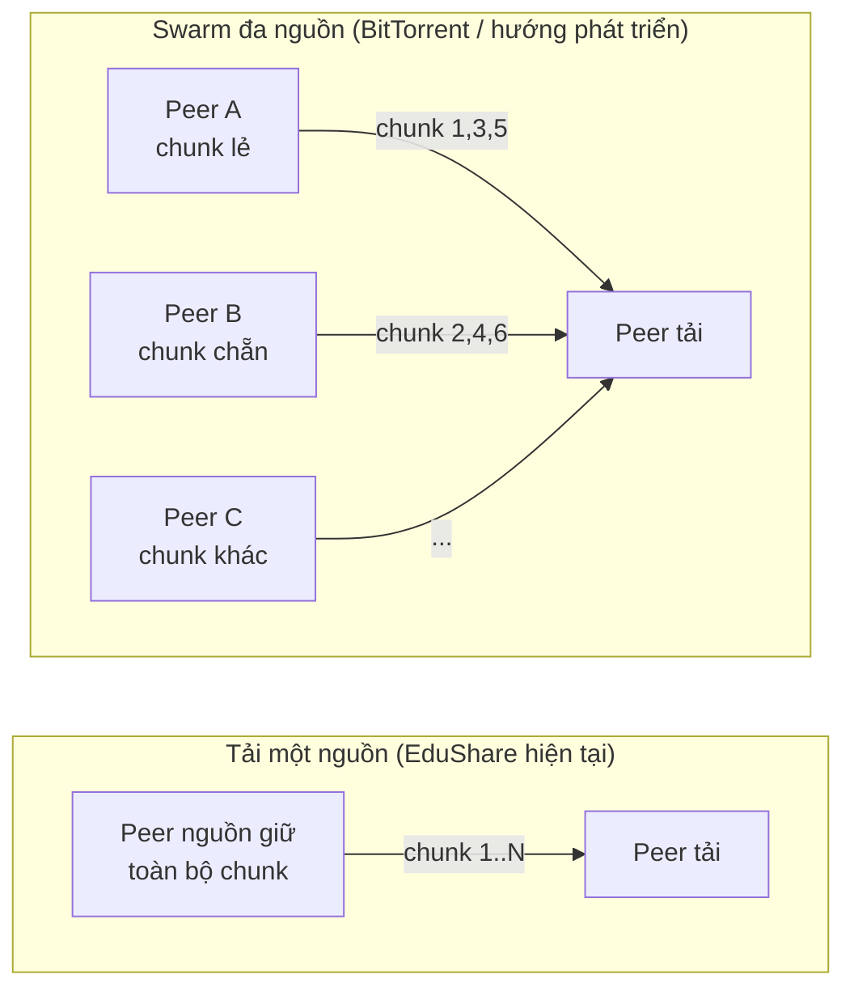
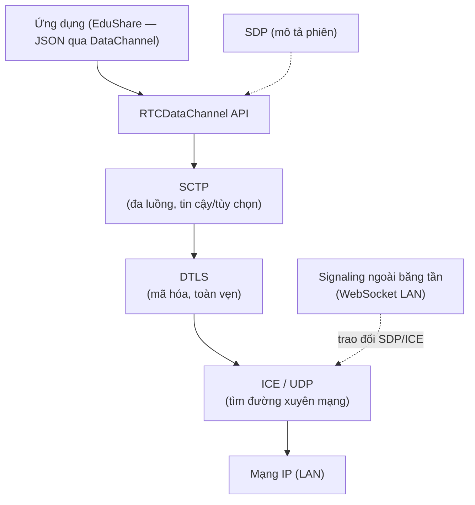
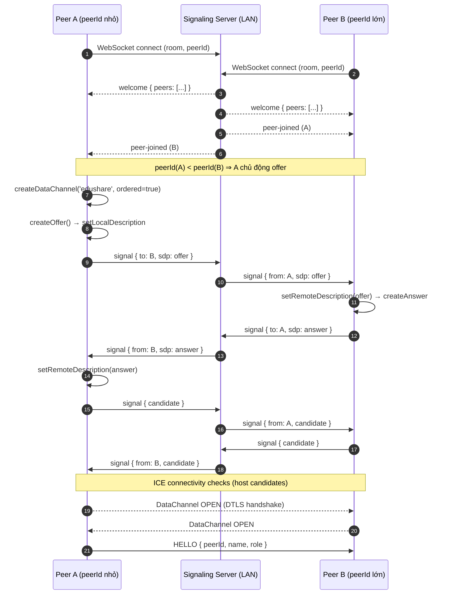
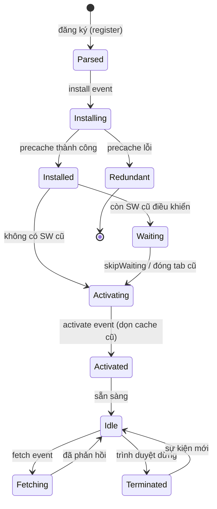
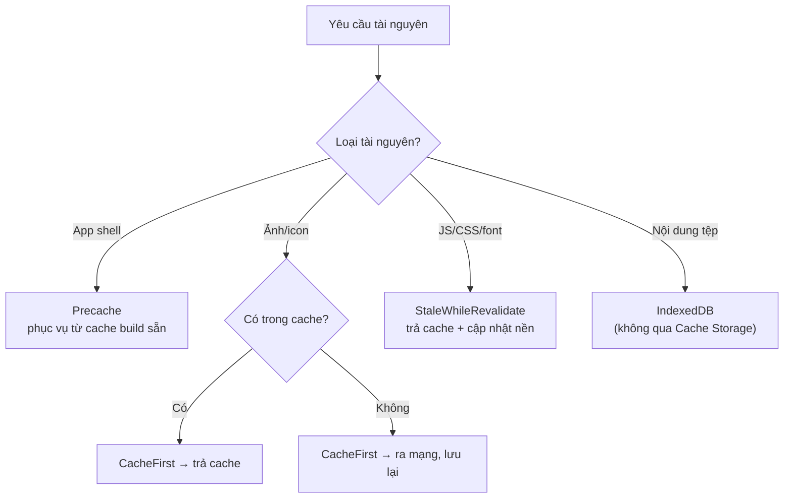
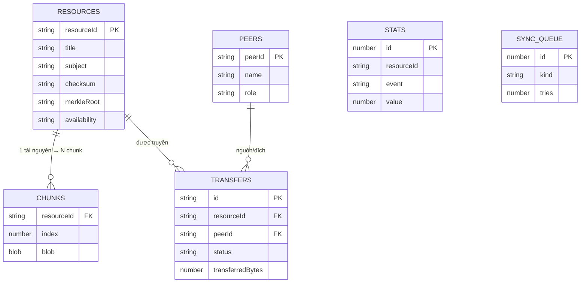
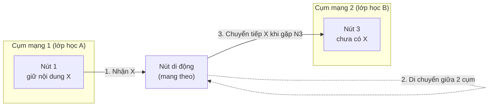
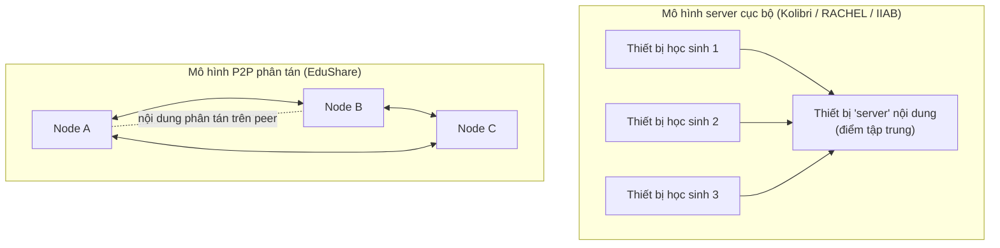

# Chương 2: CƠ SỞ LÝ THUYẾT

## Mục lục chương

- [2.1. Tổng quan hệ thống chia sẻ tệp P2P](#21-tổng-quan-hệ-thống-chia-sẻ-tệp-p2p)
  - [2.1.1. Phân loại kiến trúc P2P](#211-phân-loại-kiến-trúc-p2p)
  - [2.1.2. Structured (DHT) và unstructured (gossip/flooding)](#212-structured-dht-và-unstructured-gossipflooding)
  - [2.1.3. Các hệ thống tiêu biểu: BitTorrent, IPFS/libp2p, Freenet](#213-các-hệ-thống-tiêu-biểu-bittorrent-ipfslibp2p-freenet)
  - [2.1.4. Tổng hợp ưu nhược điểm và bài học cho EduShare](#214-tổng-hợp-ưu-nhược-điểm-và-bài-học-cho-edushare)
- [2.2. Giao thức WebRTC](#22-giao-thức-webrtc)
  - [2.2.1. Kiến trúc tổng thể](#221-kiến-trúc-tổng-thể)
  - [2.2.2. ICE, STUN và TURN](#222-ice-stun-và-turn)
  - [2.2.3. SDP và signaling ngoài băng tần](#223-sdp-và-signaling-ngoài-băng-tần)
  - [2.2.4. DTLS và bảo mật kênh truyền](#224-dtls-và-bảo-mật-kênh-truyền)
  - [2.2.5. RTCDataChannel: reliable/unreliable, SCTP, chunk và backpressure](#225-rtcdatachannel-reliableunreliable-sctp-chunk-và-backpressure)
  - [2.2.6. Sơ đồ bắt tay WebRTC](#226-sơ-đồ-bắt-tay-webrtc)
- [2.3. Progressive Web App và Service Worker](#23-progressive-web-app-và-service-worker)
  - [2.3.1. Progressive Web App](#231-progressive-web-app)
  - [2.3.2. Vòng đời Service Worker](#232-vòng-đời-service-worker)
  - [2.3.3. Các chiến lược cache](#233-các-chiến-lược-cache)
  - [2.3.4. Background Sync, Periodic Background Sync và Storage API](#234-background-sync-periodic-background-sync-và-storage-api)
- [2.4. Lưu trữ cục bộ trên trình duyệt](#24-lưu-trữ-cục-bộ-trên-trình-duyệt)
  - [2.4.1. So sánh LocalStorage, Cache Storage và IndexedDB](#241-so-sánh-localstorage-cache-storage-và-indexeddb)
  - [2.4.2. IndexedDB: object store, index, transaction và quota](#242-indexeddb-object-store-index-transaction-và-quota)
- [2.5. Mạng chịu trễ (Delay-Tolerant Networking — DTN)](#25-mạng-chịu-trễ-delay-tolerant-networking--dtn)
  - [2.5.1. Mô hình store-and-forward](#251-mô-hình-store-and-forward)
  - [2.5.2. Epidemic routing](#252-epidemic-routing)
  - [2.5.3. Liên hệ với bài toán EduShare](#253-liên-hệ-với-bài-toán-edushare)
- [2.6. Các nghiên cứu và hệ thống liên quan](#26-các-nghiên-cứu-và-hệ-thống-liên-quan)
  - [2.6.1. Kolibri, RACHEL, Internet-in-a-Box](#261-kolibri-rachel-internet-in-a-box)
  - [2.6.2. Bảng so sánh tổng hợp và khoảng trống nghiên cứu](#262-bảng-so-sánh-tổng-hợp-và-khoảng-trống-nghiên-cứu)
- [2.7. Kết chương](#27-kết-chương)

---

## 2.1. Tổng quan hệ thống chia sẻ tệp P2P

Chia sẻ tệp ngang hàng (peer-to-peer) là một trong những lớp ứng dụng lâu đời và có ảnh
hưởng nhất của mạng máy tính phân tán. Khác với mô hình client–server, trong đó vai trò
được phân chia cứng nhắc giữa một (hoặc vài) máy phục vụ và nhiều máy khách, P2P trao cho
mỗi nút đồng thời hai vai trò: **vừa yêu cầu vừa phục vụ** tài nguyên. Sự đối xứng này là
nguồn gốc của cả ưu điểm (khả năng mở rộng, chịu lỗi) lẫn thách thức (định tuyến, tìm
kiếm, tin cậy) của P2P.

### 2.1.1. Phân loại kiến trúc P2P

P2P được phân loại theo mức độ phụ thuộc vào thành phần trung tâm:

- **Pure P2P (P2P thuần):** không có bất kỳ thành phần trung tâm nào; các nút tự tổ chức,
  tự khám phá và tự định tuyến. Ví dụ điển hình là Gnutella thế hệ đầu và Freenet. Ưu
  điểm là không có điểm lỗi duy nhất; nhược điểm là hiệu quả tìm kiếm kém khi quy mô lớn.
- **Hybrid P2P (P2P lai):** có một thành phần trung tâm **giới hạn chức năng** — thường chỉ
  làm nhiệm vụ danh bạ hoặc điều phối, không lưu hay phục vụ nội dung. Ví dụ kinh điển là
  BitTorrent với *tracker* (hoặc bản DHT hóa sau này), và các mạng có *super-node*. Ưu
  điểm là hiệu quả cao, dễ triển khai; nhược điểm là phụ thuộc (một phần) vào hạ tầng.
- **Structured P2P:** có cấu trúc định tuyến xác định, thường dựa trên **bảng băm phân tán
  (Distributed Hash Table — DHT)**, cho phép tìm khóa trong `O(log N)` bước (Chord,
  Kademlia, Pastry). Ưu điểm là khả năng mở rộng tốt và độ trễ tìm kiếm dự đoán được;
  nhược điểm là phức tạp và nhạy cảm với churn.
- **Unstructured P2P:** không có cấu trúc định tuyến cố định; nút tìm kiếm bằng cách lan
  truyền (flooding, random walk, gossip). Ưu điểm là đơn giản, chịu churn tốt; nhược điểm
  là lưu lượng quảng bá lớn.

Hình 2.1 minh họa cây phân loại này.

```mermaid
flowchart TD
    P["Kiến trúc P2P"] --> PU["Pure P2P<br/>không trung tâm"]
    P --> HY["Hybrid P2P<br/>trung tâm giới hạn chức năng"]
    P --> ST["Structured<br/>định tuyến xác định"]
    P --> UN["Unstructured<br/>lan truyền"]

    PU --> PU1["Gnutella (đầu), Freenet"]
    HY --> HY1["BitTorrent (tracker)", "mạng super-node"]
    ST --> ST1["Chord", "Kademlia", "Pastry"]
    UN --> UN1["Gossip", "Flooding", "Random walk"]

    EDU["EduShare<br/>Hybrid nhẹ + Unstructured"]:::target
    HY1 -. kế thừa signaling .-> EDU
    UN1 -. kế thừa gossip .-> EDU

    classDef target fill:#d1fae5,stroke:#059669,stroke-width:2px;
```

**Hình 2.1 — Phân loại kiến trúc P2P và vị trí của EduShare.** EduShare lai giữa mô hình
hybrid (một signaling server nhẹ chỉ lo bắt tay) và mô hình unstructured (gossip metadata,
flooding có TTL).

**Bảng 2.1 — So sánh bốn nhóm kiến trúc P2P**

| Tiêu chí | Pure P2P | Hybrid P2P | Structured (DHT) | Unstructured (gossip/flooding) |
|---|---|---|---|---|
| Thành phần trung tâm | Không | Có (giới hạn) | Không | Không |
| Định tuyến | Ngẫu nhiên | Qua super-node/tracker | Bảng băm, `O(log N)` | Lan truyền |
| Hiệu quả tìm kiếm | Thấp–trung bình | Cao | Rất cao | Trung bình |
| Chi phí quảng bá | Cao | Thấp | Thấp | Cao (flooding) |
| Khả năng mở rộng | Kém | Tốt | Rất tốt | Trung bình |
| Chịu churn | Trung bình | Trung bình | Nhạy cảm | Tốt |
| Độ phức tạp triển khai | Trung bình | Trung bình | Cao | Thấp |
| Không cần Internet | Tùy | Tùy | Tùy | Có thể |

### 2.1.2. Structured (DHT) và unstructured (gossip/flooding)

**Bảng băm phân tán (DHT).** DHT ánh xạ một khóa (ví dụ `resourceId`) tới một nút quản lý
khóa đó bằng hàm băm, rồi dùng bảng định tuyến để chuyển truy vấn tới đúng nút trong số
`O(log N)` bước. Chord tổ chức các nút thành vòng tròn định danh và dùng bảng *finger*;
Kademlia dùng khoảng cách XOR và bảng định tuyến theo tiền tố bit, rất hiệu quả và chịu
lỗi tốt — đây là nền tảng định tuyến của IPFS/libp2p [16]. DHT có hai nhược điểm liên quan
trực tiếp tới đề tài:

1. **Yêu cầu kết nối liên tục và định danh ổn định.** Trong mạng LAN lớp học, danh sách
   nút thay đổi liên tục (học sinh vào/ra) và quy mô chỉ vài chục nút — lợi ích `O(log N)`
   của DHT gần như biến mất khi `N` nhỏ, trong khi chi phí duy trì bảng định tuyến và
   bootstrap vẫn còn.
2. **Bootstrap và join phức tạp.** DHT cần cơ chế khởi tạo (bootstrap node) và duy trì
   *successor list*; trong mạng offline không có bootstrap cố định, điều này khó thực hiện.

**Gossip và flooding.** Ngược lại, tiếp cận unstructured dùng **lan truyền dịch tễ
(epidemic/gossip)** [14]: mỗi nút định kỳ chia sẻ thông tin với các nút láng giềng; thông
tin "lây lan" khắp mạng theo thời gian. Flooding là biến thể trong đó mỗi thông điệp được
chuyển tiếp tới mọi láng giềng, thường kèm **thời gian sống (TTL — Time To Live)** để giới
hạn số hop và tránh bão gói. Gossip có ưu điểm vượt trội trong bối cảnh của đề tài:

- **Đơn giản, phi tập trung hoàn toàn:** không cần bảng định tuyến, không cần bootstrap.
- **Chịu churn tốt:** nút rời mạng không làm hỏng cấu trúc; thông tin vẫn lan qua các đường
  khác.
- **Lan tỏa nhanh trong mạng nhỏ:** với `N` nhỏ (một lớp học), gossip đạt độ phủ nhanh chỉ
  với vài chu kỳ.

Đánh đổi chính là **lưu lượng quảng bá** (mỗi thông điệp có thể tạo nhiều bản sao) và
**không đảm bảo độ phủ** trong mạng lớn. Trong mạng LAN cỡ lớp học, đánh đổi này hoàn toàn
chấp nhận được, và EduShare giảm thiểu bằng `DEFAULT_TTL = 3` cùng quy tắc "chỉ chuyển tiếp
bản mới hơn theo `version`" (xem `app/src/lib/gossip.ts`).

**Bảng 2.2 — DHT so với gossip/flooding theo bối cảnh đề tài**

| Tiêu chí | DHT (structured) | Gossip/flooding (unstructured) |
|---|---|---|
| Chi phí tìm kiếm | `O(log N)` | Lan truyền, không đảm bảo |
| Yêu cầu bootstrap | Có | Không |
| Chịu churn | Nhạy cảm | Tốt |
| Phù hợp mạng nhỏ, offline | Ít phù hợp | **Rất phù hợp** |
| Lưu lượng quảng bá | Thấp | Cao (kiểm soát bằng TTL) |
| Độ phức tạp hiện thực | Cao | Thấp |
| Lựa chọn của EduShare | Không dùng | **Có dùng** |

### 2.1.3. Các hệ thống tiêu biểu: BitTorrent, IPFS/libp2p, Freenet

**BitTorrent.** BitTorrent chia tệp thành các mảnh (piece) và cho phép nhiều peer tải song
song các mảnh khác nhau — cơ chế **swarm** nổi tiếng giúp throughput tăng theo số peer.
BitTorrent nguyên thủy dùng *tracker* (máy chủ danh bạ) để biết peer nào đang giữ tệp;
các phiên bản sau dùng DHT (mainline DHT dựa trên Kademlia) để phi tập trung hóa việc tìm
peer. BitTorrent chứng minh sức mạnh của mô hình "nhiều nguồn": càng nhiều peer giữ dữ
liệu, mạng càng nhanh và bền. Tuy nhiên, BitTorrent giả định có đường truyền Internet và
cơ chế NAT traversal, đồng thời không có tầng ứng dụng offline-first.

**IPFS và libp2p.** InterPlanetary File System (IPFS) là một hệ thống tệp phân tán định
danh nội dung: mỗi tệp được định danh bằng hàm băm nội dung (CID — Content Identifier),
tương tự nguyên lý `resourceId = SHA-256(tệp)` của EduShare. libp2p là ngăn xếp mạng mô-đun
cung cấp transport (TCP, QUIC, WebRTC), định tuyến DHT (Kademlia), discovery và pub/sub
[16]. IPFS định hướng mạng toàn cầu nên phụ thuộc bootstrap node và DHT toàn cục — không
phù hợp trực tiếp cho LAN offline, nhưng **triết lý content-addressing** của nó là nguồn
cảm hứng trực tiếp cho cơ chế toàn vẹn của EduShare.

**Freenet.** Freenet là mạng P2P thuần chú trọng ẩn danh và chống kiểm duyệt: dữ liệu được
mã hóa và phân tán trên các nút, định tuyến theo khóa. Freenet có ưu điểm về quyền riêng
tư nhưng đánh đổi bằng độ trễ cao và độ phức tạp lớn, không phù hợp với yêu cầu tương tác
nhanh trong lớp học.

Hình 2.2 so sánh trực quan luồng tải giữa mô hình một nguồn và mô hình swarm của
BitTorrent — cơ sở lý thuyết cho hai hướng: (a) hiện thực hiện tại của EduShare tải từ một
nguồn, (b) hướng phát triển tải đa nguồn.



**Hình 2.2 — Một nguồn so với swarm đa nguồn.** EduShare hiện dùng cửa sổ song song
`WINDOW = 4` trên một nguồn (`app/src/lib/transfer.ts`); mở rộng sang đa nguồn là hướng
phát triển.

**Bảng 2.3 — So sánh chi tiết BitTorrent, IPFS/libp2p, Freenet và EduShare**

| Tiêu chí | BitTorrent | IPFS/libp2p | Freenet | **EduShare** |
|---|---|---|---|---|
| Mô hình | Hybrid (tracker) / DHT | Pure + DHT toàn cầu | Pure, DHT | Hybrid nhẹ + gossip |
| Định danh nội dung | Hash mảnh (piece) | CID (content-addressed) | Khóa mã hóa | `resourceId = SHA-256` |
| Tìm peer | Tracker / DHT | DHT (Kademlia) | Định tuyến theo khóa | Gossip + signaling LAN |
| Transport | TCP/uTP | TCP/QUIC/WebRTC | TCP (UDP) | WebRTC DataChannel (SCTP/DTLS) |
| Offline LAN | Không thiết kế | Cần bootstrap | Không | **Có** |
| Tầng ứng dụng web | Không | Một phần | Không | **PWA + Service Worker** |
| Cài đặt | Phần mềm native | Daemon/CLI | Phần mềm native | Trình duyệt (không cài native) |
| Ẩn danh | Thấp | Trung bình | Cao | Không ưu tiên |
| Chi phí hạ tầng | Tracker/DHT | Bootstrap | Bootstrap | **~0 (LAN)** |

### 2.1.4. Tổng hợp ưu nhược điểm và bài học cho EduShare

**Bảng 2.4 — Ưu nhược điểm của từng hệ thống và bài học rút ra**

| Hệ thống | Ưu điểm chính | Nhược điểm | Bài học cho EduShare |
|---|---|---|---|
| BitTorrent | Swarm mạnh, chịu churn, hiệu quả | Cần Internet; không offline-first | Lấy tinh thần chunk + kiểm chứng; hướng tới đa nguồn |
| IPFS/libp2p | Content-addressing, mô-đun | DHT/bootstrap toàn cầu, nặng | Lấy content-addressing + Merkle |
| Freenet | Ẩn danh, kháng kiểm duyệt | Độ trễ cao, phức tạp | Không chọn ẩn danh; ưu tiên đơn giản |
| Gnutella (pure) | Không trung tâm | Flooding tốn băng thông | Giới hạn TTL để kiểm soát quảng bá |

Từ các phân tích trên, EduShare kế thừa **content-addressing** từ IPFS, **chunk hóa và
kiểm chứng** từ BitTorrent, và **gossip có giới hạn TTL** từ mạng unstructured, nhưng
thay thế toàn bộ tầng vận chuyển bằng WebRTC DataChannel và bổ sung tầng offline-first
bằng Service Worker/IndexedDB — một tổ hợp chưa được khảo sát đầy đủ trong tài liệu.

---

## 2.2. Giao thức WebRTC

WebRTC (Web Real-Time Communication) là bộ tiêu chuẩn của W3C/IETF cho phép giao tiếp thời
gian thực giữa các trình duyệt mà không cần plugin. Điểm cốt lõi với đề tài: WebRTC cung
cấp **RTCDataChannel** — kênh truyền dữ liệu hai chiều, tùy ý (arbitrary) và có mã hóa,
cho phép hai trình duyệt trao đổi dữ liệu nhị phân trực tiếp. DataChannel là "xương sống"
của tầng P2P trong EduShare.

### 2.2.1. Kiến trúc tổng thể

Ngăn xếp WebRTC gồm nhiều tầng. Ở tầng phiên, ICE chịu trách nhiệm tìm đường kết nối;
SDP mô tả phiên; DTLS cung cấp bảo mật; với DataChannel, dữ liệu ứng dụng đi qua **SCTP**
(Session Control Transmission Protocol) đặt trên DTLS/UDP [5]. Hình 2.3 mô tả chồng giao
thức này.



**Hình 2.3 — Ngăn xếp giao thức WebRTC cho DataChannel.** SDP và signaling không nằm trong
đường truyền dữ liệu; chúng chỉ dùng để thiết lập phiên.

### 2.2.2. ICE, STUN và TURN

**ICE (Interactive Connectivity Establishment)** [2] là khung giao thức giúp hai peer
tìm được đường kết nối, bất chấp NAT và tường lửa. Quá trình ICE gồm:

1. **Thu thập candidate (gathering):** mỗi peer thu thập các địa chỉ mạng khả dụng:
   - *host candidate*: địa chỉ IP nội bộ của thiết bị;
   - *srflx candidate* (server reflexive): địa chỉ công khai nhìn từ ngoài, phát hiện qua
     **STUN**;
   - *relay candidate*: địa chỉ của máy chủ relay **TURN**, dùng khi không thể kết nối trực
     tiếp.
2. **Trao đổi candidate** qua kênh signaling.
3. **Kiểm tra kết nối (connectivity checks):** các cặp candidate được thử theo thứ tự ưu
   tiên; cặp đầu tiên hoạt động được chọn.

**STUN** (Session Traversal Utilities for NAT) giúp peer phát hiện địa chỉ công khai của
mình; **TURN** (Traversal Using Relays around NAT) làm máy chủ trung chuyển khi kết nối trực
tiếp bất khả thi. Cả hai đều là hạ tầng **bên ngoài** — điều mà đề tài muốn loại bỏ. Bởi
vậy, EduShare cấu hình danh sách máy chủ ICE rỗng để chỉ dùng host candidate trong LAN:

```ts
// app/src/lib/peer.ts
const RTC_CONFIG: RTCConfiguration = {
  iceServers: [],          // LAN thuần, offline: chỉ dùng host candidate
  iceCandidatePoolSize: 0
};
```

**Bảng 2.5 — Vai trò STUN/TURN và lựa chọn của EduShare**

| Thành phần | Chức năng | Cần khi nào | Trong EduShare |
|---|---|---|---|
| Host candidate | Địa chỉ IP nội bộ | Cùng LAN | **Dùng (chính)** |
| STUN | Phát hiện địa chỉ công khai | Có NAT | Không dùng |
| TURN | Relay lưu lượng | Không kết nối trực tiếp được | Không dùng |

Việc bỏ STUN/TURN là quyết định thiết kế trung tâm, cho phép hệ thống chạy **hoàn toàn
ngoại tuyến** mà vẫn giữ khả năng kết nối P2P trong phạm vi LAN.

### 2.2.3. SDP và signaling ngoài băng tần

**SDP (Session Description Protocol)** là định dạng văn bản mô tả phiên: các media, codec,
thuộc tính, và với DataChannel là các tham số SCTP. Hai peer trao đổi **offer** và
**answer** SDP để thống nhất phiên. Vì WebRTC không quy định kênh trao đổi SDP, giao thức
này phải diễn ra **ngoài băng tần (out-of-band)** — nghĩa là qua một kênh khác không phải
kênh P2P đang thiết lập.

Trong EduShare, kênh signaling là **WebSocket tới signaling server trong LAN**. Server chỉ
chuyển tiếp `signal` chứa SDP/ICE tới đúng peer đích và không lưu nội dung. Các phương án
dự phòng khi không có server gồm **mDNS** (giới hạn bởi trình duyệt) và **QR/SDP thủ công**
(copy-paste). Đây là lý do hệ thống được xếp vào nhóm **hybrid P2P**: signaling chỉ cần
thiết trong giai đoạn bắt tay.

### 2.2.4. DTLS và bảo mật kênh truyền

Mọi kênh WebRTC — kể cả DataChannel — đều được mã hóa bằng **DTLS** [4] (Datagram Transport
Layer Security), một biến thể của TLS chạy trên UDP. DTLS đảm bảo:

- **Bảo mật (confidentiality):** dữ liệu được mã hóa đầu-cuối giữa hai peer.
- **Toàn vẹn (integrity):** gói bị sửa đổi sẽ bị phát hiện.
- **Xác thực (authentication):** khóa được trao đổi qua bắt tay DTLS, gắn với dấu vân tay
  (fingerprint) trong SDP.

Đối với DataChannel, luồng dữ liệu đi qua SCTP đặt trên DTLS [5], nên mặc định đã được mã
hóa mà lập trình viên không phải cấu hình gì thêm. EduShare tận dụng tính chất này: **kênh
truyền chunk đã an toàn ở tầng giao vận**, còn tầng ứng dụng bổ sung kiểm chứng toàn vẹn
theo nội dung (SHA-256/Merkle/HMAC) để chống giả mạo ở mức ứng dụng.

### 2.2.5. RTCDataChannel: reliable/unreliable, SCTP, chunk và backpressure

**RTCDataChannel** cho phép truyền dữ liệu ứng dụng tùy ý giữa hai peer. Hai cặp thuộc
tính quan trọng quyết định hành vi:

- **`ordered`:** nếu `true`, gói đến theo đúng thứ tự; nếu `false`, gói có thể đến lệch
  thứ tự (dùng cho dữ liệu thời gian thực như video call).
- **`maxRetransmits` / `maxPacketLifeTime`:** kiểm soát cơ chế truyền lại của SCTP. Không
  đặt hai thuộc tính này nghĩa là **reliable** (truyền lại tới khi thành công); đặt nghĩa
  là **unreliable/partial reliability**.

Với bài toán truyền tệp, tính **đúng thứ tự và đáng tin cậy** là bắt buộc, nên EduShare
tạo DataChannel với `ordered: true` và chế độ mặc định reliable:

```ts
// app/src/lib/peer.ts
const ch = pc.createDataChannel('edushare', { ordered: true });
```

**SCTP (Stream Control Transmission Protocol)** là lớp bên dưới DataChannel, chạy trên DTLS
[5]. SCTP cung cấp truyền tải đa luồng (multi-streaming), điều khiển luồng (flow control)
và điều khiển tắc nghẽn (congestion control). Điều khiển luồng của SCTP là cơ sở cho cơ chế
**backpressure** ở tầng ứng dụng: trình duyệt giới hạn tốc độ mà ứng dụng có thể đẩy dữ
liệu vào kênh.

**Chunking.** Vì DataChannel có giới hạn kích thước thông điệp và vì không nên đẩy một tệp
lớn trong một lần, EduShare chia tệp thành các chunk cố định **256 KB**:

```ts
// app/src/lib/protocol.ts
export const CHUNK_SIZE = 256 * 1024;          // 262144 bytes
export const BUFFER_HIGH_WATER = 8 * 1024 * 1024; // 8 MB
export const BUFFER_LOW_WATER  = 1 * 1024 * 1024; // 1 MB
```

Kích thước 256 KB là kết quả cân bằng: đủ lớn để giảm overhead điều khiển, đủ nhỏ để hạn
chế độ trễ và mức sử dụng RAM trên thiết bị yếu. Chunk cũng là đơn vị **resume**: nếu một
phiên tải bị gián đoạn, chỉ các chunk còn thiếu cần tải lại, vì chunk đã nhận được lưu
trong IndexedDB (khóa `[resourceId+index]`).

**Backpressure.** Nếu ứng dụng gửi dữ liệu nhanh hơn tốc độ đường truyền, bộ đệm gửi
(`bufferedAmount`) sẽ tăng và có thể làm tràn bộ nhớ. EduShare kiểm soát bằng cơ chế *high
water mark / low water mark*: tạm dừng gửi khi `bufferedAmount ≥ 8 MB`, tiếp tục khi tụt
xuống `≤ 1 MB`, nhờ sự kiện `bufferedamountlow` (kèm kiểm tra định kỳ dự phòng):

```ts
// app/src/lib/peer.ts — trích waitForDrain()
if (ch.bufferedAmount < BUFFER_HIGH_WATER) return;
ch.bufferedAmountLowThreshold = BUFFER_LOW_WATER;
ch.addEventListener('bufferedamountlow', check);
```

**Bảng 2.6 — Thuộc tính DataChannel và lựa chọn của EduShare**

| Thuộc tính | Ý nghĩa | Lựa chọn EduShare | Lý do |
|---|---|---|---|
| `ordered` | Đảm bảo thứ tự | `true` | Ghép tệp cần đúng thứ tự chunk |
| Reliable | Truyền lại khi mất | Mặc định reliable | Không được mất chunk |
| `binaryType` | Kiểu dữ liệu nhị phân | `arraybuffer` | Truyền chunk nhị phân |
| `bufferedAmount` | Bộ đệm gửi hiện tại | Theo dõi để backpressure | Tránh tràn bộ nhớ |
| High/low water | Ngưỡng bật/tắt gửi | 8 MB / 1 MB | Cân bằng throughput và an toàn |
| Kích thước chunk | Đơn vị truyền | 256 KB | Cân bằng overhead/độ trễ |

**Bảng 2.7 — So sánh chế độ reliable và unreliable**

| Tiêu chí | Reliable | Unreliable/partial |
|---|---|---|
| Truyền lại | Có (tới thành công) | Hạn chế/không |
| Độ trễ | Có thể tăng khi mất gói | Thấp, dự đoán được |
| Ứng dụng | Truyền tệp, tin nhắn | Video/audio, game |
| EduShare | **Dùng** | Không dùng |

### 2.2.6. Sơ đồ bắt tay WebRTC

Hình 2.4 mô tả toàn bộ quá trình bắt tay giữa hai peer qua signaling LAN, từ lúc vào lớp
tới khi DataChannel mở. Quy tắc chống xung đột (glare): **chỉ bên có `peerId` nhỏ hơn chủ
động tạo offer** — một lựa chọn tất định, tránh cả hai bên cùng tạo offer [2].



**Hình 2.4 — Sơ đồ tuần tự bắt tay WebRTC qua signaling LAN.** Sau sự kiện `open` của
DataChannel, mọi trao đổi dữ liệu P2P (HELLO, advertise, chunk) diễn ra trực tiếp, không
qua server.

**Bảng 2.8 — Máy trạng thái kết nối peer**

| Trạng thái | Mô tả | Sự kiện chuyển |
|---|---|---|
| `new` | Vừa tạo RTCPeerConnection | Bắt đầu tạo offer/answer |
| `connecting` | Đang kiểm tra candidate | ICE thành công |
| `connected` | Đã kết nối | Duy trì |
| `disconnected` | Tạm mất kết nối | Có thể phục hồi |
| `failed` | ICE thất bại | Đóng, thử lại |
| `closed` | Đã đóng | Kết thúc |

---

## 2.3. Progressive Web App và Service Worker

### 2.3.1. Progressive Web App

**Progressive Web App (PWA)** là ứng dụng web được tăng cường các khả năng giống ứng dụng
gốc: cài lên màn hình chính (Add to Home Screen), chạy toàn màn hình, hoạt động ngoại tuyến,
và nhận thông báo. PWA dựa trên ba trụ cột: **HTTPS** (để dùng các API nâng cao trong ngữ
cảnh bảo mật), **Web App Manifest** (khai báo tên, icon, màu), và **Service Worker** (lớp
trung gian mạng). Với EduShare, PWA mang lại hai lợi ích quyết định: (1) người dùng cài ứng
dụng mà **không cần kho ứng dụng** (rất phù hợp với trường học); (2) một codebase duy nhất
chạy trên cả mobile và desktop.

### 2.3.2. Vòng đời Service Worker

**Service Worker (SW)** là một worker chạy nền, tách biệt khỏi luồng trang, hoạt động như
một **proxy mạng** giữa trang và Internet [10]. SW có vòng đời riêng (Hình 2.5):

1. **Đăng ký (register):** trang đăng ký một tệp SW.
2. **Cài đặt (install):** SW tải và precache các tài nguyên app shell. Nếu precache thất
   bại, SW bị loại.
3. **Chờ (waiting):** nếu còn SW cũ đang điều khiển trang, SW mới ở trạng thái chờ cho tới
   khi mọi tab cũ đóng (hoặc gọi `skipWaiting`).
4. **Kích hoạt (activate):** dọn cache cũ (`cleanupOutdatedCaches`), bắt đầu kiểm soát
   trang (`clientsClaim`).
5. **Bắt sự kiện fetch:** chặn và trả lời các yêu cầu mạng theo chiến lược cache.
6. **Nhàn rỗi/kết thúc (idle/terminate):** SW bị trình duyệt dừng khi không dùng để tiết
   kiệm tài nguyên, và khởi động lại khi có sự kiện.



**Hình 2.5 — Vòng đời Service Worker.** EduShare gọi `skipWaiting()` và `clientsClaim()`
để SW mới kích hoạt ngay (xem `app/src/sw.ts`), phù hợp với cập nhật ứng dụng tự động.

### 2.3.3. Các chiến lược cache

Workbox [12] cung cấp các chiến lược cache được dùng trong EduShare:

- **CacheFirst:** trả từ cache nếu có, chỉ ra mạng khi cache trống. Phù hợp tài nguyên ít
  thay đổi (icon, hình ảnh). Dùng cho `edushare-images` với `ExpirationPlugin` (tối đa 200
  mục, 90 ngày).
- **NetworkFirst:** ưu tiên mạng, dùng cache khi mạng lỗi. Phù hợp dữ liệu cần cập nhật
  (thường dùng cho metadata API). EduShare không áp dụng cho nội dung tệp vì tệp nằm trong
  IndexedDB.
- **StaleWhileRevalidate:** trả bản cache ngay (nhanh) đồng thời cập nhật nền từ mạng. Phù
  hợp JS/CSS/font. Dùng cho `edushare-static`.
- **Precache + Navigation fallback:** precache app shell để ứng dụng mở được ngoại tuyến;
  điều hướng SPA luôn trả `index.html`.

Hình 2.6 minh họa luồng quyết định của ba chiến lược chính.



**Hình 2.6 — Chiến lược cache theo loại tài nguyên trong EduShare.**

**Bảng 2.9 — Đối chiếu ba chiến lược cache**

| Chiến lược | Ưu tiên | Ưu điểm | Nhược điểm | Dùng trong EduShare |
|---|---|---|---|---|
| CacheFirst | Cache | Nhanh, tiết kiệm băng thông | Có thể trả bản cũ | `edushare-images` |
| NetworkFirst | Mạng | Luôn mới nếu mạng tốt | Chậm khi mạng kém | Không dùng |
| StaleWhileRevalidate | Cache rồi nền | Cân bằng tốc độ/độ mới | Bản trả về có thể cũ một nhịp | `edushare-static` |
| Precache | App shell | Mở app ngoại tuyến | Tốn dung lượng | App shell |

Một quyết định thiết kế quan trọng của EduShare: **nội dung tài nguyên không nằm trong
Cache Storage mà nằm trong IndexedDB**, và trang tạo `Blob URL` để xem. Cách tách biệt này
giúp quản lý quota dễ hơn (cache tĩnh nhỏ, nội dung lớn nhưng có thể xóa theo tài nguyên)
và tránh việc Cache Storage phình to khó kiểm soát.

### 2.3.4. Background Sync, Periodic Background Sync và Storage API

Các API nền mở rộng khả năng offline:

- **Background Sync API:** cho phép đăng ký một tác vụ để SW thực thi lại khi mạng trở lại,
  kể cả khi tab đã đóng. EduShare dùng object store `sync_queue` để lưu các mục đồng bộ
  (thống kê, advertise, withdraw) với trường `tries`; khi có mạng, chúng được xử lý lại.
- **Periodic Background Sync API:** cho phép SW chạy định kỳ để cập nhật nội dung. Tuy
  nhiên, API này **không đồng nhất giữa các trình duyệt** và bị giới hạn tần suất, thường
  cần PWA đã được cài và có mức độ tương tác đủ cao. Đây là một hạn chế trung thực của đề
  tài: thực tế hàng đợi được xử lý khi ứng dụng mở.
- **Storage API:** cung cấp `navigator.storage.estimate()` (ước lượng dung lượng đã dùng)
  và `navigator.storage.persist()` (xin **persistent storage** để giảm nguy cơ trình duyệt
  tự xóa dữ liệu khi thiếu dung lượng). EduShare xin persistent storage để bảo vệ các chunk
  đã tải — nội dung học tập có thể lớn và việc mất dữ liệu sẽ buộc phải tải lại.

**Bảng 2.10 — Các API nền và mức hỗ trợ**

| API | Mục đích | Hỗ trợ | Rủi ro |
|---|---|---|---|
| Background Sync | Thử lại tác vụ khi có mạng | Chromium tốt, Firefox hạn chế | Không đồng nhất |
| Periodic Background Sync | Chạy định kỳ | Chromium, cần cài PWA | Tần suất thấp, không phổ quát |
| Storage API (persist) | Xin lưu trữ bền vững | Chromium/Firefox | Trình duyệt có thể từ chối |
| Storage API (estimate) | Ước lượng quota | Phổ biến | Số liệu xấp xỉ |

---

## 2.4. Lưu trữ cục bộ trên trình duyệt

### 2.4.1. So sánh LocalStorage, Cache Storage và IndexedDB

Trình duyệt cung cấp nhiều cơ chế lưu trữ cục bộ, khác nhau về dung lượng, kiểu dữ liệu,
khả năng truy vấn và tính bất đồng bộ.

**Bảng 2.11 — So sánh LocalStorage, Cache Storage và IndexedDB**

| Tiêu chí | LocalStorage | Cache Storage | IndexedDB |
|---|---|---|---|
| Dung lượng | ~5 MB | Theo quota (lớn) | Lớn (theo quota, hàng trăm MB–GB) |
| Kiểu dữ liệu | Chuỗi (string) | Cặp Request/Response | Object, Blob, ArrayBuffer, mảng |
| Truy vấn | Không | Không | Có (index, khóa ghép) |
| Bất đồng bộ | Không (đồng bộ) | Có | Có |
| Giao dịch | Không | Không | Có (transaction ACID) |
| Dùng cho | Cấu hình nhỏ | Tài nguyên tĩnh | **Chunk tệp + metadata** |
| Trong EduShare | Định danh thiết bị | Ảnh/JS/CSS/font (Workbox) | Nội dung, metadata, peer, transfer |

EduShare kết hợp cả ba: **LocalStorage** lưu định danh người dùng (nhỏ, đọc đồng bộ khi
khởi động), **Cache Storage** (qua Workbox) lưu app shell và tài nguyên tĩnh, còn
**IndexedDB** lưu nội dung tài nguyên — phần chiếm dung lượng lớn nhất và cần truy vấn
theo chỉ mục.

### 2.4.2. IndexedDB: object store, index, transaction và quota

**IndexedDB** là cơ sở dữ liệu giao dịch, hướng đối tượng, chạy trong trình duyệt [11], [13].
Các khái niệm cốt lõi:

- **Object store:** tương đương "bảng"; lưu các bản ghi theo khóa. Ví dụ store `resources`
  lưu metadata tài nguyên, khóa chính là `resourceId`.
- **Index:** cấu trúc phụ trợ để truy vấn theo trường không phải khóa chính. Ví dụ store
  `resources` được đánh index theo `subject`, `grade`, `availability`.
- **Khóa ghép (compound key):** cho phép khóa gồm nhiều trường. EduShare dùng khóa
  `[resourceId+index]` cho store `chunks` — nhờ đó tra cứu một chunk cụ thể rất nhanh, phục
  vụ resume.
- **Transaction:** IndexedDB thực thi các thao tác trong giao dịch có tính ACID; chế độ
  `readonly`/`readwrite`. EduShare dùng giao dịch khi chuyển chunk tạm (`__pending__`) sang
  `resourceId` thật, đảm bảo tính nguyên tử.
- **Quota:** dung lượng phụ thuộc trình duyệt và thiết bị; có thể bị thu hồi khi thiếu chỗ.
  Vì vậy cần `persist()` và xử lý quota.

**Bảng 2.12 — Sáu object store của EduShare (Dexie, `app/src/lib/db.ts`)**

| Object store | Khóa chính | Index | Vai trò |
|---|---|---|---|
| `resources` | `resourceId` | title, subject, grade, createdAt, ownerId, availability | Metadata tài nguyên |
| `chunks` | `[resourceId+index]` | resourceId | Nội dung từng phần |
| `peers` | `peerId` | name, role, lastSeen | Danh bạ peer |
| `sync_queue` | `++id` | kind, createdAt | Hàng đợi background sync |
| `stats` | `++id` | resourceId, event, at | Số liệu thực nghiệm |
| `transfers` | `id` | resourceId, direction, status, updatedAt | Phiên truyền (resume) |

Hình 2.7 biểu diễn quan hệ giữa các object store (chi tiết đầy đủ ở Chương 3).



**Hình 2.7 — Quan hệ logic giữa các object store trong IndexedDB.** `stats` và `sync_queue`
hoạt động độc lập, chỉ tham chiếu `resourceId` khi cần.

Việc chọn Dexie.js [13] làm lớp trừu tượng IndexedDB giúp mã nguồn gọn, hỗ trợ transaction
và Promise rõ ràng, đồng thời vẫn tận dụng được sức mạnh của IndexedDB gốc.

---

## 2.5. Mạng chịu trễ (Delay-Tolerant Networking — DTN)

### 2.5.1. Mô hình store-and-forward

**Mạng chịu trễ (DTN)** là lớp kiến trúc mạng được thiết kế cho môi trường mà kết nối
**không liên tục** và độ trễ có thể rất lớn — ví dụ mạng giữa các vệ tinh, mạng cảm biến
vùng sâu, hoặc mạng liên lạc trong thảm họa. Ý tưởng trung tâm của DTN là **lưu và chuyển
tiếp (store-and-forward)**: một nút nhận dữ liệu, **lưu** nó (có thể trong thời gian dài),
rồi **chuyển tiếp** khi có cơ hội kết nối với nút khác. Khác với mô hình mạng truyền
thống (yêu cầu đường đi đầu-cuối tồn tại trong suốt phiên), DTN chấp nhận rằng đường đi có
thể chưa tồn tại tại thời điểm gửi.

Đặc điểm này rất gần với bối cảnh lớp học không có Internet: các thiết bị có thể mất kết
nối tạm thời, và nội dung cần được "mang theo" để lan truyền khi có cơ hội.

### 2.5.2. Epidemic routing

**Epidemic routing** [15] là một trong những thuật toán định tuyến DTN nổi tiếng nhất, lấy
cảm hứng từ lan truyền dịch tễ. Nguyên lý:

1. Mỗi nút duy trì một **bản tóm tắt (summary vector)** các thông điệp nó đang giữ.
2. Khi hai nút gặp nhau, chúng trao đổi summary vector.
3. Mỗi nút sao chép các thông điệp mà nút kia chưa có (lan truyền "dịch").
4. Thông điệp có TTL hoặc giới hạn số bản sao để tránh lây lan vô hạn.

Ưu điểm là xác suất giao hàng cao và độ trễ thấp trong mạng có kết nối gián đoạn; nhược
điểm là tiêu tốn lưu trữ và băng thông vì mỗi nút giữ nhiều bản sao. Các biến thể như
*spray-and-wait* giới hạn số bản sao để giảm chi phí.

Hình 2.8 minh họa mô hình store-and-forward giữa hai cụm mạng có kết nối gián đoạn.



**Hình 2.8 — Mô hình store-and-forward: nút di động mang nội dung giữa hai cụm mạng.**

### 2.5.3. Liên hệ với bài toán EduShare

EduShare áp dụng nguyên lý DTN ở **mức nhẹ (lightweight)**, không hiện thực một ngăn xếp
Bundle Protocol đầy đủ. Cụ thể:

1. **Store:** peer lưu chunk đã tải trong IndexedDB, kể cả khi nguồn gốc đã rời mạng. Nhờ
   vậy, nội dung vẫn tồn tại cục bộ và có thể phục vụ lại.
2. **Forward & replicate:** cơ chế **replication theo độ phổ biến** (ngưỡng `θ = 3`) tăng
   số bản sao của tài nguyên "nóng" bằng cách quảng bá lại metadata với `version` tăng, để
   các peer khác chủ động tải về — một dạng epidemic lan truyền nội dung (xem
   `app/src/lib/replication.ts`).
3. **Gossip metadata:** quảng bá và truy vấn metadata qua nhiều hop với TTL là biến thể
   unstructured của epidemic routing [14].

**Bảng 2.13 — Ánh xạ khái niệm DTN sang EduShare**

| Khái niệm DTN | Tương ứng trong EduShare |
|---|---|
| Store-and-forward | Lưu chunk trong IndexedDB, phục vụ lại cho peer khác |
| Bundle | Tài nguyên (resource) + metadata |
| Epidemic routing | Gossip metadata TTL + replication theo độ phổ biến |
| Summary vector | Bảng `resourceId → {holders, version}` của mỗi peer |
| TTL / giới hạn bản sao | `DEFAULT_TTL = 3` |
| Nút di động giữa cụm | Peer đổi Wi-Fi và mang theo tài nguyên (hướng phát triển) |

Mở rộng đầy đủ mô hình DTN — peer mang hàng đợi nội dung sang cụm mạng khác — được để ở
hướng phát triển (Chương 6), nhưng các nguyên lý cốt lõi (chịu gián đoạn, lan truyền theo
cơ hội, lưu để chuyển tiếp) đã hiện diện trong thiết kế hiện tại.

---

## 2.6. Các nghiên cứu và hệ thống liên quan

### 2.6.1. Kolibri, RACHEL, Internet-in-a-Box

Ba hệ thống dưới đây là những giải pháp tiêu biểu cho bài toán "đưa học liệu số tới nơi
không có Internet". Điểm chung của chúng là đều dựa trên một **máy chủ nội dung cục bộ**
(local content server).

- **Kolibri** (Learning Equality) [17]: nền tảng học tập mã nguồn mở, đóng gói nội dung
  giáo dục thành các kênh (channel), chạy trên một thiết bị cục bộ (máy tính, Raspberry Pi)
  làm máy chủ; học sinh kết nối vào mạng Wi-Fi phát ra từ thiết bị đó để truy cập. Kolibri
  có thư viện nội dung phong phú và hỗ trợ nhiều nền tảng, nhưng nội dung tập trung tại
  **một thiết bị**, và nếu thiết bị đó tắt/hỏng thì hệ thống ngừng phục vụ nội dung.
- **RACHEL** (Remote Area Community Hotspot for Education and Learning): thiết bị chuyên
  dụng (thường là một máy tính nhỏ hoặc router được cấu hình sẵn) đóng gói sẵn nhiều website
  giáo dục (Wikipedia offline, Khan Academy Lite, sách điện tử…) và phát mạng Wi-Fi. RACHEL
  nổi tiếng với tính "đóng gói" tiện dụng nhưng phụ thuộc phần cứng chuyên dụng và không có
  cơ chế lan truyền giữa các máy.
- **Internet-in-a-Box (IIAB)**: giải pháp cộng đồng đóng gói kho nội dung khổng lồ (bản đồ,
  Wikipedia, tài liệu y tế, giáo dục) lên một máy chủ nhỏ. IIAB mạnh về khối lượng nội dung
  và cộng đồng, nhưng vẫn là mô hình **server cục bộ tập trung**.

Hình 2.9 minh họa khác biệt kiến trúc giữa mô hình server cục bộ (như Kolibri/RACHEL/IIAB)
và mô hình P2P phân tán của EduShare.



**Hình 2.9 — Server cục bộ tập trung so với P2P phân tán.** Trong mô hình tập trung, mọi
thiết bị phụ thuộc một "server"; trong EduShare, nội dung nằm phân tán và phụ thuộc lẫn nhau.

### 2.6.2. Bảng so sánh tổng hợp và khoảng trống nghiên cứu

**Bảng 2.14 — So sánh EduShare với các hệ thống liên quan**

| Tiêu chí | Kolibri [17] | RACHEL | Internet-in-a-Box | **EduShare** |
|---|---|---|---|---|
| Mô hình | Server cục bộ | Server cục bộ + hotspot | Server cục bộ | **Hybrid P2P + gossip** |
| Cần thiết bị "server" | Có | Có (chuyên dụng) | Có | **Không bắt buộc** |
| Hoạt động khi server tắt | Không | Không | Không | **Có (DataChannel trực tiếp)** |
| Nội dung phân tán trên peer | Không | Không | Không | **Có** |
| Offline hoàn toàn | Có (qua server) | Có (qua server) | Có (qua server) | **Có (không server)** |
| Tầng ứng dụng | App/Web | Web | Web | **PWA (trình duyệt)** |
| Cài đặt trên thiết bị người dùng | App | Web | Web | **PWA, không cần native** |
| Kiểm chứng nội dung phi tập trung | Không nêu | Không | Không | **SHA-256/Merkle/HMAC** |
| Chi phí hạ tầng | Trung bình | Cao (phần cứng) | Trung bình–cao | **~0** |
| Chịu churn | Kém | Kém | Kém | **Tốt** |

Từ bảng so sánh, **khoảng trống nghiên cứu** được xác định như sau:

1. **Thiếu mô hình nội dung phân tán trên thiết bị người học.** Các hệ thống hiện có đều
   xoay quanh một máy chủ nội dung; khi máy chủ đó ngừng hoạt động, nội dung không còn
   đường phục vụ. EduShare đặt nội dung trên chính thiết bị người học và dùng signaling
   nhẹ chỉ cho bắt tay, nên **nội dung vẫn sống khi "server" tắt**.
2. **Chưa tận dụng WebRTC DataChannel cho phân phối học liệu ngoại tuyến.** Đa số giải
   pháp dùng HTTP tới server cục bộ; EduShare dùng kênh P2P mã hóa sẵn (DTLS) trong trình
   duyệt, không cần cài đặt ứng dụng gốc.
3. **Thiếu cơ chế kiểm chứng toàn vẹn phi tập trung ở tầng ứng dụng giáo dục.** EduShare
   kết hợp content-addressing (SHA-256), Merkle root theo chunk, và chữ ký HMAC của Admin
   Node để thay thế "niềm tin vào máy chủ" bằng "niềm tin vào mật mã".
4. **Ít nghiên cứu đánh giá định lượng P2P trong LAN offline cỡ lớp học** về throughput,
   thời gian phủ sóng và chịu churn — đây là đóng góp thực nghiệm của đề tài.

---

## 2.7. Kết chương

Chương này đã xây dựng nền tảng lý thuyết cho toàn bộ đề tài. Mục 2.1 cho thấy EduShare
thuộc nhóm **hybrid P2P kết hợp unstructured gossip** — lựa chọn phù hợp cho mạng LAN nhỏ,
offline và chịu churn, đồng thời kế thừa content-addressing từ IPFS và tinh thần chunk hóa
từ BitTorrent. Mục 2.2 làm rõ cách **WebRTC DataChannel** cung cấp kênh truyền tin cậy, có
thứ tự và được mã hóa DTLS, với ICE host candidate cho phép bỏ STUN/TURN, cùng cơ chế
chunking và backpressure là nền tảng của TransferManager. Mục 2.3 và 2.4 trình bày **PWA,
Service Worker và IndexedDB** — bộ ba tạo nên khả năng offline-first, với các chiến lược
cache và mô hình lưu trữ phù hợp cho nội dung lớn. Mục 2.5 giới thiệu **DTN và epidemic
routing** để giải thích cơ chế store-and-forward và replication. Cuối cùng, mục 2.6 so
sánh với các hệ thống học liệu ngoại tuyến hiện có và xác định **bốn khoảng trống nghiên
cứu** mà đề tài hướng tới.

**Bảng 2.15 — Ánh xạ cơ sở lý thuyết sang quyết định thiết kế (dẫn sang Chương 3)**

| Lý thuyết | Quyết định thiết kế | Vị trí hiện thực |
|---|---|---|
| Hybrid P2P + gossip (2.1) | Signaling nhẹ + flooding metadata TTL=3 | `gossip.ts`, `signaling-server/server.js` |
| WebRTC / ICE host (2.2) | `iceServers: []`, offer tất định theo peerId | `peer.ts` |
| DataChannel chunking/backpressure (2.2) | Chunk 256 KB, ngưỡng 8 MB/1 MB, WINDOW=4 | `protocol.ts`, `transfer.ts` |
| PWA/Service Worker (2.3) | Precache app shell, CacheFirst/SWR | `sw.ts`, `vite.config` |
| IndexedDB (2.4) | 6 object store, khóa `[resourceId+index]` | `db.ts` |
| DTN/replication (2.5) | Replication theo ngưỡng phổ biến θ=3 | `replication.ts` |
| Khoảng trống nghiên cứu (2.6) | Mô hình node + phân quyền, offline-first | Toàn hệ thống |

Trên nền tảng lý thuyết này, Chương 3 sẽ trình bày phân tích yêu cầu và thiết kế chi tiết
của hệ thống EduShare.

