# Chương 3: PHÂN TÍCH & THIẾT KẾ HỆ THỐNG

Chương này trình bày toàn bộ quá trình phân tích yêu cầu và thiết kế hệ thống **EduShare** — một
mạng lưới chia sẻ tài nguyên giáo dục P2P ngoại tuyến dựa trên **WebRTC DataChannel** và
**Service Worker**. Nội dung được tổ chức từ yêu cầu (chức năng, phi chức năng) đến kiến trúc tổng
thể, thiết kế giao thức mạng, thiết kế tầng lưu trữ cục bộ, thiết kế offline-first và giao diện
người dùng. Phần có giá trị nghiên cứu cao nhất là mục 3.4 (thiết kế giao thức mạng), nơi đề xuất
các thuật toán gossip metadata, chọn nguồn tải và nhân bản theo độ phổ biến.

Hệ thống chỉ gồm **một codebase phần mềm** với hai thành phần chạy trên thiết bị người dùng: ứng
dụng PWA (`app/`) và signaling server LAN (`signaling-server/`). Trong mạng P2P, mỗi thiết bị là
một *node*; tùy vai trò người dùng, node mang hai mức quyền logic: **Learner Node** (học sinh) và
**Admin Node** (giáo viên). Việc phân tích dưới đây bám sát hiện thực mã nguồn, do đó các thiết kế
đều có thể đối chiếu trực tiếp với tệp nguồn tương ứng.

## Mục lục chương

- [3.1. Yêu cầu chức năng](#31-yêu-cầu-chức-năng)
- [3.2. Yêu cầu phi chức năng](#32-yêu-cầu-phi-chức-năng)
- [3.3. Use case & kiến trúc tổng quan](#33-use-case--kiến-trúc-tổng-quan)
- [3.4. Thiết kế giao thức mạng](#34-thiết-kế-giao-thức-mạng)
  - [3.4.1. Phát hiện peer](#341-phát-hiện-peer)
  - [3.4.2. Định dạng tin nhắn giao thức](#342-định-dạng-tin-nhắn-giao-thức)
  - [3.4.3. Gossip metadata](#343-gossip-metadata)
  - [3.4.4. Thuật toán lựa chọn nguồn tải](#344-thuật-toán-lựa-chọn-nguồn-tải)
  - [3.4.5. Chiến lược replication theo độ phổ biến](#345-chiến-lược-replication-theo-độ-phổ-biến)
- [3.5. Thiết kế cơ sở dữ liệu cục bộ (IndexedDB)](#35-thiết-kế-cơ-sở-dữ-liệu-cục-bộ-indexeddb)
- [3.6. Thiết kế Service Worker & offline-first](#36-thiết-kế-service-worker--offline-first)
- [3.7. Thiết kế bảo mật & mô hình phân quyền](#37-thiết-kế-bảo-mật--mô-hình-phân-quyền)
- [3.8. Thiết kế giao diện UI/UX](#38-thiết-kế-giao-diện-uiux)

---

## 3.1. Yêu cầu chức năng

Yêu cầu chức năng của EduShare được mã hóa từ **F1 đến F7**, kế thừa đề cương nghiên cứu [14], có
bổ sung cột *tiêu chí nghiệm thu* và *module hiện thực* để phục vụ kiểm thử ở Chương 5. Mức ưu tiên
theo thang MoSCoW rút gọn: **Must** (bắt buộc), **Should** (nên có), **Could** (có thì tốt).

| Mã | Chức năng | Ưu tiên | Trạng thái | Tiêu chí nghiệm thu | Module hiện thực |
|---|---|---|---|---|---|
| **F1** | Phát hiện thiết bị (peer) trong LAN | Must | ✅ Hoàn thành | Hai thiết bị cùng `room` nhìn thấy nhau ≤ 5 s; heartbeat 15 s | `lib/signaling.ts`, `signaling-server/server.js` |
| **F2** | Chia sẻ / tải tài nguyên P2P | Must | ✅ Hoàn thành | Truyền nguyên vẹn tệp 1–100 MB; SHA-256 khớp | `lib/transfer.ts`, `lib/peer.ts` |
| **F3** | Tìm kiếm tài nguyên qua nhiều hop | Must | ✅ Hoàn thành | Truy vấn phủ tới 3 hop (TTL=3); phản hồi ≤ 2.5 s | `lib/gossip.ts` |
| **F4** | Xem nội dung ngoại tuyến qua Service Worker | Must | ✅ Hoàn thành | Ngắt mạng hoàn toàn vẫn mở PDF/video/ảnh đã tải | `sw.ts`, `lib/db.ts`, `components/PreviewModal.tsx` |
| **F5** | Tạm dừng / resume tải bị gián đoạn | Should | ✅ Hoàn thành | Rút mạng giữa chừng, kết nối lại → chỉ tải chunk thiếu | `lib/transfer.ts` (`pause`, `resume`, `pump`) |
| **F6** | Đồng bộ hóa khi có mạng | Should | ⏳ Một phần | Hàng đợi `sync_queue` được xử lý lại khi có mạng/app mở | `lib/db.ts`, `store/AppContext.tsx` |
| **F7** | Cơ chế kiểm chứng nội dung | Should | ✅ Hoàn thành | Sai checksum → hủy job, giữ trạng thái `error`, không đánh dấu `local` | `lib/crypto.ts`, `lib/transfer.ts` |

**Phân rã F2** (chức năng phức tạp nhất) thành các hành vi con để phục vụ thiết kế:

- **F2a — Publish:** chia tệp thành chunk 256 KB, băm từng chunk, dựng Merkle root, sinh
  `resourceId = SHA-256(toàn tệp)`, lưu vào IndexedDB (`lib/transfer.ts:80-129`).
- **F2b — Serve:** phục vụ `CHUNK_REQUEST` từ peer khác, đọc blob từ IndexedDB và tôn trọng
  backpressure trước khi gửi (`lib/transfer.ts:148-161`).
- **F2c — Download:** tính các chunk còn thiếu (resume), phát `CHUNK_REQUEST` theo cửa sổ song song
  `WINDOW = 4`, kiểm chứng khi hoàn tất (`lib/transfer.ts:166-353`).

Các yêu cầu **chưa nằm trong phạm vi** (đưa vào hướng phát triển ở Chương 6): tải đa nguồn song song
chia chunk cho nhiều peer, mã hóa đầu-cuối ngoài DTLS, tìm kiếm ngữ nghĩa bằng vector.

---

## 3.2. Yêu cầu phi chức năng

Bảng dưới tổng hợp các thuộc tính chất lượng (quality attributes) cùng chỉ tiêu định lượng và cơ
chế thiết kế đáp ứng. Các chỉ tiêu đánh dấu *(mẫu)* sẽ được đo và điền số ở Chương 5.

| Thuộc tính | Chỉ tiêu thiết kế | Cơ chế đáp ứng | Tham chiếu mã nguồn |
|---|---|---|---|
| **Hiệu năng** | Throughout ≥ 5 MB/s trong LAN Wi-Fi; độ trễ bắt tay ≤ 3 s | Chunk 256 KB, cửa sổ song song 4, DataChannel reliable | `lib/protocol.ts:7`, `lib/transfer.ts:267` |
| **Chịu lỗi / churn** | Tải vẫn hoàn tất nếu còn ≥ 1 nguồn; khôi phục sau khi peer rời | Resume từ IndexedDB, chọn lại nguồn còn mở, signaling tự reconnect backoff | `lib/transfer.ts:186-188`, `lib/signaling.ts:183-192` |
| **Bảo mật** | Kênh mã hóa; metadata có chữ ký; phát hiện sửa đổi | DTLS mặc định WebRTC, HMAC-SHA256, content-addressing + Merkle | `lib/crypto.ts`, mục 3.7 |
| **Khả năng mở rộng** | Chịu 50–100 thiết bị mỗi lớp | Signaling nhẹ (chỉ giữ kết nối), room-based, không lưu nội dung | `signaling-server/server.js:45-99` |
| **Tài nguyên thiết bị yếu** | Không vượt quá bộ nhớ thiết bị; treo UI khi thiết bị cấu hình thấp | Backpressure 8 MB/1 MB, cache giới hạn 200 ảnh, xử lý theo luồng | `lib/peer.ts:9-10`, `sw.ts:29` |
| **Offline-first** | 100% tính năng xem nội dung sau lần tải đầu | Service Worker precache app shell; nội dung ở IndexedDB | `sw.ts:18-23` |
| **Tiêu thụ pin / nhiệt** | Giảm truyền nền; chỉ gossip định kỳ 20 s | Kiểm soát chu kỳ, dừng gửi khi buffer đầy | `lib/gossip.ts:42`, `lib/peer.ts:84-106` |
| **Khả dụng / UX** | Thao tác tải/chia sẻ ≤ 3 chạm; không lộ thuật ngữ P2P | UI tiếng Việt, giao diện ẩn chi tiết kỹ thuật | `screens/*`, `components/*` |

### 3.2.1. Hiệu năng và thông lượng

Trong mạng LAN, WebRTC dùng đường dẫn host-candidate trực tiếp, không qua TURN, nên thông lượng bị
giới hạn chủ yếu bởi băng thông Wi-Fi và chi phí sao chép dữ liệu trong trình duyệt. Kích thước chunk
**256 KB** (`CHUNK_SIZE = 262144`, `lib/protocol.ts:7`) được chọn cân bằng giữa hai yếu tố: chunk quá
nhỏ làm tăng overhead và số lượng thông điệp điều khiển; chunk quá lớn làm tăng độ chiếm bộ đệm và
độ trễ phát hiện lỗi. Cửa sổ song song `WINDOW = 4` (`lib/transfer.ts:267`) cho phép "bơm" liên tục
mà không chờ tuần tự từng chunk.

Backpressure thực thi qua `bufferedAmount` với hai ngưỡng **8 MB** (`BUFFER_HIGH_WATER`) và **1 MB**
(`BUFFER_LOW_WATER`) tại `lib/protocol.ts:9-10`. Hàm `waitForDrain()` (`lib/peer.ts:84-106`) chờ sự
kiện `bufferedamountlow` (có cơ chế kiểm tra định kỳ 100 ms dự phòng) trước khi gửi chunk kế tiếp,
nhờ đó không làm tràn bộ đệm trên điện thoại yếu.

### 3.2.2. Khả năng chịu lỗi và churn

Môi trường lớp học có *churn* cao (học sinh ra vào mạng, Wi-Fi chập chờn). EduShare đối phó ở nhiều
tầng: (i) signaling tự kết nối lại với backoff lũy thừa `1 s → 2 s → … → 15 s` (`lib/signaling.ts:187`);
(ii) chunk đã nhận được lưu ngay vào IndexedDB nên tải lại chỉ hỏi phần thiếu
(`lib/transfer.ts:186-188`); (iii) khi nguồn không phản hồi, `pump()` chọn lại peer còn kết nối;
(iv) nếu checksum sai, job bị đánh dấu `error` và không lưu `local` (`lib/transfer.ts:340-342`).
Điểm mấu chốt: **signaling server sập không làm mạng P2P sập** — các peer đã bắt tay vẫn truyền trực
tiếp qua DataChannel.

### 3.2.3. Bảo mật

Ba trụ cột: **mã hóa kênh** (DTLS), **toàn vẹn** (content-addressing + Merkle) và **nguồn gốc**
(chữ ký HMAC của Admin Node). Chi tiết ở mục 3.7.

### 3.2.4. Khả năng mở rộng

Signaling server chỉ giữ kết nối WebSocket mở và bản metadata mỏng trong RAM, không lưu nội dung.
Một phòng (`room`) là một lớp; nhiều lớp tương ứng nhiều phòng độc lập. Với WebSocket nhẹ, một máy
giáo viên phổ thông đủ sức giữ **50–100** kết nối đồng thời.

### 3.2.5. Ràng buộc tài nguyên và secure context

Hai ràng buộc phải ghi nhận trung thực:

- **Quota lưu trữ:** dung lượng IndexedDB/Cache Storage do trình duyệt cấp, có thể bị thu hồi khi
  thiếu chỗ. Thiết kế dùng `ExpirationPlugin` giới hạn 200 ảnh, 90 ngày (`sw.ts:29`) và dự kiến xin
  *persistent storage* khi khả dụng.
- **Secure context:** `crypto.subtle` và Service Worker yêu cầu HTTPS hoặc `localhost`. Vì demo LAN
  thường dùng HTTP thuần, `lib/crypto.ts` có **fallback SHA-256/HMAC thuần JavaScript** được kiểm
  chứng đúng 10/10 so với Web Crypto/Node crypto (`lib/crypto.ts:150-235`).

---

## 3.3. Use case & kiến trúc tổng quan

### 3.3.1. Tác nhân và sơ đồ use case

Hệ thống có hai tác nhân người dùng, tương ứng hai vai trò logic chạy **cùng một codebase**:

- **Học sinh (Learner Node):** đọc, tải, xem ngoại tuyến, chia sẻ tài nguyên của chính mình.
- **Giáo viên (Admin Node):** toàn bộ quyền của học sinh, cộng thêm ký/phát hành, thu hồi và xem
  thống kê.

Sơ đồ use case dưới đây dùng cú pháp Mermaid `flowchart` với nút dạng stadium để mô phỏng use case:

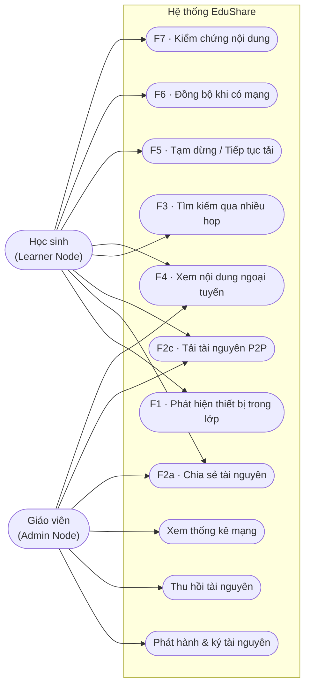

### 3.3.2. Kiến trúc tổng thể 4 tầng

EduShare được tổ chức thành **bốn tầng** tách bạch trách nhiệm (separation of concerns), cho phép
thay thế từng tầng độc lập (ví dụ thay WebRTC bằng transport khác mà không đổi UI):

1. **Tầng giao diện (UI):** các màn hình React, hiển thị trạng thái mạng và tài nguyên.
2. **Tầng mạng P2P:** `SignalingClient` (WebSocket LAN) và `PeerManager` (RTCPeerConnection/DataChannel).
3. **Tầng giao thức & logic:** `GossipEngine`, `TransferManager`, `ReplicationManager`, `Crypto`.
4. **Tầng lưu trữ:** IndexedDB (Dexie) cho nội dung/metadata và Service Worker (Workbox) cho app shell.

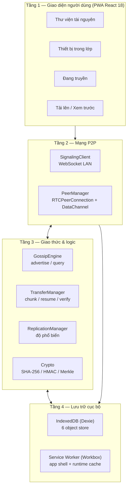

**Mối quan hệ giữa các module** (sơ đồ lớp rút gọn, mô tả phụ thuộc thực tế trong mã nguồn):

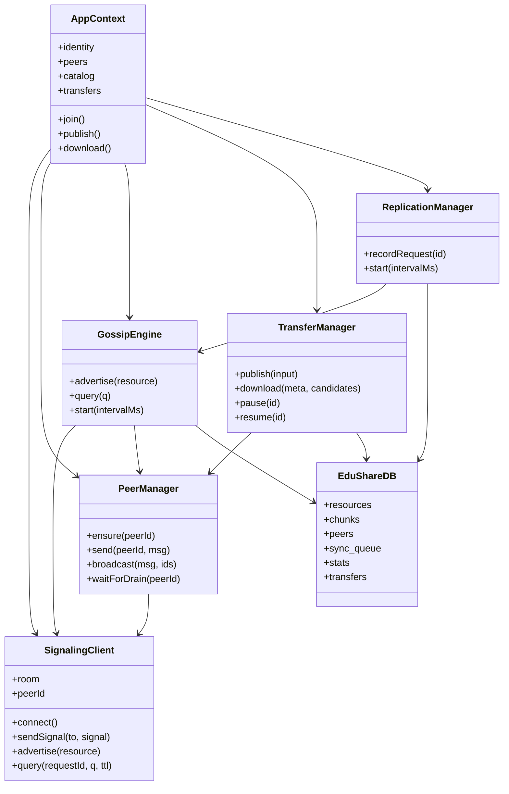

Các manager được khởi tạo tập trung trong `AppContext` (`store/AppContext.tsx:121-130`), đăng ký
lắng nghe sự kiện chéo và được dọn dẹp khi rời lớp (`store/AppContext.tsx:202-212`).

### 3.3.3. Sơ đồ tuần tự — thiết lập WebRTC qua signaling LAN

Đây là luồng nền tảng của toàn hệ thống: hai peer vào cùng `room`, server gửi `welcome`, hai bên tự
chọn ai tạo offer theo **thứ tự peerId** để chống *glare* (`lib/peer.ts:44`), rồi trao đổi SDP/ICE
qua server và mở DataChannel mã hóa DTLS.

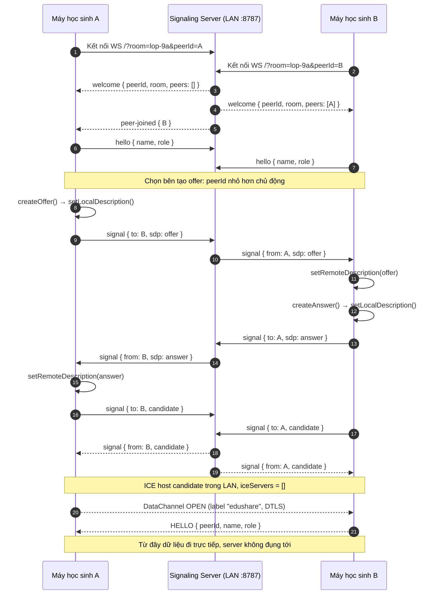

Việc chọn bên tạo offer là **tất định** (`this.localId < peerId`, `lib/peer.ts:44`), tránh cả hai
bên cùng tạo offer gây xung đột trạng thái SDP. Danh sách `iceServers: []`
(`lib/peer.ts:17-22`) thể hiện triết lý LAN thuần: chỉ dùng host candidate, không phụ thuộc STUN/TURN
→ hoạt động hoàn toàn ngoại tuyến [2], 2].

---

## 3.4. Thiết kế giao thức mạng

Đây là phần đóng góp cốt lõi của đề tài. Giao thức EduShare gồm **hai lớp**: lớp signaling
(client ↔ server, JSON qua WebSocket) và lớp P2P (peer ↔ peer, JSON qua RTCDataChannel). Chương này
tập trung vào lớp P2P với 9 loại bản tin, cơ chế phát hiện peer, lan truyền metadata và truyền tệp.

### 3.4.1. Phát hiện peer

Bài toán: làm sao hai thiết bị tìm thấy nhau trong một LAN **không có dịch vụ định danh tập trung và
không có Internet** (trả lời RQ1). EduShare áp dụng chiến lược **ba lớp dự phòng (fallback)**, từ
thuận tiện đến thủ công:

1. **Signaling LAN (chính):** một tiến trình Node.js + `ws` chạy trên máy bất kỳ trong lớp (thường
   là máy giáo viên), phục vụ các phòng (`room`). Peer kết nối `ws://<host>:8787/?room=&peerId=`,
   server trả `welcome` kèm danh sách peer, sau đó phát `peer-joined`/`peer-left`. Heartbeat ping/pong
   **15 s** phát hiện peer chết ở tầng TCP (`signaling-server/server.js:24`, `:298-311`).
2. **mDNS (dự phòng):** khi không có signaling server, thử quảng bá/tìm peer qua Multicast DNS
   (`.local`). Trình duyệt hiện chỉ hỗ trợ hạn chế, nên đây là kênh "nếu có thì tốt" và được ghi
   nhận kết quả thực nghiệm.
3. **QR / SDP thủ công (dự phòng cuối):** hai thiết bị trao đổi offer/answer ngoài băng tần
   (out-of-band) bằng cách quét QR chứa SDP hoặc sao chép chuỗi SDP. Đây là kỹ thuật kinh điển của
   WebRTC khi không có signaling [2].

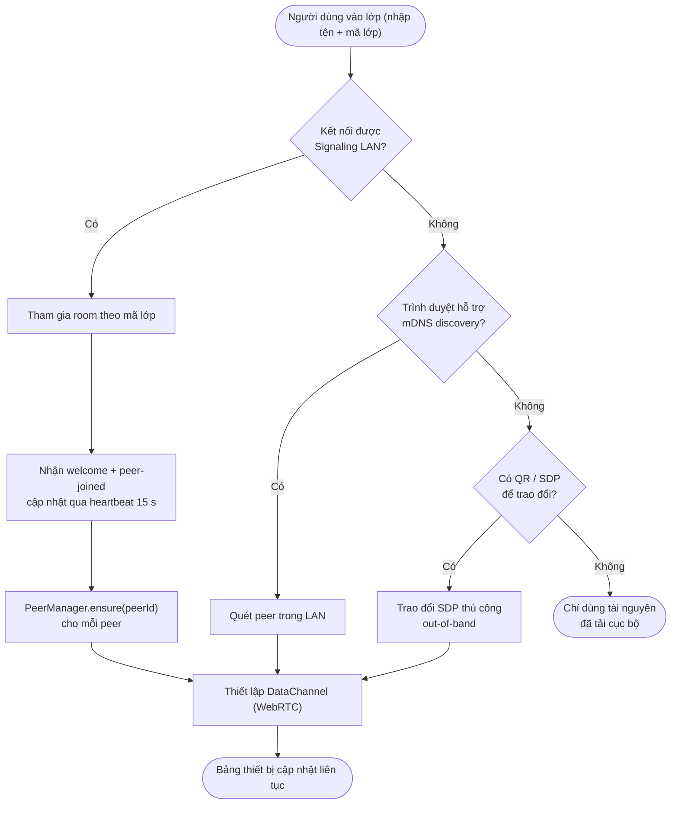

Sau khi có danh sách peer, việc duy trì kết nối gồm: (i) signaling tự reconnect với backoff
(`lib/signaling.ts:183-192`); (ii) `PeerManager` lắng nghe `peer-left` để đóng kết nối
(`lib/peer.ts:36`); (iii) `onconnectionstatechange` phát `peer-close` khi kết nối `failed/closed/disconnected`
(`lib/peer.ts:132-137`). Cơ chế này trả lời RQ1: không cần máy chủ định danh bền vững, chỉ cần một
"môi giới" tạm thời cho vài giây bắt tay.

### 3.4.2. Định dạng tin nhắn giao thức

Mọi bản tin P2P là JSON có **header chung**:

```json
{ "v": 1, "id": "<msgId>", "ts": 1700000000000, "type": "<TYPE>" }
```

Trong đó `v` là phiên bản giao thức (`PROTOCOL_VERSION = 1`, `lib/protocol.ts:6`), `id` là định danh
duy nhất sinh bởi `msgId()` gồm timestamp base36 + bộ đếm + chuỗi ngẫu nhiên
(`lib/protocol.ts:101-106`), `ts` là thời điểm tạo (epoch ms), `type` là loại bản tin. Có **9 loại**
bản tin (`lib/protocol.ts:12-21`), chia làm ba nhóm chức năng: bắt tay, lan truyền metadata, truyền tệp.

| # | Loại (`type`) | Nhóm | Hướng | Trường chính (ngoài header) | Mục đích |
|---|---|---|---|---|---|
| 1 | `HELLO` | Bắt tay | peer → peer | `peerId`, `name`, `role` | Chào hỏi sau khi DataChannel mở |
| 2 | `PEER_LIST` | Bắt tay | peer → peer | `peers[]` | Trao đổi danh bạ peer đã biết (discovery nhiều hop) |
| 3 | `RESOURCE_ADVERTISE` | Metadata | peer → peer | `resource`, `ttl` | Quảng bá metadata tài nguyên (gossip) |
| 4 | `RESOURCE_QUERY` | Metadata | peer → peer | `requestId`, `query`, `ttl` | Truy vấn tài nguyên (flooding có TTL) |
| 5 | `RESOURCE_RESPONSE` | Metadata | peer → peer | `requestId`, `hits[]` | Trả kết quả truy vấn |
| 6 | `CHUNK_REQUEST` | Truyền tệp | peer → peer | `transferId`, `resourceId`, `index` | Yêu cầu một chunk theo chỉ số |
| 7 | `CHUNK_DATA` | Truyền tệp | peer → peer | `transferId`, `resourceId`, `index`, `total`, `data` | Trả dữ liệu nhị phân (`ArrayBuffer`) |
| 8 | `TRANSFER_COMPLETE` | Truyền tệp | peer → peer | `transferId`, `resourceId`, `checksum` | Đánh dấu truyền xong + checksum |
| 9 | `VERIFY` | Truyền tệp | peer → peer | `requestId`, `ok`, `checksum?` | Kết quả kiểm chứng |

Định nghĩa kiểu đầy đủ nằm tại `lib/protocol.ts:29-99`; hàm khởi tạo bản tin nằm trong đối tượng
`Protocol` (`lib/protocol.ts:112-146`). **Bản tin mẫu** cho quảng bá tài nguyên (đã rút gọn):

```json
{
  "v": 1,
  "id": "m3x9-1f-a7c2",
  "ts": 1700000000000,
  "type": "RESOURCE_ADVERTISE",
  "ttl": 3,
  "resource": {
    "resourceId": "e3b0c44298fc1c149afbf4c8996fb92427ae41e4649b934ca495991b7852b855",
    "title": "Bài giảng Hóa 9 - Bài 4",
    "subject": "Hóa học",
    "grade": "Lớp 9",
    "tags": ["ôn thi", "học kỳ 1"],
    "size": 10485760,
    "mime": "application/pdf",
    "chunkSize": 262144,
    "chunkCount": 40,
    "checksum": "e3b0c44298fc1c149afbf4c8996fb92427ae41e4649b934ca495991b7852b855",
    "merkleRoot": "9f86d081884c7d659a2feaa0c55ad015a3bf4f1b2b0b822cd15d6c15b0f00a08",
    "ownerId": "peer-admin1",
    "ownerName": "Máy cô Hoa",
    "createdAt": 1700000000000,
    "version": 1,
    "signature": "a1b2c3d4..."
  }
}
```

**Hằng số giao thức** (nguồn `lib/protocol.ts:6-10` và `lib/transfer.ts:267`):

| Hằng số | Giá trị | Ý nghĩa thiết kế |
|---|---|---|
| `PROTOCOL_VERSION` | `1` | Phiên bản giao thức trong trường `v` |
| `CHUNK_SIZE` | `262144` (256 KB) | Kích thước mỗi chunk — cân bằng overhead/độ trễ |
| `DEFAULT_TTL` | `3` | Số hop tối đa cho gossip/query |
| `BUFFER_HIGH_WATER` | `8388608` (8 MB) | Ngưỡng dừng gửi (backpressure) |
| `BUFFER_LOW_WATER` | `1048576` (1 MB) | Ngưỡng tiếp tục gửi |
| `WINDOW` | `4` | Số chunk yêu cầu đồng thời (cửa sổ trượt) |

**Kiểm tra hợp lệ gói tin:** hàm `isValidMessage()` chỉ kiểm tra nông `type` và `id` là chuỗi
(`lib/protocol.ts:149-156`) nhằm chống crash khi nhận gói độc hại/sai định dạng — đây là lớp phòng vệ
ở mức tối thiểu, các kiểm tra ngữ nghĩa sâu hơn diễn ra tại từng handler.

### 3.4.3. Gossip metadata

**Mục tiêu:** lan truyền *metadata* tài nguyên (không phải nội dung) khắp mạng để mọi peer biết tài
nguyên nào đang tồn tại và ai đang giữ, mà không cần trao đổi nội dung — tiết kiệm băng thông.

Mỗi peer duy trì một **bảng gossip** ánh xạ `resourceId → { holders, version, checksum, merkleRoot, ttl }`.
Về mặt mã nguồn, phần "đã biết" được lưu trong IndexedDB (`resources` với `holders`, `version`,
`availability`) và một `Map` trong bộ nhớ `GossipEngine.seen` để chống vòng lặp và bỏ bản cũ
(`lib/gossip.ts:20-21`).

| Trường | Kiểu | Ý nghĩa |
|---|---|---|
| `resourceId` | string (khóa) | SHA-256 nội dung (content-addressed) |
| `holders` | string[] | Danh sách peerId đang giữ bản sao |
| `version` | number | Phiên bản metadata; chỉ nhận bản `>=` đã biết |
| `checksum` | string | SHA-256 toàn tệp — kiểm chứng khi tải xong |
| `merkleRoot` | string | Merkle root của các chunk — phát hiện chunk hỏng |
| `ttl` | number | Số hop còn lại (mặc định 3, mỗi hop giảm 1) |

**Tham số vận hành:** chu kỳ gossip `Δt = 20 s` (`lib/gossip.ts:42`, `GossipEngine.start(intervalMs = 20000)`)
và TTL mặc định `3` (`DEFAULT_TTL`). Một lần chạy gossup ngay sau khi khởi động được hẹn trước 1.5 s
(`lib/gossip.ts:45`) để kịp mở DataChannel.

**Quy tắc hợp nhất:** khi nhận `RESOURCE_ADVERTISE`, peer chỉ chấp nhận nếu
`resource.version >= seen[resourceId]`; sau đó cập nhật `seen`, thêm người gửi vào `holders`, và
chuyển tiếp nếu `ttl > 0` (trừ peer gửi) — trừ khi đã có bản `local` (`lib/gossip.ts:161-175`,
`:138-144`). Quy tắc này chống bão lặp (loop) và chống hạ cấp metadata.

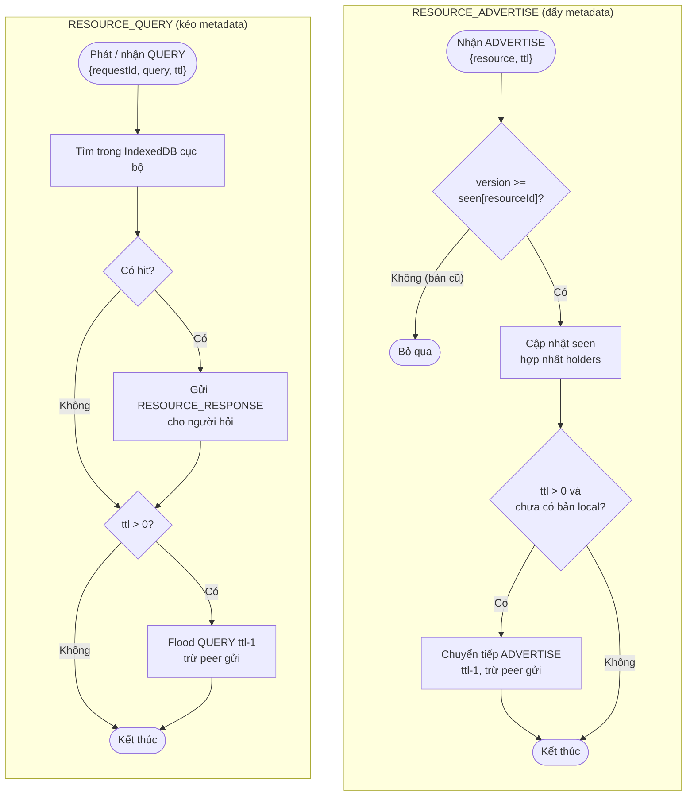

Khi truy vấn, `GossipEngine.query()` phát **đồng thời hai kênh**: gửi `RESOURCE_QUERY` qua WebSocket
lẫn broadcast qua DataChannel, đồng thời tự trả lời bằng tài nguyên cục bộ; kết quả được gom trong
**2500 ms** rồi hợp nhất theo `resourceId` (`lib/gossip.ts:67-89`, `:104-134`). Cách này giúp kết quả
đến nhanh qua server mà vẫn đúng tinh thần P2P khi server vắng mặt.

### 3.4.4. Thuật toán lựa chọn nguồn tải

Khi một học sinh tải tài nguyên, `AppContext.download()` tập hợp ứng viên gồm các peer đang mở
DataChannel cộng với `holders` biết được qua gossip (`store/AppContext.tsx:311-314`). Thuật toán chọn
nguồn tối ưu theo **hàm điểm**:

```text
score(peer) = load(peer) × 10^6 + bufferedAmount(peer)
```

Trong đó `load(peer)` là số phiên tải đang `active` dùng peer đó (cân bằng tải), còn
`bufferedAmount(peer)` là lượng dữ liệu còn tồn trong bộ đệm gửi của DataChannel (ước lượng độ
nghẽn/độ trễ). Hệ số `10^6` đảm bảo **ưu tiên tuyệt đối** việc giảm tải: chỉ khi số phiên tải bằng
nhau mới so sánh tới độ nghẽn. Hiện thực tại `TransferManager.pickSource()` (`lib/transfer.ts:247-261`):

```text
function PICK_SOURCE(active_download):
    best = null
    bestScore = +∞
    for peer in active_download.candidates:
        if not PEERS.isOpen(peer):
            continue
        load = |{ t ∈ all_active : t.peerId = peer and t.status = "active" }|
        buffered = PEERS.bufferedAmount(peer)
        score = load × 1_000_000 + buffered
        if score < bestScore:
            bestScore = score
            best = peer
    return best
```

Việc "bơm" chunk dùng **cửa sổ trượt `WINDOW = 4`** kết hợp backpressure
(`lib/transfer.ts:264-292`): vòng lặp gửi `CHUNK_REQUEST` cho tối đa 4 chunk `inflight`; khi nhận
`CHUNK_DATA`, chunk ra khỏi `inflight` và một chunk mới được bơm vào. Nếu `send()` thất bại, chỉ số
được lùi lại để thử ở vòng sau. Nếu chưa có nguồn nào mở, job ở trạng thái `connecting` và thử lại sau
800 ms (`lib/transfer.ts:269-276`).

**Máy trạng thái phiên tải** (`TransferJob.status`, `lib/types.ts:64`, `lib/transfer.ts`):

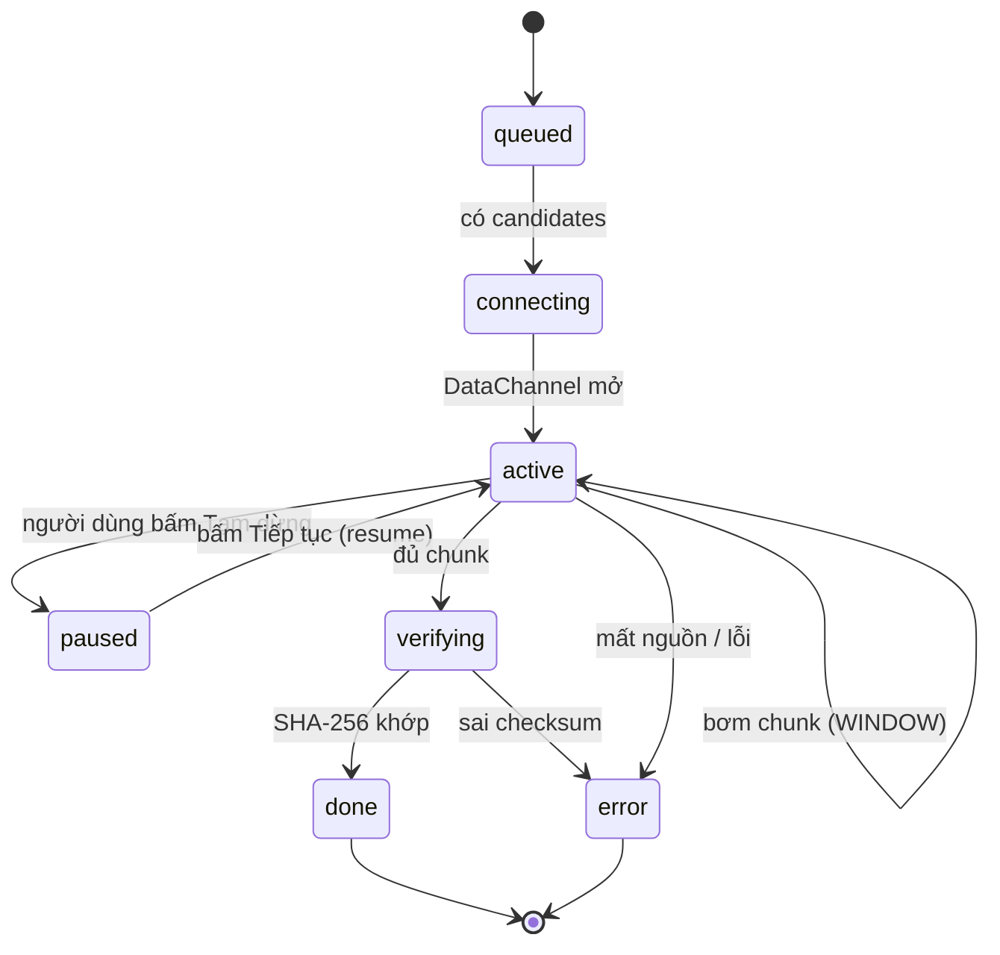

### 3.4.5. Chiến lược replication theo độ phổ biến

**Vấn đề:** tài nguyên "nóng" (được nhiều học sinh tải) nhưng chỉ nằm trên một thiết bị; nếu thiết bị
đó rời mạng, tài nguyên biến mất. Chiến lược replication kiểu *epidemic nhẹ* [14], 15] chủ động tăng số
bản sao mà **không** cần chuyển nội dung ngay: khi độ phổ biến vượt ngưỡng, peer giữ bản sao quảng bá
lại metadata với `version + 1`, kích thích các peer khác tải về (pull) khi có nhu cầu, từ đó nhân bản.

**Ngưỡng:** `θ = 3` (`lib/replication.ts:24`, khởi tạo `new ReplicationManager(gossip, peers, 3)` tại
`store/AppContext.tsx:130`). Bộ đếm phổ biến được dựng lại từ `stats` khi khởi động
(`lib/replication.ts:30-38`) và tăng mỗi lần có yêu cầu/tải (`store/AppContext.tsx:321`).

```text
# --- Đếm phổ biến & kích hoạt nhân bản ---
procedure RECORD_REQUEST(resourceId):
    popularity[resourceId] += 1
    log_stat(resourceId, event="request", value=popularity[resourceId])
    if popularity[resourceId] == θ:            # θ = 3
        meta = DB.resources.get(resourceId)
        if meta != null:
            GOSSIP.advertise(meta with version = meta.version + 1)

# --- Vòng lặp định kỳ nhân bản tài nguyên nóng ---
procedure REPLICATE_CYCLE():                    # mỗi 30 s
    for r in DB.resources where availability == "local":
        if popularity[r.resourceId] >= θ:
            GOSSIP.advertise(r)                 # nhắc lại cho peer mới

# --- Gossip định kỳ (ủng cố catalog) ---
procedure GOSSIP_CYCLE():                       # mỗi Δt = 20 s
    for r in DB.resources where availability == "local":
        PEERS.broadcast(ADVERTISE(r, ttl = 3))
        SIGNALING.advertise(r)
```

Hai vòng lặp độc lập nhưng cộng hưởng: `gossipCycle` (20 s) duy trì catalog, còn `replicateCycle`
(30 s) bổ sung nhắc lại cho các tài nguyên đã nóng. Cách này trả lời RQ2: nội dung lan truyền theo
nhu cầu (pull), băng thông không bị tiêu tốn cho nội dung không ai cần, nhưng tài nguyên phổ biến
được bảo toàn khả năng sống (availability). Trạng thái thiết kế này cũng là điểm khác biệt so với các
mô hình server tập trung như Kolibri [17].

---

## 3.5. Thiết kế cơ sở dữ liệu cục bộ (IndexedDB)

Tầng lưu trữ cục bộ dùng **IndexedDB** thông qua **Dexie.js** [11], 13], định nghĩa tại `lib/db.ts`.
IndexedDB được chọn thay cho LocalStorage vì: (i) dung lượng lớn hơn nhiều và hỗ trợ lưu `Blob`/`ArrayBuffer`
cho nội dung tệp; (ii) giao dịch (transaction) và chỉ mục (index) cho truy vấn; (iii) thao tác bất
đồng bộ không chặn UI. Thiết kế gồm **6 object store**:

| Object store | Khóa chính | Index phụ | Vai trò |
|---|---|---|---|
| `resources` | `resourceId` | `title, subject, grade, createdAt, ownerId, availability` | Metadata tài nguyên (catalog) |
| `chunks` | `[resourceId+index]` (ghép) | `resourceId` | Nội dung từng phần (Blob) — hỗ trợ resume |
| `peers` | `peerId` | `name, role, lastSeen` | Danh bạ thiết bị trong lớp |
| `sync_queue` | `++id` (tự tăng) | `kind, createdAt` | Hàng đợi đồng bộ nền |
| `stats` | `++id` (tự tăng) | `resourceId, event, at` | Số liệu thực nghiệm (request/download/publish) |
| `transfers` | `id` | `resourceId, direction, status, updatedAt` | Phiên truyền (tiến trình, speed) |

Khai báo schema thực tế tại `lib/db.ts:24-31`. Sơ đồ thực thể–liên kết (ER) logic:

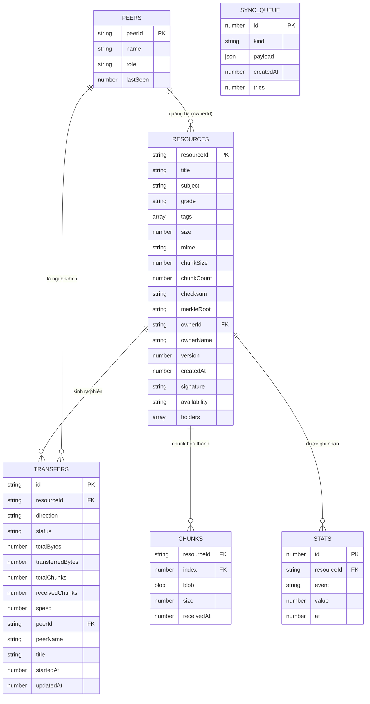

**Chi tiết trường `resources`** (`lib/types.ts:20-43`) — bảng trung tâm của hệ thống:

| Trường | Kiểu | Ghi chú thiết kế |
|---|---|---|
| `resourceId` (PK) | string | `SHA-256(toàn tệp)` — định danh theo nội dung (content-addressing) |
| `title`, `subject`, `grade` | string | Phục vụ hiển thị và lọc tìm kiếm |
| `tags` | string[] | Từ khóa tìm kiếm tự do |
| `size`, `chunkSize`, `chunkCount` | number | Kích thước tệp, kích thước và số lượng chunk |
| `checksum` | string | SHA-256 toàn tệp — kiểm chứng cuối |
| `merkleRoot` | string | Merkle root của các chunk hash |
| `ownerId`, `ownerName` | string | Peer phát hành đầu tiên |
| `version`, `createdAt` | number | Điều khiển gossip (hợp nhất bản mới) |
| `signature` | string? | HMAC-SHA256 của Admin Node (chỉ tài nguyên do admin phát hành) |
| `availability` | `local`\|`network`\|`unknown` | Trạng thái — ánh xạ trực tiếp lên UI 3 màu |
| `holders` | string[]? | Danh sách peer đang giữ bản sao (cập nhật qua gossip) |

**Lý do chọn từng cấu trúc:**

- **Khóa ghép `[resourceId+index]` cho `chunks`:** cho phép truy xuất một chunk cụ thể theo cặp
  (ID tài nguyên, chỉ số) chỉ với một lần tra cứu, đồng thời chống ghi trùng khi resume. Index phụ
  `resourceId` phục vụ `receivedChunkIndexes()` và `assembleBlob()` (`lib/db.ts:85-100`).
- **Tách `stats` khỏi `transfers`:** `stats` là *event log* phục vụ phân tích/thực nghiệm
  (publish/request/download) và tính độ phổ biến; `transfers` là *phiên hiện tại* phục vụ UI và resume.
  Việc tách giúp truy vấn nhanh và không làm nặng bảng transfers.
- **`sync_queue` riêng:** hàng đợi các thao tác cần gửi khi có mạng (thống kê, advertise, withdraw),
  tách biệt để có thể xử lý lại độc lập (`lib/db.ts:117-129`).
- **`peers` lưu cục bộ:** danh bạ peer kèm `lastSeen` giúp hiển thị tức thời danh sách lớp trước khi
  signaling phản hồi; kết hợp `connected` (DataChannel) và `hops` trong `PeerInfo` (`lib/types.ts:5-16`).

**Ghép tệp từ chunk (`assembleBlob`):** đọc toàn bộ chunk của `resourceId`, sắp xếp theo `index`, rồi
tạo `Blob` duy nhất (`lib/db.ts:95-100`). Kết quả này được băm lại SHA-256 để đối chiếu `checksum`
khi hoàn tất tải (`lib/transfer.ts:334-353`).

**Quản lý quota:** `deleteResource()` xóa cả metadata lẫn chunk trong một transaction để giải phóng
dung lượng (`lib/db.ts:55-60`). Thiết kế ghi nhận rằng IndexedDB có thể bị trình duyệt thu hồi khi
thiếu chỗ — đây là hạn chế được nêu ở Chương 6 và hướng khắc phục là xin *persistent storage*.

---

## 3.6. Thiết kế Service Worker & offline-first

Service Worker (`app/src/sw.ts`) dùng **Workbox 7** chế độ `injectManifest` [10], 12], đảm bảo ứng dụng
mở được **không cần mạng** sau lần cài đặt đầu tiên. Chiến lược gồm hai phần: **precache app shell**
(vỏ ứng dụng) và **runtime cache** theo loại tài nguyên.

### 3.6.1. Chiến lược cache theo loại tài nguyên

| Loại tài nguyên | Route/Điều kiện | Chiến lược | Cache name | Tham chiếu |
|---|---|---|---|---|
| App shell (HTML/JS/CSS build) | `precacheAndRoute(__WB_MANIFEST)` | Precache + revision | Workbox precache | `sw.ts:19` |
| Điều hướng SPA (navigation) | `NavigationRoute` | Trả `index.html` (fallback offline) | — | `sw.ts:22-23` |
| Ảnh/icon | `request.destination === 'image'` | **CacheFirst** | `edushare-images` (max 200, 90 ngày) | `sw.ts:25-31` |
| Style/Script/Font | `destination ∈ {style, script, font}` | **StaleWhileRevalidate** | `edushare-static` | `sw.ts:33-36` |
| Nội dung tài nguyên (PDF/video/ảnh bài giảng) | Truy cập qua IndexedDB → Blob URL | **Không** lưu ở Cache Storage | `resources`/`chunks` | `lib/db.ts`, `lib/transfer.ts` |

`cleanupOutdatedCaches()` dọn cache phiên bản cũ; `clientsClaim()` và `skipWaiting()` giúp bản mới
kích hoạt nhanh (`sw.ts:15-18`, `sw.ts:39-42`). Việc dùng **CacheFirst cho ảnh** giảm băng thông lặp
lại; **StaleWhileRevalidate cho JS/CSS/font** vừa phục vụ tức thời từ cache vừa cập nhật nền.

### 3.6.2. Luồng Background Sync cho hàng đợi đồng bộ

Các thao tác cần mạng (ghi thống kê, quảng bá, thu hồi) được đưa vào `sync_queue` trong IndexedDB
(`enqueueSync`, `lib/db.ts:119-121`). Khi điều kiện cho phép (app mở hoặc có mạng trở lại), hàng đợi
được xử lý lại. Cần ghi nhận trung thực: **Background Sync API không đồng nhất giữa các trình duyệt**;
do đó thiết kế thực chất xử lý hàng đợi khi app đang mở, còn `SyncManager` (nếu khả dụng) là kênh
tăng cường.

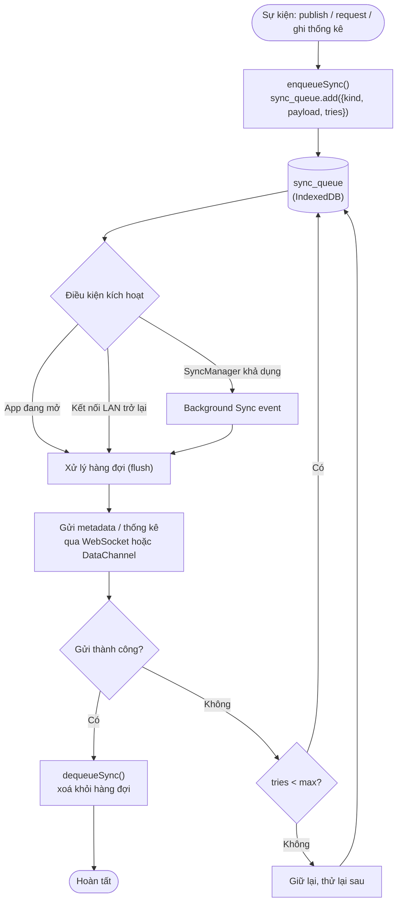

### 3.6.3. Vì sao nội dung ở IndexedDB còn app shell ở Cache Storage?

Đây là quyết định thiết kế quan trọng, xuất phát từ bản chất hai loại dữ liệu:

- **App shell** (HTML/JS/CSS) là tập hợp **tĩnh, ít thay đổi, có địa chỉ URL ổn định**. Cache Storage
  phục vụ theo **Request URL** rất phù hợp cho HTTP fetch; Workbox precache quản lý revision và phục
  vụ tức thời khi offline (`sw.ts:19-36`).
- **Nội dung tài nguyên** là tập **động, do người dùng tạo, không có URL HTTP** — chúng chỉ là `Blob`
  nằm trong `chunks`. Nếu đưa vào Cache Storage sẽ phải tạo URL giả, khó quản lý dung lượng và không
  hỗ trợ truy vấn theo metadata (môn/lớp/độ sẵn sàng). IndexedDB cho phép lưu `Blob`, truy vấn theo
  index và gắn chặt với logic resume/verify.

Vì vậy app shell và nội dung **tách kênh lưu trữ**: khi mở tài nguyên, `getLocalBlob()` đọc blob từ
IndexedDB (`store/AppContext.tsx:345-349`), tạo `URL.createObjectURL(blob)` rồi nạp vào
`<iframe>/<video>/<audio>/` (`components/PreviewModal.tsx:18-41`, `:84-100`). Cách này khiến ứng
dụng vừa mở tức thời (nhờ precache) vừa xem được nội dung đã tải (nhờ IndexedDB), và dễ dàng xóa/đối
soát quota tách biệt.

---

## 3.7. Thiết kế bảo mật & mô hình phân quyền

Bảo mật của EduShare được xây dựng theo mô hình **zero-trust đối với trung gian**: signaling server
chỉ là kênh "mai mối", còn tính đúng đắn của dữ liệu được các peer tự kiểm chứng. Ba trụ cột:

### 3.7.1. Mã hóa kênh — DTLS

Mọi `RTCDataChannel` của WebRTC **mặc định được mã hóa bằng DTLS** (Datagram TLS) [4], 5]. Vì vậy dù
kết nối chỉ trong LAN, nội dung và metadata vẫn được mã hóa trên đường truyền giữa hai peer mà lập
trình viên không cần cấu hình thêm. Signaling (SDP/ICE) cũng chạy trên WebSocket; trong triển khai
HTTPS sẽ nâng lên `wss://` (`lib/signaling.ts:41`).

### 3.7.2. Toàn vẹn — content-addressing + Merkle

- **Content-addressing:** `resourceId = SHA-256(toàn bộ nội dung)` (`lib/transfer.ts:94`,
  `lib/crypto.ts:35`). Nghĩa là **tên** của tài nguyên chính là **dấu vân tay nội dung**: hai tệp
  giống nhau có cùng `resourceId`, mọi sửa đổi dù nhỏ đều làm đổi ID.
- **Kiểm chứng khi hoàn tất:** sau khi ghép đủ chunk, peer tính lại `SHA-256(blob)` và so với
  `checksum`; nếu lệch, job bị hủy và đánh dấu `error` (`lib/transfer.ts:339-342`).
- **Merkle per chunk:** mỗi chunk được băm; dựng cây Merkle để lấy `merkleRoot` (`lib/crypto.ts:68-81`).
  Cấu trúc này cho phép phát hiện **một chunk đơn lẻ bị hỏng** mà không cần băm lại toàn tệp, đồng
  thời mở đường cho xác minh từng phần trong tương lai. Hàm băm tầng Merkle dùng FNV-1a 64-bit dạng
  hex (`lib/crypto.ts:83-93`).

### 3.7.3. Nguồn gốc — chữ ký HMAC của Admin Node

Chỉ **Admin Node** (giáo viên) mới có khóa bí mật của lớp (`adminKey`, mặc định
`edushare-class-secret`, `store/AppContext.tsx:245`). Khi phát hành tài nguyên, admin ký metadata:

```text
signature = HMAC-SHA256(adminKey, canonicalMetadata(meta))
```

Hàm `canonicalMetadata()` cố định **thứ tự trường** để chuỗi ký luôn tất định, chỉ gồm các trường
"bất biến" (bỏ `availability`, `holders`, `signature`) (`lib/crypto.ts:128-148`). Mọi peer có thể
kiểm chứng bằng `hmacVerify()` (`lib/crypto.ts:108-115`, `store/AppContext.tsx:351-356`) và UI hiển
thị nhãn "✓ Chữ ký hợp lệ"/"✗ Chữ ký không hợp lệ" (`components/PreviewModal.tsx:53-54`). Có **fallback
HMAC-SHA256 thuần JS** cho HTTP LAN (`lib/crypto.ts:215-235`).

### 3.7.4. Mô hình phân quyền hai loại node

Admin Node **không phải** một sản phẩm riêng — nó là một thiết bị chạy cùng codebase PWA nhưng đăng
nhập bằng vai trò `admin`. Đây là vai trò **logic**, không phải thành phần phần mềm độc lập.

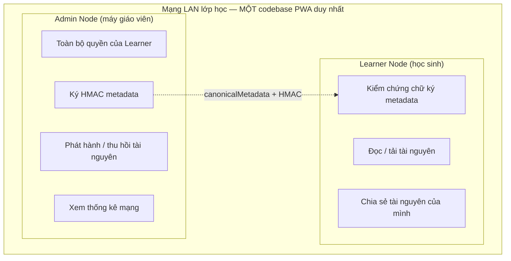

Cơ chế ký và kiểm chứng theo trình tự:

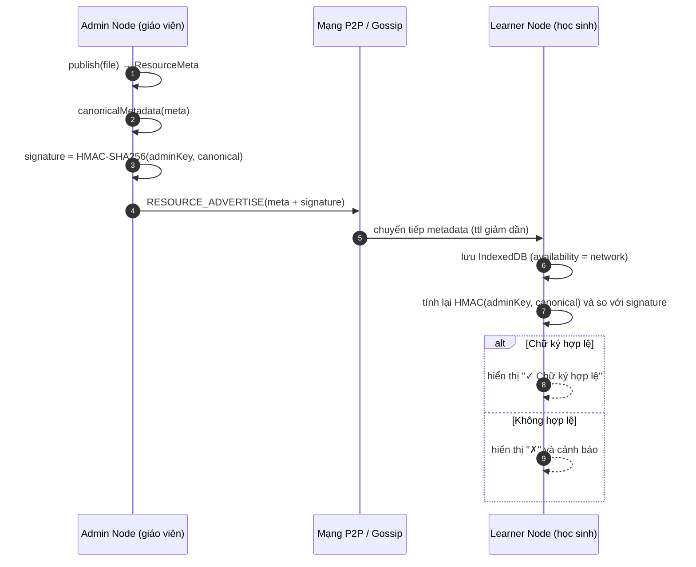

### 3.7.5. Nếu máy giáo viên (Admin Node) tắt thì sao?

Đây là câu hỏi phản biện quan trọng, được trả lời ở ba khía cạnh:

1. **Tính khả dụng của signaling:** signaling server chỉ cần cho vài giây bắt tay. Các cặp peer **đã**
   kết nối vẫn truyền trực tiếp qua DataChannel mà không qua server. Nếu cần thêm peer mới, có thể
   (a) chạy signaling trên máy khác trong lớp, (b) dùng mDNS, hoặc (c) trao đổi QR/SDP thủ công. Thiết
   kế đề xuất *bầu chọn đơn giản* một peer làm signaling tạm thời khi máy admin vắng.
2. **Tính hợp lệ của nội dung đã phát hành:** chữ ký HMAC nằm **kèm trong metadata** đã lan truyền và
   được lưu cục bộ ở mỗi peer. Vì vậy tài nguyên đã ký vẫn kiểm chứng được **mà không cần admin online**.
3. **Tính phân tán:** admin chỉ là "peer đặc biệt" — mất nó, mạng vẫn chia sẻ bình thường. Đây chính là
   điểm mạnh so với Kolibri/RACHEL (các mô hình phụ thuộc server nội dung luôn trực tuyến) [17].

Hạn chế của mô hình khóa tĩnh (`adminKey` mặc định dùng chung) là chưa có PKI đầy đủ và chưa hỗ trợ
thu hồi khóa; đây là hướng phát triển được ghi ở Chương 6.

---

## 3.8. Thiết kế giao diện UI/UX

Giao diện là **lớp duy nhất người dùng nhìn thấy**; toàn bộ độ phức tạp P2P (WebRTC, SDP, peer, chunk)
được giấu kín phía sau. Đối tượng người dùng là học sinh phổ thông dùng điện thoại, giáo viên dùng
laptop — nên thiết kế ưu tiên đơn giản, tiếng Việt, ít thao tác.

### 3.8.1. Nguyên tắc thiết kế

| Nguyên tắc | Lý do | Biểu hiện trong thiết kế |
|---|---|---|
| **Mobile-first** | Học sinh chủ yếu dùng điện thoại | Tab bar dưới, nút chạm ≥ 44 px, thẻ xếp dọc |
| **Offline-first** | Mọi màn hình phải hoạt động khi không có Internet | Trạng thái mạng LAN hiển thị liên tục; tài nguyên đã tải luôn xem được |
| **≤ 3 chạm** | Thao tác nhanh trong lớp | Tải = 1 chạm; chia sẻ = chọn tệp → điền → phát hành |
| **Không lộ thuật ngữ** | Tránh gây bối rối | Thay "peer" → "thiết bị trong lớp"; "WebRTC" không xuất hiện |
| **Ngôn ngữ tiếng Việt** | Đối tượng học sinh phổ thông | Toàn bộ nhãn, thông báo bằng tiếng Việt |

### 3.8.2. Bốn màn hình chính

1. **📚 Thư viện tài nguyên** (`screens/Library.tsx`): danh sách thẻ tài nguyên; thanh tìm kiếm;
   bộ lọc môn/lớp; nút "🌐 Tìm trên mạng lớp" kích hoạt gossip (`Library.tsx:38-43`).
2. **👥 Thiết bị trong lớp** (`screens/Devices.tsx`): danh sách peer, badge P2P/LAN, nhật ký hoạt động,
   badge Admin Node.
3. **⬆️ Đang truyền** (`screens/Transfers.tsx`): mỗi phiên một dòng tiến trình + tốc độ MB/s + nút
   Tạm dừng/Tiếp tục.
4. **➕ Tải lên / Xem trước** (`components/UploadModal.tsx`, `components/PreviewModal.tsx`): chọn tệp,
   điền metadata, phát hành; xem trước PDF/video/ảnh ngoại tuyến.

### 3.8.3. Ba trạng thái tài nguyên

Ánh xạ trực tiếp giữa `availability` (dữ liệu) và màu/badge (giao diện), định nghĩa ở
`components/Badge.tsx:3-12`:

| Trạng thái | `availability` | Badge UI | Hành động chính |
|---|---|---|---|
| 🟢 Có sẵn — xem ngay | `local` | Xanh lá | Mở trình xem ngoại tuyến |
| 🟡 Có trên mạng lớp — tải về | `network` | Vàng | Tải P2P từ peer |
| ⚪ Chưa có trong mạng | `unknown` | Xám | "Yêu cầu" → gossip tìm kiếm |

### 3.8.4. Bảng mapping UI ↔ công nghệ

| Thành phần UI | Công nghệ phía dưới | Tham chiếu |
|---|---|---|
| Badge "X thiết bị đang kết nối" | WebSocket signaling + heartbeat 15 s | `components/StatusBar.tsx`, `signaling-server/server.js:24` |
| Nút "Tải về" | RTCDataChannel, chunk 256 KB, SHA-256 | `lib/transfer.ts:166-353` |
| Thanh tiến trình / nút Tiếp tục | IndexedDB lưu chunk + resume | `lib/db.ts`, `lib/transfer.ts:226-244` |
| Xem tệp ngoại tuyến | IndexedDB → Blob URL | `components/PreviewModal.tsx:18-41` |
| Tài nguyên "xuất hiện" khi có mạng | Gossip metadata | `lib/gossip.ts` |
| "Tự động gửi lại khi có mạng" | `sync_queue` + Background Sync | `lib/db.ts:117-129` |
| Badge "Admin" / nút quản trị | Vai trò `admin` + HMAC | `store/AppContext.tsx:275-285` |

### 3.8.5. Thiết kế responsive

Dùng Tailwind CSS breakpoint chuẩn; chiến lược là **mobile-first + adaptive** (không chỉ co giãn mà
đổi cả bố cục):

| Tên | Kích thước | Thiết bị tiêu biểu | Bố cục |
|---|---|---|---|
| `sm` | < 640 px | Điện thoại dọc | 1 tab mỗi lúc; tab bar dưới; FAB |
| `md` | 640–1024 px | Điện thoại ngang, tablet | Lưới 2 cột; vẫn điều hướng tab |
| `lg` | > 1024 px | Laptop, màn hình lớn | Sidebar trái + nội dung; bỏ tab dưới |

Mapping thành phần mobile vs laptop:

| Thành phần | Mobile (< 640 px) | Laptop (> 1024 px) | Mã nguồn |
|---|---|---|---|
| Điều hướng | Tab bar dưới (3 tab) | Sidebar trái | `App.tsx:41-79`, `:108-128` |
| Danh sách tài nguyên | Thẻ dọc 1 cột | Lưới 2–4 cột | `Library.tsx:84` |
| Chi tiết / xem trước | Modal fullscreen (trượt từ đáy) | Modal rộng (panel) | `components/Modal.tsx:26-32` |
| Thiết bị trong lớp | Tab riêng | Panel sidebar | `screens/Devices.tsx` |
| Đang truyền | Tab riêng, xếp dọc | Tab + lưới 2 cột | `Transfers.tsx:20` |
| Nút tải lên | FAB góc phải dưới | Nút ở sidebar | `App.tsx:72-74`, `:132-138` |
| Bộ lọc môn/lớp | Dropdown gọn | Dropdown/sidebar | `Library.tsx:63-74` |

Nguyên tắc CSS: dùng prefix `lg:` cho mọi thay đổi bố cục lớn; tránh tương tác chỉ có `hover`; nút
chạm tối thiểu 44×44 px; font nhỏ trên mobile (`text-xs`/`text-sm`) và lớn hơn trên laptop.

### 3.8.6. Wireframe dạng Mermaid

**Mobile (< 640 px) — "một việc tại một thời điểm":**

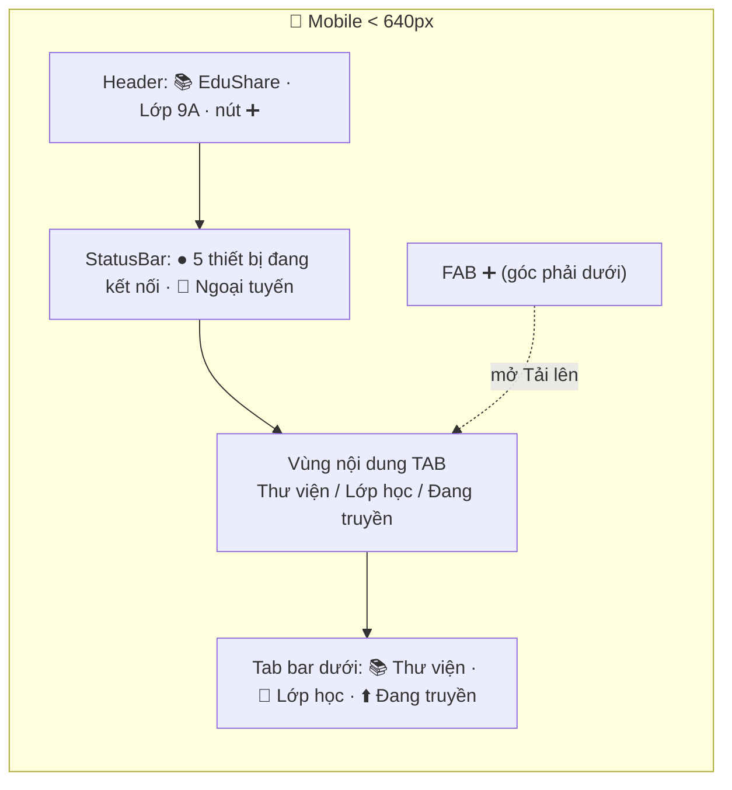

**Laptop (> 1024 px) — "bảng điều khiển nhiều cột":**

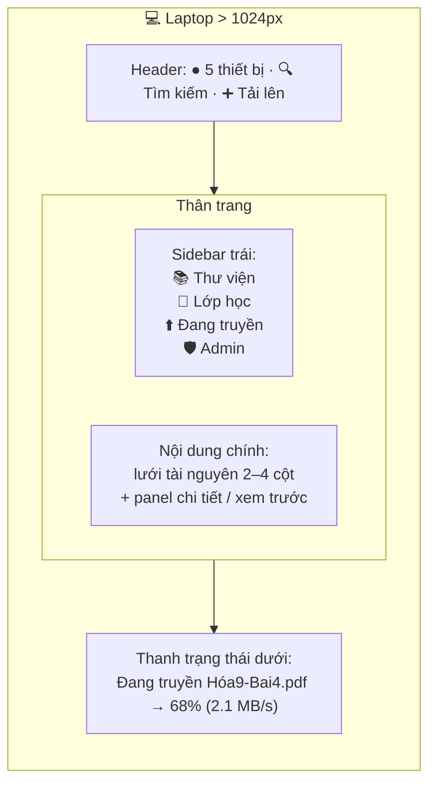

### 3.8.7. Luồng tương tác điển hình

**Luồng A — Học sinh tải tài nguyên từ bạn cùng lớp (kèm thời điểm UI cập nhật):**

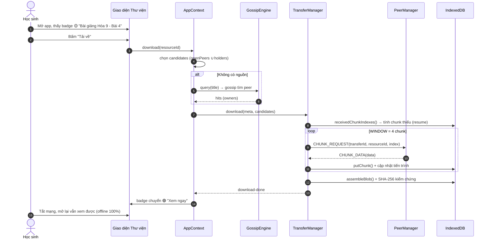

**Luồng B — Giáo viên phát hành tài nguyên:**

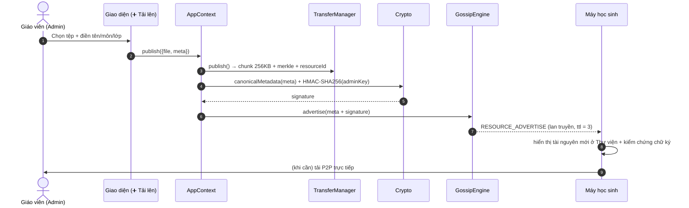

Kết luận chương: các thiết kế trên tạo nên một hệ thống **offline-first, P2P, tự kiểm chứng** phù hợp
bối cảnh lớp học thiếu Internet. Chương 4 sẽ trình bày hiện thực chi tiết từng module tương ứng với
các thiết kế đã nêu; Chương 5 sẽ đo lường và kiểm chứng các chỉ tiêu ở mục 3.2.

> **Ghi chú trích dẫn:** các ký hiệu `[1]`–`[24]` trong chương tương ứng với danh mục
> *TÀI LIỆU THAM KHẢO* (chuẩn IEEE) ở cuối báo cáo — xem [tài liệu tham khảo](tai-lieu-tham-khao.md). Một số mục tiêu biểu: `[2]` ICE (RFC 8445),
> `[4]` DTLS (RFC 6347), `[5]` WebRTC Data Channels (RFC 8831), `[10]` Service Workers (W3C),
> `[11]` IndexedDB (W3C), `[12]` Workbox, `[13]` Dexie.js, `[14]` Eugster et al. (gossip),
> `[15]` Vahdat & Becker (epidemic), `[16]` libp2p, `[17]` Kolibri.


