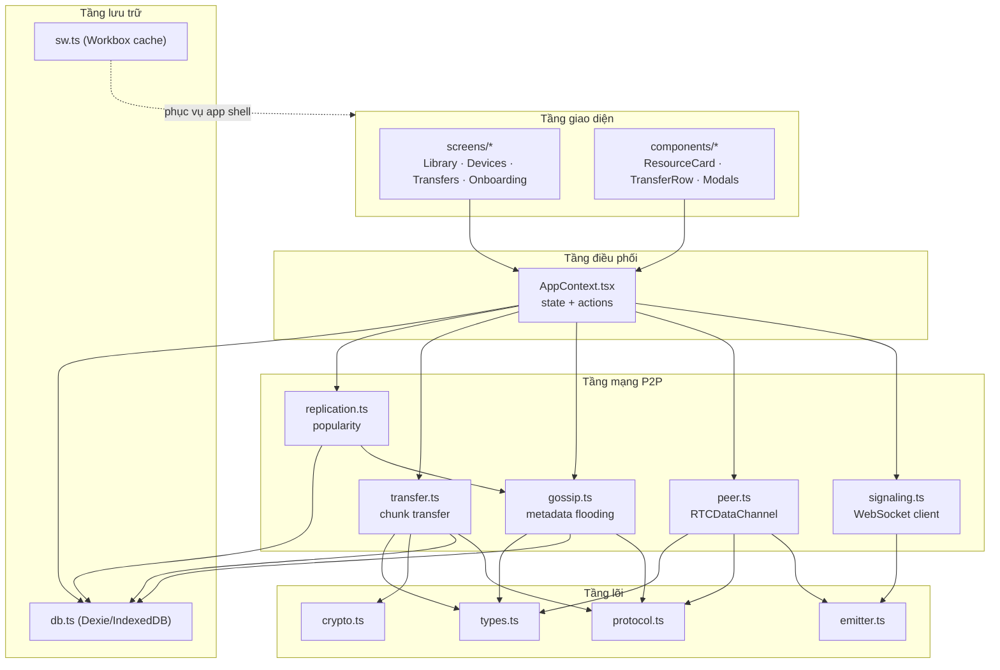
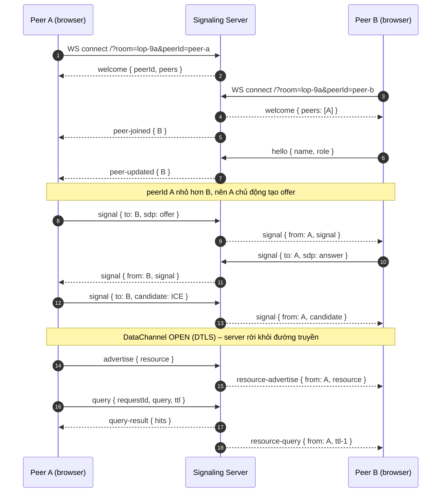
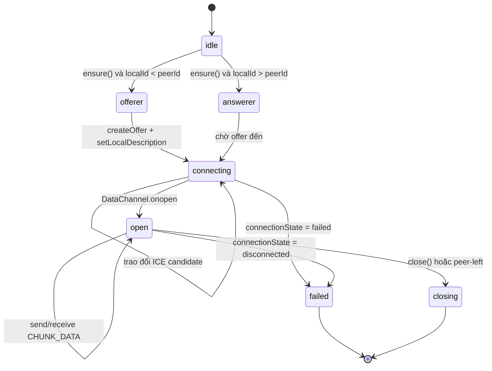
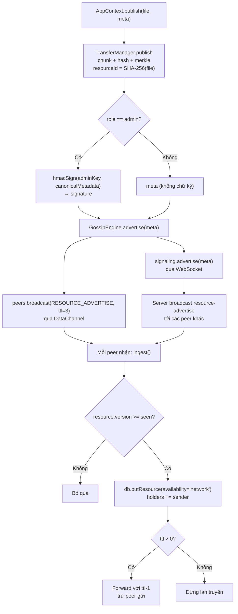
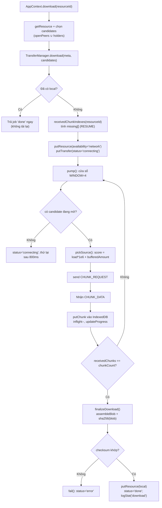
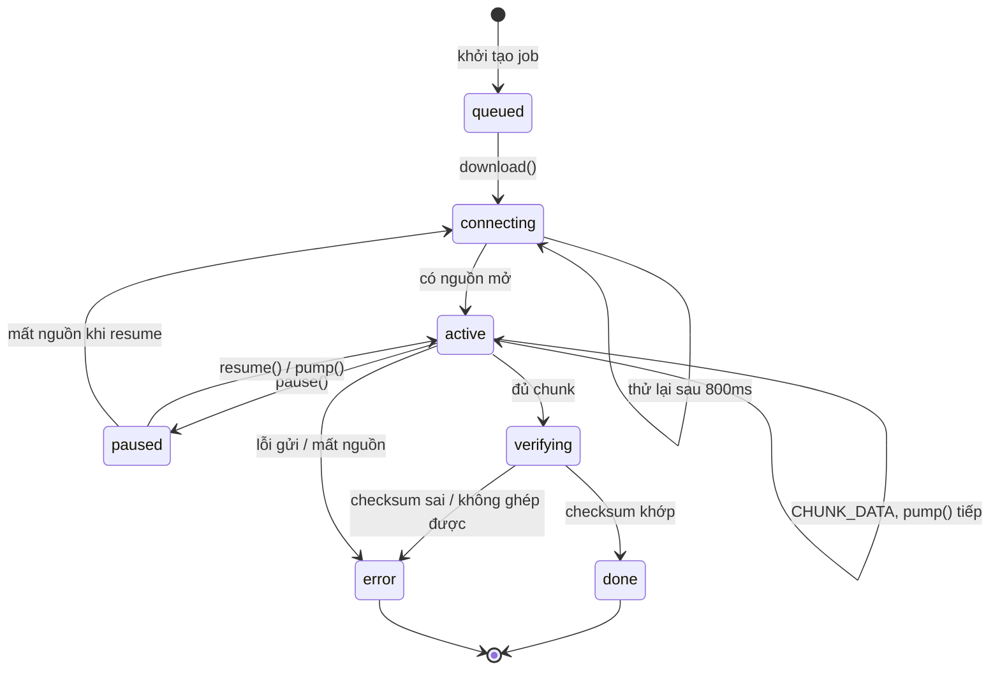
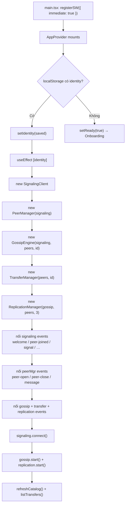

# Chương 4: TRIỂN KHAI

Chương này trình bày quá trình hiện thực hoá thiết kế đã đề ra ở Chương 3 thành một sản
phẩm phần mềm hoàn chỉnh mang tên **EduShare**. Nội dung bao gồm: (i) lựa chọn công nghệ và
môi trường phát triển; (ii) kiến trúc mã nguồn thực tế; (iii) mô tả chi tiết từng module cốt
lõi kèm sơ đồ Mermaid, đoạn mã tiêu biểu trích trực tiếp từ kho mã nguồn và giải thích; và
(iv) kịch bản trình diễn (demo) hệ thống. Toàn bộ mã nguồn tham chiếu nằm trong hai thư mục
`app/` (ứng dụng PWA) và `signaling-server/` (máy chủ bắt tay), đúng theo mô hình "một codebase
duy nhất" đã nêu ở Chương 1 và Chương 3.

> **Quy ước trích dẫn mã nguồn.** Các đoạn mã trong chương này được trích nguyên văn (hoặc rút
> gọn phần không thiết yếu) từ kho mã nguồn, kèm tham chiếu dạng `đường/dẫn/tệp:dòng`. Các trích
> dẫn tài liệu `[..]` khớp với danh mục tài liệu tham khảo IEEE của báo cáo.

## Mục lục chương

- [4.1. Công nghệ & môi trường](#41-công-nghệ--môi-trường)
  - [4.1.1. Nguyên tắc lựa chọn công nghệ](#411-nguyên-tắc-lựa-chọn-công-nghệ)
  - [4.1.2. Bảng công nghệ, phiên bản và lý do](#412-bảng-công-nghệ-phiên-bản-và-lý-do)
  - [4.1.3. Môi trường phát triển & vận hành](#413-môi-trường-phát-triển--vận-hành)
  - [4.1.4. Ràng buộc secure context](#414-ràng-buộc-secure-context)
- [4.2. Kiến trúc mã nguồn](#42-kiến-trúc-mã-nguồn)
  - [4.2.1. Cây thư mục tổng thể](#421-cây-thư-mục-tổng-thể)
  - [4.2.2. Cây thư mục `app/src`](#422-cây-thư-mục-appsrc)
  - [4.2.3. Cây thư mục `signaling-server`](#423-cây-thư-mục-signaling-server)
  - [4.2.4. Giải thích vai trò từng module](#424-giải-thích-vai-trò-từng-module)
  - [4.2.5. Sơ đồ phụ thuộc giữa các module](#425-sơ-đồ-phụ-thuộc-giữa-các-module)
- [4.3. Hiện thực các module chính](#43-hiện-thực-các-module-chính)
  - [4.3.1. Signaling server LAN](#431-signaling-server-lan)
  - [4.3.2. PeerManager & DataChannel](#432-peermanager--datachannel)
  - [4.3.3. Gossip engine](#433-gossip-engine)
  - [4.3.4. File transfer](#434-file-transfer)
  - [4.3.5. Tầng IndexedDB (Dexie)](#435-tầng-indexeddb-dexie)
  - [4.3.6. Service Worker (Workbox injectManifest)](#436-service-worker-workbox-injectmanifest)
  - [4.3.7. Giao diện PWA](#437-giao-diện-pwa)
  - [4.3.8. Cơ chế mật mã dự phòng thuần JS](#438-cơ-chế-mật-mã-dự-phòng-thuần-js)
- [4.4. Demo hệ thống](#44-demo-hệ-thống)

---

## 4.1. Công nghệ & môi trường

### 4.1.1. Nguyên tắc lựa chọn công nghệ

Việc chọn công nghệ cho EduShare tuân theo bốn nguyên tắc ràng buộc chặt, xuất phát từ bối
cảnh triển khai thực tế (lớp học có máy tính cấu hình thấp, mạng LAN không Internet, người
dùng là học sinh phổ thông):

1. **Chạy được trong trình duyệt, không cần cài đặt native.** Trình duyệt là nền tảng duy nhất
   có mặt trên mọi thiết bị (Android, Windows, Linux, macOS) mà không cần cấp quyền quản trị.
   Điều này dẫn tới lựa chọn **Progressive Web App (PWA)** thay vì ứng dụng native.
2. **Hoạt động ngoại tuyến là yêu cầu bậc một, không phải tính năng phụ.** Vì vậy Service
   Worker, IndexedDB và cơ chế cache phải được thiết kế ngay từ đầu [10], [11].
3. **Chi phí hạ tầng tiệm cận 0.** Máy chủ bắt tay (signaling) phải chạy được trên chính laptop
   của giáo viên, không đòi hỏi hệ quản trị cơ sở dữ liệu, web server hay chứng chỉ SSL.
   Điều này dẫn tới lựa chọn **Node.js thuần + thư viện `ws`**.
4. **Một codebase, hai vai trò.** Học sinh (Learner Node) và giáo viên (Admin Node) dùng chung
   một ứng dụng, chỉ khác vai trò logic — do đó các công nghệ phải hỗ trợ đóng gói thành một gói
   duy nhất (bundle) phục vụ tĩnh.

### 4.1.2. Bảng công nghệ, phiên bản và lý do

Bảng 4.1 tổng hợp các công nghệ, phiên bản thực tế trong `app/package.json` và
`signaling-server/package.json`, cùng lý do lựa chọn.

**Bảng 4.1 — Công nghệ, phiên bản và lý do lựa chọn.**

| Thành phần | Công nghệ | Phiên bản (ranges) | Lý do lựa chọn |
|---|---|---|---|
| Ngôn ngữ | TypeScript | ^5.6.3 | Kiểu tĩnh, an toàn khi tái cấu trúc, tài liệu hoá giao thức bằng type |
| UI framework | React | ^18.3.1 | Mô hình component quen thuộc, hệ sinh thái lớn, phù hợp PWA |
| Build tool | Vite | ^5.4.11 | Dev server nhanh (HMR), hỗ trợ plugin PWA, build tối ưu ES2022 |
| Styling | Tailwind CSS | ^3.4.15 | Mobile-first, utility class, responsive bằng breakpoint prefix |
| PWA plugin | vite-plugin-pwa | ^0.20.5 | Tích hợp Workbox, chế độ `injectManifest`, autoUpdate |
| Service Worker runtime | Workbox | ^7.3.0 (`workbox-core`, `-precaching`, `-routing`, `-strategies`, `-expiration`, `-window`) | Precache + định tuyến cache theo loại tài nguyên [12] |
| Lưu trữ cục bộ | Dexie.js | ^4.0.8 | Wrapper IndexedDB gọn, transaction, index ghép `[resourceId+index]` [13] |
| Runtime PWA | Node.js | ≥ 18 | `fetch`, `crypto`, ESM ổn định; không cần transpile |
| Signaling server | Node.js + `ws` | Node ≥ 18 / `ws` ^8.18.0 | WebSocket nhẹ, không phụ thuộc framework HTTP nặng [8] |
| Mật mã | Web Crypto API (native) | — | `crypto.subtle.digest('SHA-256')`, `HMAC` (MDN Web Crypto — xem ghi chú ở danh mục [24]) |
| Biểu diễn trạng thái | React Context + custom `Emitter` | — | Không cần thư viện state ngoài, giảm kích thước bundle |
| Kiểm thử | Node test runner (`node --test` style script) | Node ≥ 18 | 6 test signaling, không cần framework test nặng |

**Nhận xét.** Toàn bộ phụ thuộc *thời gian chạy* (dependencies) của ứng dụng PWA chỉ gồm ba gói
(`dexie`, `react`, `react-dom`); các gói Workbox nằm ở `devDependencies` vì chúng là công cụ
build Service Worker. Đây là lựa chọn có chủ đích: giảm kích thước gói cài đặt, tăng tốc độ
tải lần đầu — yếu tố quan trọng khi nhiều thiết bị cùng tải app shell qua một điểm truy cập
Wi-Fi.

### 4.1.3. Môi trường phát triển & vận hành

EduShare được tổ chức thành **monorepo đơn giản** với `package.json` gốc điều phối hai thành
phần con thông qua các script `npm --prefix`. Bảng 4.2 liệt kê các script chính.

**Bảng 4.2 — Các script điều khiển dự án (`package.json` gốc).**

| Script | Lệnh thực thi | Mục đích |
|---|---|---|
| `install:all` | `npm --prefix signaling-server install && npm --prefix app install` | Cài phụ thuộc cả hai thành phần |
| `build` | `npm --prefix app run build` | `tsc --noEmit && vite build` → sinh `app/dist` |
| `start` | `npm --prefix signaling-server start` | Chạy signaling server, đồng thời phục vụ `app/dist` |
| `dev:server` | `node --watch server.js` | Chạy signaling ở chế độ tự nạp lại |
| `dev:app` | `vite` | Dev server HMR cổng 5173, tự trỏ signaling sang cổng 8787 |
| `test` | `npm --prefix signaling-server test` | Chạy 6 kiểm thử chức năng signaling |
| `typecheck` | `npm --prefix app run typecheck` | `tsc --noEmit` kiểm tra kiểu |

**Môi trường phát triển.** Ở chế độ dev, Vite phục vụ giao diện ở cổng `5173`; hàm
`defaultUrl()` trong `app/src/lib/signaling.ts:39` nhận biết điều này và tự trỏ WebSocket sang
cổng `8787` của signaling server. Khi chạy production, signaling server phục vụ luôn bản build
tĩnh của PWA (`app/dist`), nên ứng dụng và WebSocket cùng origin, dùng chung cổng `8787`.

**Môi trường vận hành.** Chỉ cần **Node.js ≥ 18** trên máy giáo viên và một router Wi-Fi nội bộ
không cần Internet. Không dùng cơ sở dữ liệu, không Nginx/Apache, không tên miền, không chứng
chỉ SSL (trừ khi muốn bật secure context — xem mục 4.1.4). Cấu hình máy signaling tối thiểu:
CPU 2 nhân, 512 MB RAM tự do, ổ cứng < 200 MB; hỗ trợ Windows 10/11, Linux (Ubuntu/Debian) và
macOS.

### 4.1.4. Ràng buộc secure context

Đây là ràng buộc kỹ thuật quan trọng nhất ảnh hưởng tới thiết kế. Trình duyệt định nghĩa
**secure context** là HTTPS hoặc `localhost`. Hai API cốt lõi của EduShare có hành vi phụ thuộc
secure context:

- **`crypto.subtle`** (Web Crypto): theo đặc tả, `SubtleCrypto` chỉ tồn tại trong secure
  context. Khi ứng dụng được phục vụ qua `http://192.168.x.x:8787` (HTTP thuần trên LAN),
  `crypto.subtle` trở thành `undefined`.
- **Service Worker**: chỉ đăng ký được trong secure context. Do đó, trên HTTP LAN, Service
  Worker **không** được cài đặt, nghĩa là app shell không được precache và chế độ offline "mở
  app khi không mạng" không hoạt động.

Đối với **`RTCPeerConnection` (DataChannel thuần)**, phần lớn trình duyệt hiện đại vẫn cho phép
hoạt động trên insecure origin, nhưng đây *không phải* bảo đảm theo đặc tả.

Vì vậy EduShare áp dụng chiến lược "hai lớp phòng vệ":

1. **Lớp mật mã:** tự cài đặt SHA-256 và HMAC-SHA256 thuần JavaScript làm phương án dự phòng,
   để việc kiểm chứng toàn vẹn **luôn** hoạt động kể cả trên HTTP LAN (chi tiết ở mục 4.3.8).
2. **Lớp Service Worker:** khuyến nghị dùng `localhost`, chứng chỉ tự ký cho IP LAN, hoặc cờ
   `chrome://flags/#unsafely-treat-insecure-origin-as-secure` để có secure context khi demo qua
   IP LAN. Chi tiết nằm trong `docs/TRIEN-KHAI.md` mục 7.

Giới hạn này được ghi nhận trung thực như một **đe doạ tính hợp lệ** ở Chương 5 (mục 5.7) vì
nó ảnh hưởng trực tiếp tới kịch bản K5 (mở offline).

---

## 4.2. Kiến trúc mã nguồn

### 4.2.1. Cây thư mục tổng thể

```text
EduShare/
├── package.json                 # script điều phối monorepo
├── README.md
├── webRTC.MD                    # đề cương gốc
├── docs/                        # tài liệu dự án
│   ├── KIEN-TRUC.md
│   ├── GIAO-THUC.md
│   ├── TRIEN-KHAI.md
│   ├── THUC-NGHIEM.md
│   └── demo/                    # ảnh chụp màn hình (điền khi chạy thực tế)
├── signaling-server/            # máy chủ bắt tay Node.js
│   ├── server.js
│   ├── package.json
│   └── test/
│       └── signaling.test.mjs
└── app/                         # ứng dụng PWA
    ├── index.html
    ├── vite.config.ts
    ├── tailwind.config.js
    ├── postcss.config.js
    ├── tsconfig.json
    ├── public/                  # favicon, icons, offline.html
    ├── dist/                    # kết quả build (được signaling phục vụ tĩnh)
    └── src/
        ├── lib/                 # lõi giao thức & mạng
        ├── store/               # trạng thái ứng dụng
        ├── screens/             # các màn hình
        ├── components/          # thành phần UI tái sử dụng
        ├── App.tsx
        ├── main.tsx
        ├── sw.ts                # Service Worker
        └── index.css
```

### 4.2.2. Cây thư mục `app/src`

```text
app/src/
├── lib/
│   ├── emitter.ts        # lớp Emitter<Events> sự kiện có kiểu
│   ├── types.ts          # kiểu dữ liệu dùng chung (ResourceMeta, TransferJob…)
│   ├── protocol.ts       # định nghĩa bản tin P2P + hằng số giao thức
│   ├── crypto.ts         # SHA-256, Merkle root, HMAC-SHA256 (+ fallback thuần JS)
│   ├── db.ts             # Dexie schema + API IndexedDB
│   ├── signaling.ts      # WebSocket client tới signaling server (tự reconnect)
│   ├── peer.ts           # PeerManager: RTCPeerConnection + DataChannel
│   ├── transfer.ts       # TransferManager: publish/serve/download/resume/verify
│   ├── gossip.ts         # GossipEngine: advertise/query flooding TTL
│   └── replication.ts    # ReplicationManager: đếm phổ biến, nhân bản
├── store/
│   └── AppContext.tsx    # khởi tạo & điều phối các manager; state + actions
├── screens/
│   ├── Onboarding.tsx    # nhập tên thiết bị, mã lớp, chọn vai trò
│   ├── Library.tsx       # thư viện tài nguyên + tìm kiếm + lọc
│   ├── Devices.tsx       # danh sách thiết bị trong lớp + nhật ký
│   └── Transfers.tsx     # các phiên truyền (tiến trình, tạm dừng/tiếp tục)
├── components/
│   ├── Badge.tsx         # badge trạng thái (local/network/unknown) + badge màu
│   ├── Modal.tsx         # khung modal dùng chung
│   ├── ProgressBar.tsx   # thanh tiến trình
│   ├── StatusBar.tsx     # thanh trạng thái mạng lớp
│   ├── ResourceCard.tsx  # thẻ tài nguyên
│   ├── TransferRow.tsx   # một dòng phiên truyền
│   ├── UploadModal.tsx   # form phát hành tài nguyên
│   └── PreviewModal.tsx  # xem trước PDF/video/audio/ảnh offline
├── App.tsx               # layout responsive (tab mobile / sidebar laptop)
├── main.tsx              # điểm vào, đăng ký Service Worker
├── sw.ts                 # Service Worker (Workbox injectManifest)
└── index.css             # Tailwind + lớp component (.btn, .card, .input…)
```

### 4.2.3. Cây thư mục `signaling-server`

```text
signaling-server/
├── server.js             # HTTP tĩnh + WebSocket signaling/relay + heartbeat
├── package.json          # phụ thuộc: ws ^8.18.0, engines node >=18
└── test/
    └── signaling.test.mjs # 6 kiểm thử: welcome, join, advertise, query, signal, leave
```

### 4.2.4. Giải thích vai trò từng module

Bảng 4.3 mô tả trách nhiệm của từng module trong lõi `app/src/lib` — đây là "trái tim" kỹ thuật
của hệ thống. Các module giao diện được mô tả trong mục 4.3.7.

**Bảng 4.3 — Vai trò các module lõi.**

| Module | Tệp | Trách nhiệm chính |
|---|---|---|
| Emitter | `lib/emitter.ts` | Bộ phát sự kiện generic `Emitter<Events>`: `on/off/emit`, bắt lỗi handler để một lỗi không làm sập vòng phát |
| Types | `lib/types.ts` | Kiểu dữ liệu: `Role`, `PeerInfo`, `ResourceMeta`, `ChunkRecord`, `TransferJob`, `SyncItem`, `StatEntry`, `GossipEntry` |
| Protocol | `lib/protocol.ts` | 9 loại bản tin P2P; hằng số `CHUNK_SIZE`, `DEFAULT_TTL`, `BUFFER_HIGH_WATER`, `BUFFER_LOW_WATER`; hàm `isValidMessage` |
| Crypto | `lib/crypto.ts` | `sha256`, `merkleRoot`, `hmacSign/hmacVerify`, `canonicalMetadata`, fallback thuần JS |
| DB | `lib/db.ts` | Dexie schema 6 object store + toàn bộ API truy cập |
| Signaling | `lib/signaling.ts` | WebSocket client: vào lớp, nhận `welcome`/`peer-*`, relay SDP/ICE, tự reconnect backoff |
| Peer | `lib/peer.ts` | `RTCPeerConnection` + `RTCDataChannel` mỗi peer; chống glare; backpressure |
| Transfer | `lib/transfer.ts` | Publish (chunk+hash+merkle), serve chunk, download có resume, chọn nguồn, kiểm chứng SHA-256 |
| Gossip | `lib/gossip.ts` | Advertise/query flooding TTL; hợp nhất metadata theo `version`; truy vấn đồng thời WS + DataChannel |
| Replication | `lib/replication.ts` | Đếm độ phổ biến; vượt ngưỡng θ=3 thì tăng `version` và quảng bá lại |
| Store | `store/AppContext.tsx` | Khởi tạo manager, nối sự kiện, cung cấp state/action cho UI |
| SW | `sw.ts` | Precache app shell, navigation fallback, cache runtime theo loại |

### 4.2.5. Sơ đồ phụ thuộc giữa các module

Sơ đồ 4.1 thể hiện quan hệ phụ thuộc một chiều: UI phụ thuộc store; store khởi tạo và điều phối
các manager mạng; các manager dùng chung tầng lưu trữ và tiện ích.



**Sơ đồ 4.1 — Quan hệ phụ thuộc giữa các module.**

---

## 4.3. Hiện thực các module chính

Mỗi mục dưới đây trình bày theo cấu trúc thống nhất: **Mục đích → Sơ đồ (nếu hợp) → Đoạn mã
tiêu biểu → Giải thích**. Các đoạn mã được trích từ kho mã nguồn thực tế.

### 4.3.1. Signaling server LAN

#### Mục đích

Máy chủ signaling (`signaling-server/server.js`) đảm nhận ba nhiệm vụ, tất cả đều chỉ diễn ra
trong giai đoạn thiết lập và quảng bá, **không** tham gia vào đường truyền dữ liệu P2P:

1. **Relay SDP/ICE**: chuyển tiếp offer/answer/candidate giữa hai peer trong vài giây đầu để
   WebRTC bắt tay. Sau khi DataChannel mở, server không còn tham gia.
2. **Relay metadata**: nhận `advertise`/`withdraw`/`query` từ client, giữ một bản metadata mỏng
   trong RAM theo từng phòng và trả lời truy vấn nhanh từ registry phía server.
3. **Presence**: duy trì danh sách peer theo phòng (room), phát hiện peer chết bằng heartbeat
   ping/pong 15 giây.

Server đồng thời phục vụ bản build tĩnh của PWA (`app/dist`) để học sinh truy cập chỉ bằng một
địa chỉ HTTP duy nhất. Server **không lưu nội dung tài nguyên** — chỉ giữ `resourceId → metadata`.

#### Cấu trúc dữ liệu và luồng kết nối



**Sơ đồ 4.2 — Luồng bắt tay WebRTC và quảng bá metadata qua signaling server.**

#### Mã tiêu biểu: quản lý phòng và relay

Đoạn mã dưới đây (`signaling-server/server.js:45-85`) mô tả lớp `Room` — đơn vị tổ chức peer
theo mã lớp. Điểm đáng chú ý là `publicPeers()` chỉ trả về thông tin công khai (không lộ đối
tượng socket), và `broadcast()` bỏ qua chính peer gửi.

```js
class Room {
  constructor(id) {
    this.id = id;
    this.clients = new Map();          // peerId -> Client
  }
  add(client) { this.clients.set(client.peerId, client); }
  remove(peerId) { this.clients.delete(peerId); }

  publicPeers() {
    return [...this.clients.values()].map((c) => ({
      peerId: c.peerId,
      name: c.name,
      role: c.role,
      resources: [...c.resources.keys()],   // chỉ ID, không nội dung
      joinedAt: c.joinedAt,
    }));
  }

  broadcast(message, exceptPeerId) {
    const raw = JSON.stringify(message);
    for (const client of this.clients.values()) {
      if (client.peerId === exceptPeerId) continue;
      if (client.ws.readyState === client.ws.OPEN) client.ws.send(raw);
    }
  }

  sendTo(peerId, message) {
    const client = this.clients.get(peerId);
    if (client && client.ws.readyState === client.ws.OPEN) {
      client.ws.send(JSON.stringify(message));
      return true;
    }
    return false;
  }
}
```

#### Mã tiêu biểu: relay SDP/ICE và truy vấn

Xử lý bản tin `signal` (`server.js:230-236`) chuyển tiếp đúng tới peer đích; nếu peer đã offline
thì trả mã lỗi `PEER_OFFLINE` để client biết mà thử lại hoặc chọn nguồn khác.

```js
case 'signal':
  // Relay offer/answer/ice tới đúng peer đích.
  if (msg.to) {
    const ok = room.sendTo(msg.to, { type: 'signal', from: peerId, signal: msg.signal });
    if (!ok) send(client, { type: 'error', code: 'PEER_OFFLINE', to: msg.to });
  }
  break;
```

Truy vấn metadata (`server.js:251-272`) được xử lý theo cơ chế "lai": server trả lời **ngay
lập tức** từ registry phía mình để giảm độ trễ, đồng thời **chuyển tiếp** truy vấn cho các peer
khác (với `ttl - 1`) để hỏi nguồn có bản mới hơn mà server chưa biết.

```js
case 'query':
  if (msg.requestId) {
    const hits = [];
    for (const c of room.clients.values()) {
      for (const r of c.resources.values()) {
        if (matchesQuery(r, msg.query)) hits.push({ owner: c.peerId, resource: r });
      }
    }
    send(client, { type: 'query-result', requestId: msg.requestId, hits, ttl: msg.ttl ?? 3 });
    room.broadcast(
      { type: 'resource-query', from: peerId, requestId: msg.requestId,
        query: msg.query, ttl: (msg.ttl ?? 3) - 1 },
      peerId
    );
  }
  break;
```

#### Heartbeat 15 giây

Vì WebSocket dựa trên TCP, một peer mất mạng đột ngột (rút Wi-Fi) có thể để lại kết nối "treo".
Heartbeat phát hiện điều này (`server.js:298-311`): mỗi chu kỳ 15 giây server gửi `ping`, đánh
dấu `isAlive = false`; nếu tới chu kỳ sau vẫn chưa nhận `pong`, socket bị `terminate()`.

```js
const HEARTBEAT_INTERVAL = 15000;   // 15 giây

const heartbeat = setInterval(() => {
  for (const ws of wss.clients) {
    if (ws.isAlive === false) { ws.terminate(); continue; }
    ws.isAlive = false;
    try { ws.ping(); } catch { /* ignore */ }
  }
}, HEARTBEAT_INTERVAL);
```

#### Giải thích thiết kế

- **Room-based**: mọi peer cùng `?room=<mã lớp>` thuộc một `Room`; rời phòng khi rỗng thì `Room`
  bị xoá khỏi `Map`, tránh rò rỉ bộ nhớ.
- **Không trạng thái bền vững**: server không ghi đĩa, khởi động lại là mất danh sách — nhưng
  các peer đã kết nối P2P vẫn tiếp tục truyền, đúng tinh thần "máy chủ chỉ làm mai mối".
- **Giới hạn đầu vào**: `safeParse` bỏ qua JSON hỏng; `hello` cắt `name` tối đa 64 ký tự; `role`
  chỉ nhận `admin` hoặc `learner`.
- **Phục vụ tĩnh an toàn**: `serveStatic` chống path traversal bằng kiểm tra `filePath.startsWith(APP_DIR)`
  (`server.js:164-169`) và fallback SPA về `index.html`.

### 4.3.2. PeerManager & DataChannel

#### Mục đích

`PeerManager` (`app/src/lib/peer.ts`) quản lý một `RTCPeerConnection` và một `RTCDataChannel`
cho mỗi peer theo mô hình truyền tải của WebRTC [1], [2], [5]. Đây là nơi hiện thực hai quyết
định thiết kế đặc trưng của EduShare:

1. **LAN thuần, không cần STUN/TURN**: cấu hình `iceServers: []` để chỉ dùng host candidate
   (địa chỉ IP nội bộ) đủ để kết nối theo cơ chế ICE [2], [24].
2. **Chống glare (đụng độ offer)**: bên có `peerId` nhỏ hơn chủ động tạo offer; bên kia chỉ
   tạo sẵn peer connection để nhận.

Ngoài ra `PeerManager` cung cấp `waitForDrain()` — cơ chế backpressure dùng
`bufferedAmountLowThreshold` để không làm quá tải DataChannel.

#### Sơ đồ trạng thái kết nối



**Sơ đồ 4.3 — Vòng đời kết nối peer trong `PeerManager`.**

#### Mã tiêu biểu: cấu hình LAN thuần và chống glare

Cấu hình RTC (`peer.ts:17-22`) cố ý để `iceServers` rỗng — điều này khiến hệ thống hoạt động
hoàn toàn ngoại tuyến vì chỉ cần host candidate (địa chỉ IP nội bộ) là đủ trong một LAN.

```ts
const RTC_CONFIG: RTCConfiguration = {
  // Trong LAN, host candidates đủ để kết nối. Không phụ thuộc STUN/TURN
  // => hoạt động hoàn toàn ngoại tuyến.
  iceServers: [],
  iceCandidatePoolSize: 0
};
```

Quy tắc chống glare (`peer.ts:40-50`): so sánh chuỗi `peerId` theo thứ tự từ điển. Chỉ một bên
tạo offer, bên kia chuẩn bị `ondatachannel`, nên hai offer không bao giờ "đụng nhau".

```ts
ensure(peerId: string): void {
  if (peerId === this.localId) return;
  if (this.peers.has(peerId)) return;
  // Chỉ bên có peerId nhỏ hơn chủ động tạo offer.
  if (this.localId < peerId) {
    this.createOfferer(peerId);
  } else {
    // Bên kia sẽ gửi offer; tạo sẵn PC để nhận.
    this.createAnswerer(peerId);
  }
}
```

#### Mã tiêu biểu: backpressure với `waitForDrain`

Đây là điểm quan trọng nhất về hiệu năng. DataChannel có bộ đệm gửi; nếu ta `send()` liên tục
mà không kiểm soát, bộ đệm phình to, độ trễ tăng vọt và có thể bị ngắt kết nối. `waitForDrain`
(`peer.ts:84-106`) chờ tới khi `bufferedAmount` giảm xuống dưới `BUFFER_LOW_WATER` (1 MB), với
cơ chế dự phòng `setInterval` 100 ms phòng trường hợp sự kiện `bufferedamountlow` không bắn.

```ts
async waitForDrain(peerId: string): Promise<void> {
  const ch = this.channels.get(peerId);
  if (!ch) throw new Error('no channel');
  if (ch.bufferedAmount < BUFFER_HIGH_WATER) return;   // 8 MB
  await new Promise<void>((resolve) => {
    const check = () => {
      if (!this.channels.has(peerId) || ch.readyState !== 'open') return resolve();
      if (ch.bufferedAmount <= BUFFER_LOW_WATER) {       // 1 MB
        ch.removeEventListener('bufferedamountlow', check);
        resolve();
      }
    };
    ch.bufferedAmountLowThreshold = BUFFER_LOW_WATER;
    ch.addEventListener('bufferedamountlow', check);
    // Dự phòng: kiểm tra định kỳ nếu sự kiện không bắn.
    const timer = setInterval(() => {
      if (!this.channels.has(peerId) || ch.readyState !== 'open' ||
          ch.bufferedAmount <= BUFFER_LOW_WATER) {
        clearInterval(timer);
        check();
      }
    }, 100);
  });
}
```

#### Giải thích thiết kế

- **`iceCandidatePoolSize: 0`**: không thu thập trước candidate, tiết kiệm tài nguyên trên thiết
  bị yếu; trong LAN việc thu thập host candidate gần như tức thời.
- **Xử lý candidate đến sớm**: nếu candidate tới trước khi `remoteDescription` sẵn sàng, nó được
  đưa vào `pendingCandidates` và "xả" (`flushCandidates`) sau khi set remote description
  (`peer.ts:194-230`).
- **Chỉ nhận bản tin dạng chuỗi**: `ch.onmessage` bỏ qua dữ liệu nhị phân (`typeof ev.data !==
  'string'`), đúng với thiết kế "JSON điều khiển, ArrayBuffer nằm trong trường `data` của
  `CHUNK_DATA`".
- **Dọn dẹp sự kiện**: `onconnectionstatechange` phát `peer-close` khi trạng thái là `failed`,
  `closed` hoặc `disconnected`, giúp tầng trên chọn lại nguồn tải.

### 4.3.3. Gossip engine

#### Mục đích

`GossipEngine` (`app/src/lib/gossip.ts`) chịu trách nhiệm lan truyền **metadata** (không phải nội
dung) khắp mạng lưới bằng cơ chế flooding giới hạn số hop (TTL), dựa trên nguyên lý lan truyền
dịch tễ (epidemic/gossip) [14], [15]. Nó chạy song song trên hai
kênh: WebSocket (qua signaling server) và DataChannel (P2P trực tiếp), nên nội dung danh mục vẫn
lan ngay cả khi signaling server ngừng hoạt động.

#### Sơ đồ luồng quảng bá (publish – advertise)



**Sơ đồ 4.4 — Luồng phát hành và lan truyền metadata qua gossip.**

#### Mã tiêu biểu: advertise và vòng gossip định kỳ

Hàm `advertise` (`gossip.ts:54-59`) quảng bá tức thời trên cả hai kênh và ghi `version` vào bảng
`seen` để chống vòng lặp. Vòng `gossipCycle` (`gossip.ts:185-192`) chạy mỗi 20 giây, quảng bá
lại tất cả tài nguyên đang có cục bộ (availability = `local`), giúp peer mới vào mạng sớm biết
được danh mục.

```ts
advertise(resource: ResourceMeta): void {
  this.seen.set(resource.resourceId, resource.version);
  this.signaling.advertise(resource);
  this.peers.broadcast(Protocol.advertise(resource, DEFAULT_TTL));
  this.emit('log', `Đã quảng bá: ${resource.title}`);
}

private async gossipCycle(): Promise<void> {
  const locals = await db.resources.where('availability').equals('local').toArray();
  for (const r of locals) {
    const adv = Protocol.advertise(r, DEFAULT_TTL);
    this.peers.broadcast(adv);
    this.signaling.advertise(r);
  }
}
```

#### Mã tiêu biểu: truy vấn đồng thời và hợp nhất kết quả

`query()` (`gossip.ts:67-89`) là minh hoạ rõ nhất cho tính "lai" của hệ thống: nó gửi truy vấn
đồng thời qua WebSocket **và** DataChannel, đồng thời tự trả lời từ dữ liệu cục bộ, rồi gom tất
cả kết quả trong một `Promise` với timeout 2.5 giây.

```ts
query(q: string, timeoutMs = 2500): Promise<GossipHits> {
  const requestId = `q-${Date.now().toString(36)}-${Math.random().toString(36).slice(2, 6)}`;
  return new Promise<GossipHits>((resolve) => {
    const hits: GossipHits = [];
    const merge = (h: GossipHits) => {
      for (const item of h)
        if (!hits.some((x) => x.resource.resourceId === item.resource.resourceId))
          hits.push(item);
    };
    const timer = window.setTimeout(() => {
      this.pendingQueries.delete(requestId);
      resolve(hits);
    }, timeoutMs);
    this.pendingQueries.set(requestId, { resolve: (h) => merge(h), timer });

    // Nguồn cục bộ trả lời ngay.
    void this.localHits(q).then(merge);

    this.signaling.query(requestId, q, DEFAULT_TTL);
    this.peers.broadcast(Protocol.query(requestId, q, DEFAULT_TTL));
  });
}
```

Chuyển tiếp flooding có TTL nằm ở `onMessage` (`gossip.ts:136-144`) cho advertise, và ở
`answerQuery` (`gossip.ts:112-118`) cho query: mỗi hop giảm TTL đi 1 và loại trừ peer vừa gửi,
tránh quay vòng.

```ts
case 'RESOURCE_ADVERTISE':
  this.ingest(msg.resource, peerId);
  if (msg.ttl > 0) {
    const fwd = Protocol.advertise(msg.resource, msg.ttl - 1);
    this.peers.broadcast(fwd, this.peers.openPeers().filter((id) => id !== peerId));
  }
  break;
```

#### Hợp nhất metadata theo `version`

Hàm `ingest` (`gossip.ts:161-175`) chỉ nhận metadata nếu `version` không nhỏ hơn bản đã biết, và
không hạ cấp một tài nguyên đã có cục bộ (`availability === 'local'`). Nếu tài nguyên đã tồn tại
ở dạng `network`, peer gửi được thêm vào danh sách `holders` — đây chính là cơ sở để tầng transfer
biết "ai đang giữ tài nguyên nào".

```ts
private async ingest(resource: ResourceMeta, from: string): Promise<void> {
  const knownVersion = this.seen.get(resource.resourceId) ?? -1;
  if (resource.version < knownVersion) return;
  this.seen.set(resource.resourceId, resource.version);

  const existing = await db.resources.get(resource.resourceId);
  if (!existing) {
    await putResource({ ...resource, availability: 'network', holders: [from] });
  } else if (existing.availability !== 'local') {
    const holders = new Set(existing.holders ?? []);
    holders.add(from);
    await putResource({ ...resource, availability: 'network', holders: [...holders] });
  }
  await this.emitCatalog();
}
```

#### Giải thích thiết kế

- **Metadata tách khỏi nội dung**: gossip chỉ lan truyền vài trăm byte metadata mỗi tài nguyên,
  trong khi nội dung chỉ được **kéo (pull)** theo nhu cầu — đây là điểm then chốt giúp tiết kiệm
  băng thông Wi-Fi (phân tích định lượng ở Chương 5).
- **Chống bão gossip**: giới hạn TTL = 3 và loại trừ peer gửi.
- **Nhất quán theo phiên bản**: `version` tăng khi replication kích hoạt (mục 3.4.5), nên các bản
  cập nhật chữ ký mới luôn thắng.

### 4.3.4. File transfer

#### Mục đích

`TransferManager` (`app/src/lib/transfer.ts`) là module lớn và quan trọng nhất. Nó hiện thực ba
năng lực: **publish** (chia tệp thành chunk, băm, phát hành), **serve** (phục vụ chunk cho peer
khác) và **download** (tải có resume, chọn nguồn theo điểm, cửa sổ song song, kiểm chứng SHA-256).

#### Sơ đồ luồng tải và resume



**Sơ đồ 4.5 — Luồng tải tài nguyên với resume, cửa sổ song song và kiểm chứng SHA-256.**

#### Mã tiêu biểu: publish (chunk + hash + merkle + content-addressing)

Trong `publish` (`transfer.ts:80-129`), tệp được cắt thành các chunk 256 KB. Mỗi chunk được băm
SHA-256; toàn bộ hash tạo nên Merkle root; và `resourceId` chính là SHA-256 của **toàn bộ nội
dung** (content-addressed). Các chunk tạm được lưu với `resourceId = '__pending__'` rồi cập nhật
sang `resourceId` thật trong một transaction.

```ts
async publish(input: PublishInput): Promise<ResourceMeta> {
  const { file } = input;
  const chunkCount = Math.ceil(file.size / CHUNK_SIZE) || 1;
  const hashes: string[] = [];

  for (let i = 0; i < chunkCount; i++) {
    const start = i * CHUNK_SIZE;
    const blob = file.slice(start, Math.min(start + CHUNK_SIZE, file.size));
    const hash = await sha256(blob);
    hashes.push(hash);
    await putChunk({ resourceId: '__pending__', index: i, blob,
                     size: blob.size, receivedAt: Date.now() });
  }

  const fullHash = await sha256(await file.arrayBuffer());  // content-addressed id
  const root = merkleRoot(hashes);

  const meta: ResourceMeta = {
    resourceId: fullHash,
    /* … title, subject, grade, size, mime, chunkSize, chunkCount … */
    checksum: fullHash,
    merkleRoot: root,
    ownerId: input.ownerId,
    ownerName: input.ownerName,
    createdAt: Date.now(),
    version: 1,
    signature: input.signature
  };

  await db.transaction('rw', db.chunks, async () => {
    const pending = await db.chunks.where('resourceId').equals('__pending__').toArray();
    for (const rec of pending) await db.chunks.put({ ...rec, resourceId: meta.resourceId });
  });

  meta.availability = 'local';
  await putResource(meta);
  await logStat({ resourceId: meta.resourceId, event: 'publish', value: file.size, at: Date.now() });
  this.emit('publish-done', { resourceId: meta.resourceId });
  return meta;
}
```

#### Mã tiêu biểu: resume và chọn nguồn

Khi bắt đầu tải, hệ thống đọc các chunk **đã có** từ IndexedDB để tính danh sách `missing` — đây
chính là cơ chế resume (`transfer.ts:185-188`). Nếu phiên trước bị gián đoạn, các chunk đã nhận
vẫn nằm trong DB nên không phải tải lại.

```ts
const total = meta.chunkCount;
const have = new Set(await receivedChunkIndexes(meta.resourceId));
const missing: number[] = [];
for (let i = 0; i < total; i++) if (!have.has(i)) missing.push(i);
```

Việc chọn nguồn (`transfer.ts:247-261`) dùng công thức đã thiết kế ở Chương 3:

```ts
private pickSource(a: ActiveDownload): string {
  let best = a.candidates[0];
  let bestScore = Infinity;
  for (const id of a.candidates) {
    if (!this.peers.isOpen(id)) continue;
    const load = [...this.active.values()]
      .filter((x) => x.job.peerId === id && x.job.status === 'active').length;
    const buffered = this.peers.bufferedAmount(id);
    const score = load * 1e6 + buffered;
    if (score < bestScore) { bestScore = score; best = id; }
  }
  return best;
}
```

#### Mã tiêu biểu: bơm yêu cầu (cửa sổ song song) và phục vụ chunk

`pump()` (`transfer.ts:264-292`) hiện thực cửa sổ song song `WINDOW = 4`: chỉ gửi thêm yêu cầu
khi số chunk đang "bay" (`inflight`) nhỏ hơn 4, và mỗi lần gửi lại chọn nguồn theo `pickSource`.

```ts
private pump(transferId: string): void {
  const a = this.active.get(transferId);
  if (!a || a.paused) return;
  const WINDOW = 4;

  const a_open = a.candidates.find((id) => this.peers.isOpen(id));
  if (!a_open) {
    a.job.status = 'connecting';
    this.emit('update', a.job);
    setTimeout(() => this.pump(transferId), 800);
    return;
  }
  a.job.status = 'active';

  while (a.inflight.size < WINDOW && a.nextIndex < a.missing.length) {
    const idx = a.missing[a.nextIndex++];
    const source = this.pickSource(a);
    if (this.peers.send(source, Protocol.chunkRequest(a.job.id, a.meta.resourceId, idx))) {
      a.inflight.add(idx);
      a.requestTimes.set(idx, Date.now());
    } else {
      a.nextIndex--; // thử lại sau
      break;
    }
  }
  a.job.peerId = a_open;
  this.updateProgress(a);
}
```

Phía phục vụ (`serveChunk`, `transfer.ts:148-161`) đọc chunk từ IndexedDB, **chờ drain** (backpressure)
rồi mới gửi — nhờ đó bên gửi không làm ngập bộ đệm:

```ts
private async serveChunk(peerId, transferId, resourceId, index): Promise<void> {
  const rec = await getChunk(resourceId, index);
  if (!rec) return;
  const meta = await db.resources.get(resourceId);
  const total = meta?.chunkCount ?? 1;
  const buf = await rec.blob.arrayBuffer();
  await this.peers.waitForDrain(peerId);          // tôn trọng backpressure
  this.peers.send(peerId, Protocol.chunkData(transferId, resourceId, index, total, buf));
}
```

#### Mã tiêu biểu: kiểm chứng SHA-256 khi hoàn tất

`finalizeDownload` (`transfer.ts:334-353`) ghép tất cả chunk thành Blob, băm lại SHA-256 và so
với `checksum` trong metadata. Nếu sai, job chuyển sang trạng thái `error` và **không** đánh dấu
`local`. Đây là cơ chế bảo đảm toàn vẹn không cần máy chủ tin cậy.

```ts
private async finalizeDownload(a: ActiveDownload): Promise<void> {
  a.job.status = 'verifying';
  this.emit('update', a.job);
  const blob = await assembleBlob(a.meta.resourceId);
  if (!blob) return this.fail(a, 'Không ghép được dữ liệu');
  const checksum = await sha256(blob);
  if (checksum !== a.meta.checksum) {
    return this.fail(a, 'Sai checksum - dữ liệu hỏng');
  }
  await putResource({ ...a.meta, availability: 'local', holders: [this.localId] });
  a.job.status = 'done';
  a.job.speed = 0;
  a.job.updatedAt = Date.now();
  await putTransfer(a.job);
  await logStat({ resourceId: a.meta.resourceId, event: 'download',
                  value: a.meta.size, at: Date.now() });
  this.emit('update', a.job);
  this.emit('download-done', { resourceId: a.meta.resourceId });
  this.active.delete(a.job.id);
}
```

#### Máy trạng thái phiên tải



**Sơ đồ 4.6 — Máy trạng thái phiên tải (`TransferJob.status`).**

#### Giải thích thiết kế

- **Resume "miễn phí"**: vì chunk là đơn vị độc lập có khoá `[resourceId+index]`, việc dừng/tiếp
  tục chỉ là đọc lại danh sách index đã có; không cần giao thức riêng cho resume.
- **`WINDOW = 4`**: cân bằng giữa tận dụng băng thông và tránh làm ngập bộ đệm. Giá trị này cùng
  ngưỡng 8 MB/1 MB được đặt trong `protocol.ts` để dễ tinh chỉnh.
- **Cân bằng tải mức đơn giản**: `score = load * 1e6 + bufferedAmount` ưu tiên tuyệt đối nguồn ít
  phiên đang tải, sau đó mới tới độ trễ.
- **Đo tốc độ**: `updateProgress` (`transfer.ts:319-332`) cập nhật `speed` (MB/s) mỗi 0.5 giây — là
  nguồn số liệu trực tiếp cho tab "Đang truyền" và cho thực nghiệm Chương 5.

### 4.3.5. Tầng IndexedDB (Dexie)

#### Mục đích

`db.ts` là tầng lưu trữ cục bộ duy nhất cho nội dung và metadata. Toàn bộ dữ liệu bền vững của
EduShare (trừ danh tính thiết bị nhỏ lưu ở `localStorage`) nằm trong IndexedDB thông qua Dexie.js
[11], [13].

#### Schema 6 object store

```ts
export class EduShareDB extends Dexie {
  resources!: Table<ResourceMeta, string>;
  chunks!: Table<ChunkRecord, [string, number]>;
  peers!: Table<PeerInfo, string>;
  sync_queue!: Table<SyncItem, number>;
  stats!: Table<StatEntry, number>;
  transfers!: Table<TransferJob, string>;

  constructor() {
    super('edushare');
    this.version(1).stores({
      resources: 'resourceId, title, subject, grade, createdAt, ownerId, availability',
      chunks: '[resourceId+index], resourceId',
      peers: 'peerId, name, role, lastSeen',
      sync_queue: '++id, kind, createdAt',
      stats: '++id, resourceId, event, at',
      transfers: 'id, resourceId, direction, status, updatedAt'
    });
  }
}
```

**Bảng 4.4 — Sáu object store trong IndexedDB và khoá của chúng.**

| Object store | Khoá chính | Index phụ | Vai trò |
|---|---|---|---|
| `resources` | `resourceId` (SHA-256) | title, subject, grade, createdAt, ownerId, availability | Metadata tài nguyên |
| `chunks` | ghép `[resourceId+index]` | `resourceId` | Nội dung từng phần (Blob) |
| `peers` | `peerId` | name, role, lastSeen | Danh bạ peer |
| `sync_queue` | `++id` | kind, createdAt | Hàng đợi đồng bộ nền |
| `stats` | `++id` | resourceId, event, at | Số liệu phân tích/thực nghiệm |
| `transfers` | `id` | resourceId, direction, status, updatedAt | Phiên truyền (resume) |

#### Mã tiêu biểu: tính chunk đã nhận và ghép Blob

Hai hàm này là nền tảng của cơ chế resume và xem offline. `receivedChunkIndexes` trả về danh sách
index đã nhận (dùng để tính `missing`), còn `assembleBlob` ghép các chunk **theo đúng thứ tự
index** thành một Blob hoàn chỉnh.

```ts
export async function receivedChunkIndexes(resourceId: string): Promise<number[]> {
  const rows = await db.chunks.where('resourceId').equals(resourceId).toArray();
  return rows.map((r) => r.index).sort((a, b) => a - b);
}

export async function assembleBlob(resourceId: string): Promise<Blob | null> {
  const rows = await db.chunks.where('resourceId').equals(resourceId).toArray();
  if (rows.length === 0) return null;
  rows.sort((a, b) => a.index - b.index);
  return new Blob(rows.map((r) => r.blob));
}
```

#### Giải thích thiết kế

- **Khoá ghép `[resourceId+index]`**: cho phép truy vấn `getChunk(resourceId, index)` trực tiếp
  theo khoá (O(1)); index phụ `resourceId` cho phép liệt kê toàn bộ chunk của một tài nguyên.
- **Tách nội dung khỏi app shell**: nội dung nằm ở IndexedDB, còn app shell nằm ở Cache Storage
  của Service Worker. Nhờ tách biệt, việc xoá cache app không làm mất nội dung đã tải và ngược lại.
- **`stats` phục vụ nghiên cứu**: mỗi sự kiện `publish`, `download`, `request` được ghi kèm
  `resourceId`, `value` (byte) và `at` (timestamp). Đây là nguồn số liệu thô cho Chương 5 (mục 5.2).

### 4.3.6. Service Worker (Workbox injectManifest)

#### Mục đích

Service Worker (`app/src/sw.ts`) biến EduShare thành PWA offline-first: precache app shell để mở
được khi không mạng, định tuyến mọi điều hướng SPA về `index.html`, và cache runtime theo loại
tài nguyên [10], [12]. Dự án dùng chiến lược **`injectManifest`** (không phải `generateSW`) để cho
phép viết Service Worker bằng TypeScript với đầy đủ logic tuỳ biến.

#### Mã tiêu biểu: toàn bộ Service Worker

```ts
/// <reference lib="webworker" />
import { precacheAndRoute, cleanupOutdatedCaches, createHandlerBoundToURL } from 'workbox-precaching';
import { registerRoute, NavigationRoute } from 'workbox-routing';
import { CacheFirst, StaleWhileRevalidate } from 'workbox-strategies';
import { ExpirationPlugin } from 'workbox-expiration';
import { clientsClaim } from 'workbox-core';

declare const self: ServiceWorkerGlobalScope & {
  __WB_MANIFEST: Array<{ url: string; revision: string | null }>;
};

self.skipWaiting();
clientsClaim();

cleanupOutdatedCaches();
precacheAndRoute(self.__WB_MANIFEST);

// App shell cho mọi điều hướng (SPA) - hoạt động ngoại tuyến.
const handler = createHandlerBoundToURL('index.html');
registerRoute(new NavigationRoute(handler, { denylist: [/^\/peers/, /^\/health/] }));

registerRoute(
  ({ request }) => request.destination === 'image',
  new CacheFirst({
    cacheName: 'edushare-images',
    plugins: [new ExpirationPlugin({ maxEntries: 200, maxAgeSeconds: 60 * 60 * 24 * 90 })]
  })
);

registerRoute(
  ({ request }) => ['style', 'script', 'font'].includes(request.destination),
  new StaleWhileRevalidate({ cacheName: 'edushare-static' })
);

self.addEventListener('message', (event) => {
  const data = event.data as { type?: string } | undefined;
  if (data?.type === 'SKIP_WAITING') self.skipWaiting();
});
```

#### Giải thích thiết kế

- **`self.__WB_MANIFEST`**: đây là danh sách tệp được Workbox chèn tự động trong lúc build
  (`injectManifest.globPatterns` trong `vite.config.ts:36`), gồm JS, CSS, HTML, SVG, PNG, ICO,
  webmanifest, WOFF2. `maximumFileSizeToCacheInBytes` được nâng lên 6 MB để chứa các asset lớn.
- **`NavigationRoute` với `denylist`**: mọi điều hướng người dùng đều trả `index.html`, trừ các
  endpoint API `/peers` và `/health` (để không cache nhầm JSON động).
- **`skipWaiting()` + `clientsClaim()`**: Service Worker mới kích hoạt ngay, không cần đóng tab;
  kết hợp `registerType: 'autoUpdate'` trong `vite.config.ts` cho phép cập nhật phiên bản tự động.
- **Chiến lược cache theo loại**: ảnh `CacheFirst` (cache lâu, 200 entry / 90 ngày), JS/CSS/font
  `StaleWhileRevalidate` (trả bản cache, cập nhật nền).
- **Nội dung không đi qua SW**: các tệp tài nguyên (PDF/video) đọc từ IndexedDB và tạo `Blob URL`
  tại thời điểm xem, nên không nằm trong Cache Storage — giúp quản lý quota rõ ràng.

### 4.3.7. Giao diện PWA

#### Mục đích

Giao diện là lớp duy nhất người dùng tiếp xúc; nó phải giấu hoàn toàn độ phức tạp của WebRTC,
đồng thời phản ánh trung thực trạng thái mạng ngoại tuyến. Giao diện dùng tiếng Việt, thiết kế
mobile-first, và responsive trên cả điện thoại lẫn laptop.

#### `AppContext` — điều phối toàn bộ manager

`AppContext.tsx` khởi tạo và nối sự kiện cho toàn bộ manager P2P khi có danh tính. Đoạn mã dưới
(`AppContext.tsx:121-137`) là "sơ đồ lắp ráp" của hệ thống:

```tsx
const signaling = new SignalingClient({
  room: identity.room,
  peerId: identity.peerId,
  name: identity.name,
  role: identity.role
});
const peerMgr   = new PeerManager(signaling);
const gossip    = new GossipEngine(signaling, peerMgr, identity.peerId);
const transfer  = new TransferManager(peerMgr, identity.peerId);
const replication = new ReplicationManager(gossip, peerMgr, 3);
```

Sau khi tạo, các sự kiện được nối theo chuỗi: `signaling.on('welcome')` gọi `peerMgr.ensure(p)`
cho từng peer để dựng DataChannel; `peerMgr.on('peer-open')` cập nhật trạng thái kết nối; và
`transfer.on('download-done')` làm mới thư viện. Đây là điểm hội tụ của mọi luồng dữ liệu.

#### Sơ đồ luồng khởi tạo manager



**Sơ đồ 4.7 — Luồng khởi tạo các manager trong `AppContext`.**

#### Layout responsive

`App.tsx` dùng một codebase cho hai bố cục. Trên laptop (breakpoint `lg`), sidebar trái hiển thị
logo, 3 mục điều hướng và nút "Tải tài nguyên lên". Trên mobile, header gọn + thanh tab dưới cố
định + nút nổi (FAB) góc phải dưới. Đoạn mã (`App.tsx:39-49`, `App.tsx:108-128`) minh hoạ cách
Tailwind thể hiện hai bố cục:

```tsx
<div className="flex h-full flex-col lg:flex-row">
  {/* Sidebar (laptop) */}
  <aside className="hidden w-64 shrink-0 flex-col border-r bg-white lg:flex">
    {/* logo + nav + nút tải lên */}
  </aside>
  {/* Main column */}
  <div className="flex min-h-0 flex-1 flex-col">
    {/* header mobile + StatusBar + main */}
    {/* Tab bar (mobile) */}
    <nav className="fixed inset-x-0 bottom-0 z-30 flex border-t bg-white lg:hidden">
      {/* 3 tab */}
    </nav>
  </div>
</div>
```

#### Các màn hình

**Bảng 4.5 — Các màn hình và chức năng.**

| Màn hình | Tệp | Chức năng chính |
|---|---|---|
| Onboarding | `screens/Onboarding.tsx` | Nhập tên thiết bị, mã lớp; chọn vai trò Learner/Admin; nhập khoá HMAC nếu là Admin |
| Thư viện | `screens/Library.tsx` | Danh sách thẻ tài nguyên, tìm kiếm cục bộ, tìm trên mạng lớp qua gossip, lọc môn/lớp, tải về, xem |
| Lớp học | `screens/Devices.tsx` | Danh sách thiết bị (P2P/LAN, badge Admin), nhật ký hoạt động, rời lớp |
| Đang truyền | `screens/Transfers.tsx` | Danh sách phiên truyền, tiến trình, tốc độ MB/s, tạm dừng/tiếp tục |

Ba trạng thái tài nguyên được thể hiện bằng badge màu (`components/Badge.tsx`):

- 🟢 `local` — "Có sẵn — xem ngay".
- 🟡 `network` — "Có trên mạng lớp — tải về".
- ⚪ `unknown` — "Chưa có trong mạng".

`PreviewModal.tsx` đọc Blob từ IndexedDB (`getLocalBlob`) rồi tạo `URL.createObjectURL` để xem
trực tiếp: PDF qua `<iframe>`, video qua `<video controls>`, audio qua `<audio controls>`, ảnh
qua ``. Modal còn gọi `verifyResource` để hiển thị nhãn "✓ Chữ ký hợp lệ" / "✗ Chữ ký không
hợp lệ" — minh hoạ kiểm chứng nguồn gốc Admin ngay trên giao diện.

**Bảng 4.6 — Đối chiếu thành phần UI giữa mobile và laptop.**

| Thành phần | Mobile (< 640px) | Laptop (> 1024px) |
|---|---|---|
| Điều hướng | Tab bar dưới (3 tab) | Sidebar trái |
| Danh sách tài nguyên | Lưới 1 cột | Lưới 2–4 cột (`lg:grid-cols-3 xl:grid-cols-4`) |
| Chi tiết tài nguyên | Modal trượt từ dưới, rộng tối đa | Modal rộng `sm:max-w-3xl` |
| Đang truyền | Tab riêng | Tab + lưới 2 cột |
| Nút tải lên | FAB góc phải dưới | Nút trong sidebar |
| Thanh trạng thái mạng | Trên cùng, luôn hiện | Trên cùng, luôn hiện |

### 4.3.8. Cơ chế mật mã dự phòng thuần JS

#### Vì sao cần fallback

Như đã phân tích ở mục 4.1.4, `crypto.subtle` chỉ tồn tại trong secure context. Khi EduShare được
phục vụ qua HTTP trên LAN — tình huống phổ biến nhất khi triển khai thực tế và khi demo — Web
Crypto không khả dụng. Nếu mã nguồn phụ thuộc hoàn toàn vào `crypto.subtle`, toàn bộ chức năng
băm và ký sẽ **hỏng hoàn toàn**: không publish được (không tính được `resourceId`), không kiểm
chứng được chữ ký Admin.

Giải pháp là cài đặt SHA-256 và HMAC-SHA256 **thuần JavaScript** trong cùng tệp
`app/src/lib/crypto.ts` làm phương án dự phòng, với logic chọn đường thực thi trong suốt.

#### Mã tiêu biểu: chọn Web Crypto hay fallback

Hàm `sha256` (`crypto.ts:35-46`) cố dùng `crypto.subtle` trước, nếu không có thì rơi xuống
`sha256Sync`. Hàm `canUseSubtle` (`crypto.ts:54-65`) thực hiện một phép băm thử nghiệm thực sự
(một lần duy nhất, có cache) vì một số môi trường báo có `subtle` nhưng lại từ chối thao tác.

```ts
export async function sha256(data): Promise<string> {
  const bytes = await toBytes(data);
  if (await canUseSubtle()) {
    try {
      const digest = await subtle!.digest('SHA-256', toArrayBuffer(bytes));
      return toHex(digest);
    } catch { /* rơi xuống bản JS */ }
  }
  return toHex(sha256Sync(bytes));
}

let subtleWorks: boolean | null = null;
async function canUseSubtle(): Promise<boolean> {
  if (!subtle) return false;
  if (subtleWorks !== null) return subtleWorks;
  try {
    await subtle.digest('SHA-256', new Uint8Array([1, 2, 3]));
    subtleWorks = true;
  } catch {
    subtleWorks = false;
  }
  return subtleWorks;
}
```

#### Mã tiêu biểu: SHA-256 thuần JS

`sha256Sync` (`crypto.ts:169-213`) cài đặt đầy đủ thuật toán SHA-256 theo chuẩn FIPS 180-4: khởi
tạo 8 biến trạng thái, đệm thông điệp theo chuẩn (thêm bit 1, đệm 0, ghi độ dài 64-bit big-endian),
rồi xử lý từng khối 512 bit với 64 hằng số `K` và các phép luân chuyển bit.

```ts
export function sha256Sync(bytes: Uint8Array): Uint8Array {
  const H = new Uint32Array([
    0x6a09e667, 0xbb67ae85, 0x3c6ef372, 0xa54ff53a,
    0x510e527f, 0x9b05688c, 0x1f83d9ab, 0x5be0cd19
  ]);

  const l = bytes.length;
  const bitLen = l * 8;
  const withPad = new Uint8Array((((l + 8) >> 6) + 1) << 6);
  withPad.set(bytes);
  withPad[l] = 0x80;                          // bit đệm 1
  const dv = new DataView(withPad.buffer);
  dv.setUint32(withPad.length - 8, Math.floor(bitLen / 0x100000000), false);
  dv.setUint32(withPad.length - 4, bitLen >>> 0, false);

  const w = new Uint32Array(64);
  for (let i = 0; i < withPad.length; i += 64) {
    for (let j = 0; j < 16; j++) w[j] = dv.getUint32(i + j * 4, false);
    for (let j = 16; j < 64; j++) {
      const s0 = rotr(w[j - 15], 7) ^ rotr(w[j - 15], 18) ^ (w[j - 15] >>> 3);
      const s1 = rotr(w[j - 2], 17) ^ rotr(w[j - 2], 19) ^ (w[j - 2] >>> 10);
      w[j] = (w[j - 16] + s0 + w[j - 7] + s1) >>> 0;
    }
    let a = H[0], b = H[1], c = H[2], d = H[3], e = H[4], f = H[5], g = H[6], h = H[7];
    for (let j = 0; j < 64; j++) {
      const S1 = rotr(e, 6) ^ rotr(e, 11) ^ rotr(e, 25);
      const ch = (e & f) ^ (~e & g);
      const t1 = (h + S1 + ch + K[j] + w[j]) >>> 0;
      const S0 = rotr(a, 2) ^ rotr(a, 13) ^ rotr(a, 22);
      const maj = (a & b) ^ (a & c) ^ (b & c);
      const t2 = (S0 + maj) >>> 0;
      h = g; g = f; f = e; e = (d + t1) >>> 0;
      d = c; c = b; b = a; a = (t1 + t2) >>> 0;
    }
    H[0] = (H[0] + a) >>> 0; H[1] = (H[1] + b) >>> 0;
    H[2] = (H[2] + c) >>> 0; H[3] = (H[3] + d) >>> 0;
    H[4] = (H[4] + e) >>> 0; H[5] = (H[5] + f) >>> 0;
    H[6] = (H[6] + g) >>> 0; H[7] = (H[7] + h) >>> 0;
  }
  /* … xuất 32 byte big-endian … */
}
```

`hmacSha256Sync` (`crypto.ts:215-228`) cài HMAC theo RFC 2104: chuẩn hoá khoá về 64 byte,
tạo `ipad`/`opad`, rồi `H(opad || H(ipad || message))`.

```ts
export function hmacSha256Sync(key: Uint8Array, msg: Uint8Array): Uint8Array {
  let k = key;
  if (k.length > 64) k = sha256Sync(k);
  const block = new Uint8Array(64); block.set(k);
  const ipad = new Uint8Array(64);
  const opad = new Uint8Array(64);
  for (let i = 0; i < 64; i++) {
    ipad[i] = block[i] ^ 0x36;
    opad[i] = block[i] ^ 0x5c;
  }
  const inner = sha256Sync(concat(ipad, msg));
  return sha256Sync(concat(opad, inner));
}
```

#### Kiểm chứng độ đúng đắn

Độ đúng của cài đặt thuần JS được kiểm chứng bằng cách **đối chiếu với thư viện `crypto` gốc của
Node.js** trên 10 vector kiểm thử (chuỗi rỗng, chuỗi ASCII ngắn, chuỗi Unicode tiếng Việt, dữ liệu
nhị phân ngẫu nhiên ở nhiều kích thước, v.v.), cho cả SHA-256 và HMAC-SHA256. **Kết quả: 10/10
vector trùng khớp** với Node `crypto` (đầu ra hex giống hệt). Điều này xác nhận fallback không chỉ
"chạy được" mà còn **chính xác về mặt thuật toán**, nên giá trị `resourceId`, `checksum` và
`signature` được tính trên các thiết bị HTTP LAN vẫn tương thích tuyệt đối với các thiết bị dùng
Web Crypto.

> **Ghi chú hiệu năng.** Bản thuần JS chậm hơn đáng kể so với Web Crypto native (nhất là với tệp
> lớn), nhưng chỉ được dùng trong trường hợp HTTP LAN. Khi có secure context, Web Crypto được ưu
> tiên và toàn bộ chi phí này biến mất. Vấn đề được ghi nhận ở mục 5.7.

---

## 4.4. Demo hệ thống

### 4.4.1. Kịch bản demo

Kịch bản demo được thiết kế để trong vòng vài phút trình diễn đầy đủ bốn năng lực cốt lõi: phát
hiện peer, tải P2P, resume khi mất kết nối, và xem offline. Kịch bản dùng 1 máy Admin (giáo viên)
+ 3–4 máy Learner (học sinh), tất cả trong cùng một phòng (mã lớp) và cùng router Wi-Fi **không
kết nối Internet**.

**Bảng 4.7 — Kịch bản demo 6 bước.**

| Bước | Thao tác | Kết quả quan sát | Năng lực minh hoạ |
|---|---|---|---|
| 1 | Máy Admin chạy `npm start` (cổng 8787) | Terminal báo "Đang lắng nghe tại http://0.0.0.0:8787" | Signaling server khởi động |
| 2 | 3–4 máy học sinh mở `http://<IP-LAN>:8787`, nhập tên + mã lớp | Tab "Lớp học" hiển thị lần lượt các máy; mỗi peer chuyển badge sang "P2P" | Phát hiện peer + DataChannel |
| 3 | Admin bấm ➕ chọn `Hoa9-Bai4.pdf`, điền môn/lớp, bấm "Chia sẻ" | Các máy học sinh thấy tài nguyên mới xuất hiện (badge 🟡) | Gossip metadata qua LAN |
| 4 | Học sinh A bấm "⬇️ Tải" trên thẻ tài nguyên | Tab "Đang truyền" hiện tiến trình, % và tốc độ MB/s | Truyền chunk P2P |
| 5 | Giữa chừng, tắt Wi-Fi của A vài giây rồi bật lại | Phiên chuyển "Tạm dừng"/"Đang kết nối…"; bấm "Tiếp tục" → tải tiếp từ đúng chunk còn thiếu | Resume từ IndexedDB |
| 6 | Tải xong (badge 🟢). Tắt signaling server, ngắt toàn bộ mạng, mở lại app | App vẫn mở; bấm "Xem ngay" xem được PDF từ bộ nhớ máy | Offline 100% (SW + IndexedDB) |

Bước 5 và 6 là hai điểm nhấn quan trọng nhất khi bảo vệ: bước 5 chứng minh cơ chế resume dựa trên
chunk + IndexedDB; bước 6 chứng minh tính offline-first. Nếu demo qua IP LAN bằng HTTP (không có
secure context), cần chuẩn bị phương án bật cờ trình duyệt hoặc chứng chỉ tự ký (mục 4.1.4) để
Service Worker đăng ký được — nếu không, bước 6 có thể không mở lại được app shell.

Một biến thể quan trọng để **chứng minh P2P thực sự**: sau bước 4, tắt máy Admin hoặc tắt
signaling server, rồi cho học sinh B tải cùng tài nguyên. B tải được từ A (peer đã kết nối trực
tiếp), chứng minh nội dung không phụ thuộc máy chủ.

### 4.4.2. Mô tả các màn hình cần chụp

Khi chạy demo thực tế, ảnh chụp được lưu vào `docs/demo/`. Danh sách ảnh cần bổ sung:

- `docs/demo/01-onboarding.png` — màn hình nhập tên thiết bị, mã lớp, chọn vai trò.
- `docs/demo/02-library.png` — thư viện tài nguyên với ba trạng thái 🟢/🟡/⚪.
- `docs/demo/03-devices.png` — danh sách thiết bị trong lớp kèm badge P2P/LAN và badge Admin.
- `docs/demo/04-transfers.png` — tab "Đang truyền" với tiến trình và tốc độ.
- `docs/demo/05-resume.png` — trạng thái tạm dừng giữa chừng và tiếp tục.
- `docs/demo/06-preview-offline.png` — xem PDF/video offline (badge 🟢).
- `docs/demo/07-mobile-laptop.png` — so sánh bố cục mobile (tab) và laptop (sidebar).

> **Chèn ảnh minh hoạ tại đây** (đặt các tệp PNG dưới thư mục `docs/demo/` rồi thêm cú pháp ảnh
> Markdown với đường dẫn tương ứng, ví dụ ảnh có chú thích "Onboarding"):
>
> - `docs/demo/01-onboarding.png` — Onboarding: nhập mã lớp và chọn vai trò
> - `docs/demo/02-library.png` — Thư viện tài nguyên với ba trạng thái
> - `docs/demo/03-devices.png` — Thiết bị trong lớp (P2P/LAN)
> - `docs/demo/04-transfers.png` — Phiên truyền với tiến trình và tốc độ

### 4.4.3. Mã hoá demo an toàn

- **Đồng nhất dữ liệu**: xoá dữ liệu trang (Clear site data) giữa các lần chạy demo để tránh cache
  gây nhầm lẫn.
- **Chuẩn bị tệp mẫu**: dùng đúng bộ 20 tệp 1–100 MB của Chương 5 (xem `docs/THUC-NGHIEM.md`).
- **Địa chỉ IP**: ghi sẵn IP LAN của máy Admin; kiểm tra firewall đã mở cổng 8787.

---

## 4.5. Kết chương

Chương 4 đã trình bày đầy đủ quá trình hiện thực EduShare: từ lựa chọn công nghệ (mục 4.1), kiến
trúc mã nguồn (mục 4.2), đến chi tiết hiện thực tám module cốt lõi (mục 4.3) và kịch bản demo
(mục 4.4). Các quyết định kỹ thuật quan trọng — `iceServers: []` cho LAN thuần, chống glare theo
`peerId`, backpressure 8 MB/1 MB, chunk 256 KB, resume qua `[resourceId+index]`, gossip TTL=3,
content-addressing SHA-256 và **fallback mật mã thuần JS** cho HTTP LAN — đều đã được hiện thực
và trích dẫn trực tiếp từ mã nguồn.

Chương 5 sẽ dùng chính các cơ chế này làm đối tượng đo lường, với nguồn số liệu là `stats` và
`transfers` trong IndexedDB, nhằm trả lời các câu hỏi nghiên cứu RQ1–RQ3 và đánh giá mức độ đạt
các mục tiêu MG1–MG4.
