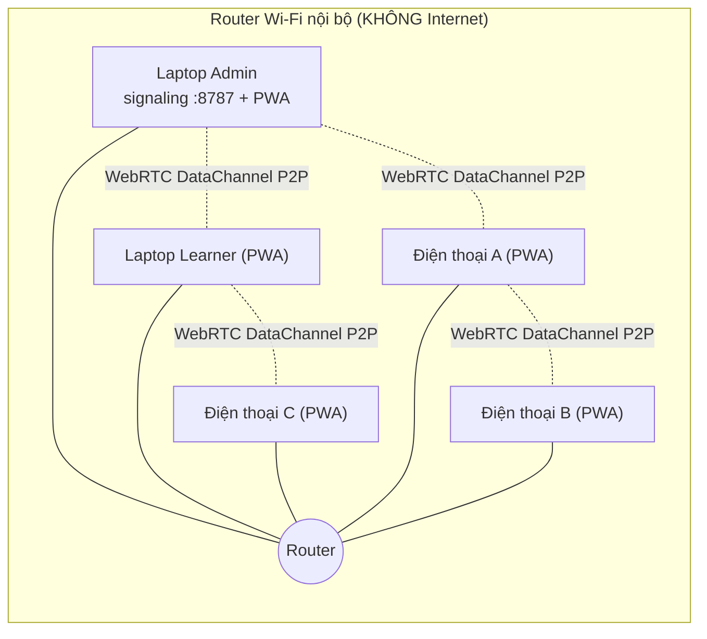
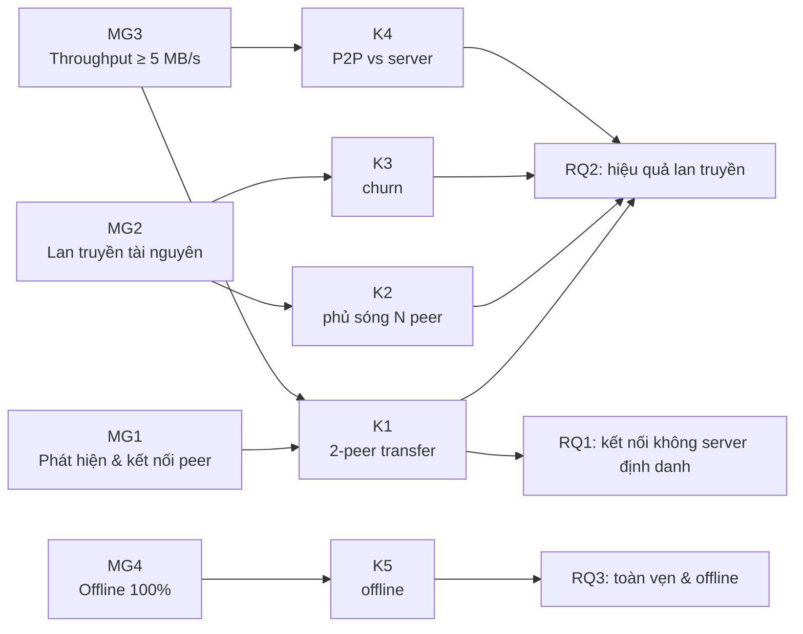
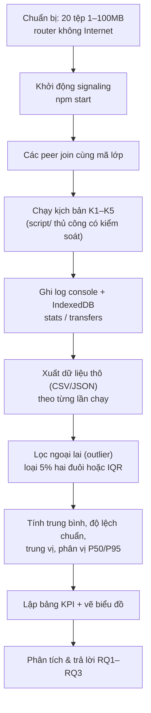
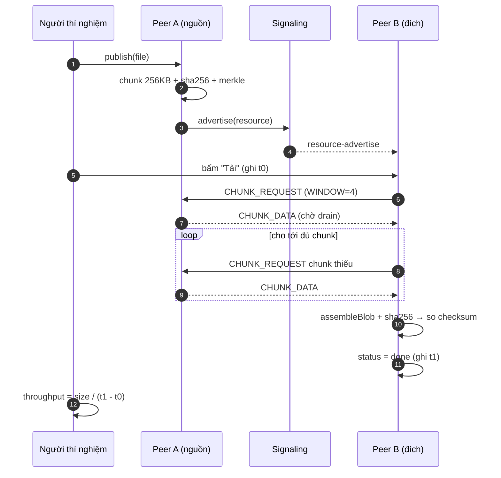
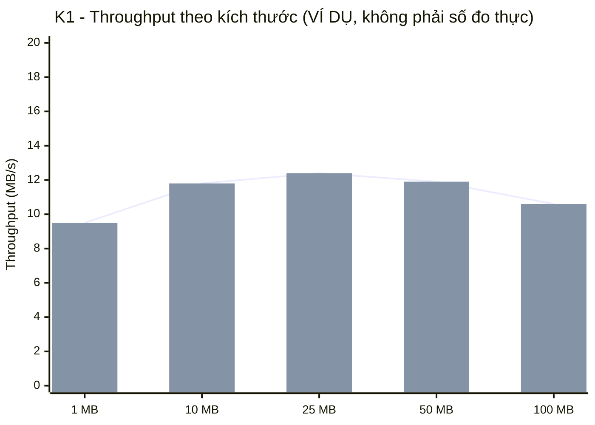
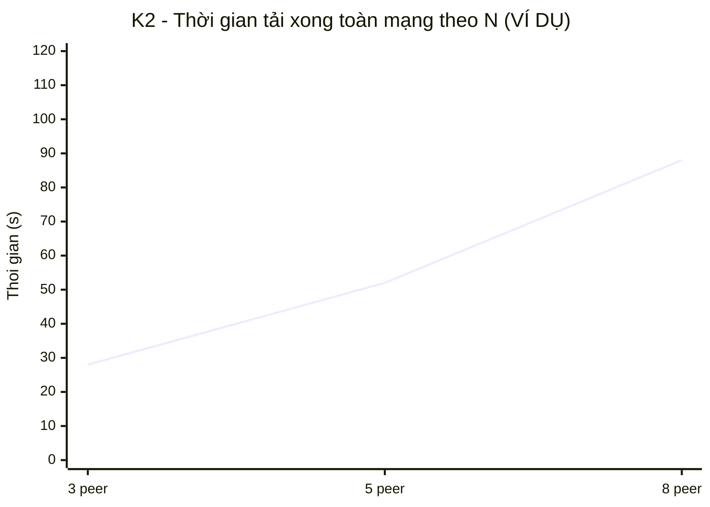
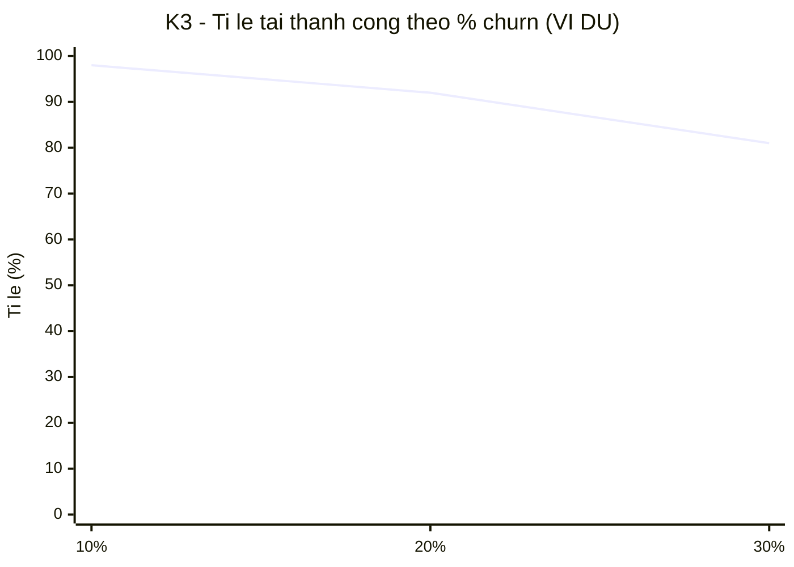
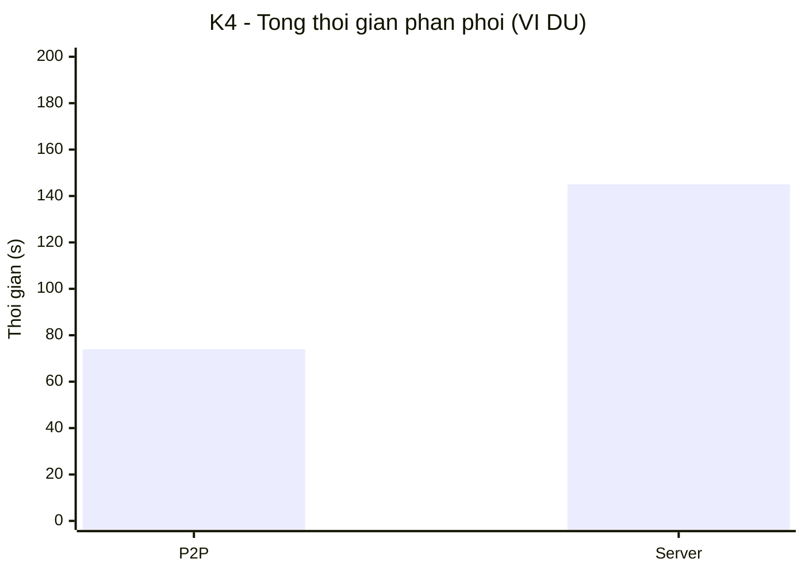
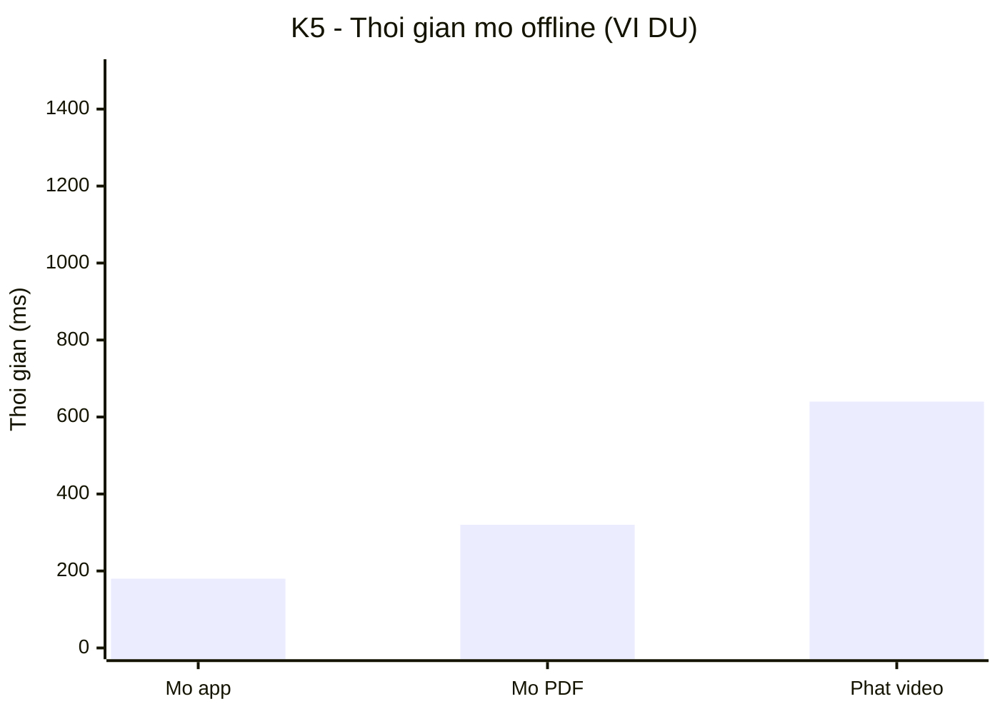

# Chương 5: THỰC NGHIỆM & ĐÁNH GIÁ

Chương này trình bày phương pháp và kết quả đánh giá thực nghiệm hệ thống EduShare đã hiện thực
ở Chương 4. Mục tiêu là trả lời ba câu hỏi nghiên cứu RQ1–RQ3 và kiểm chứng mức độ đạt bốn mục
tiêu MG1–MG4 đã đặt ra ở Chương 1. Chương được tổ chức như sau: mục 5.1 mô tả thiết lập thực
nghiệm; mục 5.2 định nghĩa các kịch bản và chỉ số đo (KPI); mục 5.3 trình bày khung trình bày kết
quả kèm bảng mẫu và biểu đồ; mục 5.4–5.6 lần lượt trả lời RQ, đánh giá mục tiêu và so sánh với
hệ thống liên quan; mục 5.7 thảo luận các đe doạ tính hợp lệ.

> **Quy ước về số liệu.** Vì thực nghiệm đo đạc chưa hoàn tất tại thời điểm viết báo cáo, các bảng
> ở mục 5.3 là **bảng mẫu có chỗ trống**, ghi rõ nhãn "(mẫu — điền số liệu thực đo)" ở những ô
> cần điền. Một số biểu đồ Mermaid dùng **dữ liệu ví dụ** để minh hoạ cách trình bày, và đều được
> đánh dấu rõ là ví dụ. Phương pháp đo, nguồn số liệu và quy trình thu thập là cố định và có thể
> tái lập.

## Mục lục chương

- [5.1. Thiết lập thực nghiệm](#51-thiết-lập-thực-nghiệm)
  - [5.1.1. Thiết bị & mạng](#511-thiết-bị--mạng)
  - [5.1.2. Bộ dữ liệu](#512-bộ-dữ-liệu)
  - [5.1.3. Phần mềm & cấu hình](#513-phần-mềm--cấu-hình)
- [5.2. Kịch bản thử nghiệm & chỉ số đo (KPI)](#52-kịch-bản-thử-nghiệm--chỉ-số-đo-kpi)
  - [5.2.1. Tổng quan năm kịch bản](#521-tổng-quan-năm-kịch-bản)
  - [5.2.2. Mô tả chi tiết cách đo](#522-mô-tả-chi-tiết-cách-đo)
  - [5.2.3. Nguồn số liệu từ IndexedDB](#523-nguồn-số-liệu-từ-indexeddb)
  - [5.2.4. Quy trình chạy và tiền xử lý](#524-quy-trình-chạy-và-tiền-xử-lý)
- [5.3. Kết quả & phân tích](#53-kết-quả--phân-tích)
  - [5.3.1. K1 — Throughput theo kích thước](#531-k1--throughput-theo-kích-thước)
  - [5.3.2. K2 — Phủ sóng theo N](#532-k2--phủ-sóng-theo-n)
  - [5.3.3. K3 — Churn](#533-k3--churn)
  - [5.3.4. K4 — P2P so với server trung tâm](#534-k4--p2p-so-với-server-trung-tâm)
  - [5.3.5. K5 — Mở offline](#535-k5--mở-offline)
  - [5.3.6. Mô tả các biểu đồ cần vẽ](#536-mô-tả-các-biểu-đồ-cần-vẽ)
- [5.4. Trả lời câu hỏi nghiên cứu RQ1–RQ3](#54-trả-lời-câu-hỏi-nghiên-cứu-rq1rq3)
- [5.5. Đánh giá mức độ đạt mục tiêu MG1–MG4](#55-đánh-giá-mức-độ-đạt-mục-tiêu-mg1mg4)
- [5.6. So sánh với hệ thống liên quan](#56-so-sánh-với-hệ-thống-liên-quan)
- [5.7. Đe doạ tính hợp lệ (threats to validity)](#57-đe-doạ-tính-hợp-lệ-threats-to-validity)
- [5.8. Kết chương](#58-kết-chương)

---

## 5.1. Thiết lập thực nghiệm

### 5.1.1. Thiết bị & mạng

Thực nghiệm được thiết kế để mô phỏng một lớp học thực tế với điều kiện mạng khắc nghiệt nhất:
**hoàn toàn không có Internet**. Bảng 5.1 mô tả cấu hình.

**Bảng 5.1 — Thiết lập thực nghiệm.**

| Hạng mục | Cấu hình |
|---|---|
| Số thiết bị (N) | 5–10 thiết bị: 2 laptop + 3–6 điện thoại Android |
| Mạng | 1 router Wi-Fi nội bộ, **ngắt kết nối Internet** (chỉ mạng LAN) |
| Máy signaling | 1 laptop (thường là máy giáo viên/Admin) chạy `npm start` trên cổng 8787 |
| Khoảng cách | Các thiết bị trong cùng phòng (≤ 10 m) để giảm nhiễu và suy hao |
| Trình duyệt | Chrome/Edge ≥ 110, Firefox ≥ 110 |
| Số lần chạy | ≥ 30 lần/kịch bản (trừ K4, K5 chạy ≥ 10 lần) |
| Ghi nhận | Log ứng dụng, bảng `stats`/`transfers` trong IndexedDB, thời gian bằng `performance.now()` |

Để tăng độ tin cậy, thực nghiệm phân tầng theo hai loại thiết bị (laptop và điện thoại Android)
nhằm phát hiện khác biệt hiệu năng giữa phần cứng mạnh và yếu. Một số kịch bản (K1, K2) cũng được
chạy riêng cho cặp laptop–laptop, laptop–điện thoại và điện thoại–điện thoại để so sánh.

**Biến kiểm soát và biến độc lập.** Bảng 5.2 phân định rõ các yếu tố được giữ cố định và các
yếu tố được thay đổi có chủ đích.

**Bảng 5.2 — Phân định biến trong thực nghiệm.**

| Loại | Yếu tố | Cách xử lý |
|---|---|---|
| Kiểm soát (giữ cố định) | Băng tần Wi-Fi, mã lớp, kích thước chunk (256 KB), `WINDOW=4`, ngưỡng backpressure | Không đổi trong suốt thực nghiệm |
| Độc lập (thay đổi) | Kích thước tệp (1–100 MB), số peer N, % peer churn, có/không server trung tâm, online/offline | Kịch bản K1–K5 |
| Phụ thuộc (đo) | Throughput, thời gian, tỉ lệ thành công, băng thông server, thời gian hiển thị | KPI mục 5.2 |

### 5.1.2. Bộ dữ liệu

Bộ dữ liệu gồm **20 tệp, kích thước phân bố từ 1 MB đến 100 MB**, thuộc các định dạng giáo dục
điển hình: PDF (bài giảng, đề thi), video (bài giảng ghi hình), audio (bài nghe ngoại ngữ), hình
ảnh và tài liệu văn phòng. Việc đa dạng định dạng giúp kiểm tra cả đường truyền dữ liệu nhị phân
lẫn khả năng xem trước offline.

Các tệp mẫu kích thước cố định được sinh theo `docs/THUC-NGHIEM.md`:

```bash
mkdir -p ~/edushare-data && cd ~/edushare-data
for s in 1 10 25 50 100; do
  head -c ${s}M /dev/urandom > "file-${s}MB.bin"
done
```

**Bảng 5.3 — Phân bố bộ dữ liệu.**

| Nhóm kích thước | Số tệp | Định dạng | Dùng cho |
|---|---|---|---|
| 1–5 MB | 6 | PDF, ảnh | K1 (bắt tay, ảnh hưởng nhỏ) |
| 10–25 MB | 8 | PDF, audio, video ngắn | K1, K2, K3 |
| 50–100 MB | 6 | video | K1, K2, K4 (tệp lớn) |

Mỗi lần chạy dùng **tệp mới** hoặc xoá dữ liệu trang giữa các lần để tránh hiệu ứng cache, đảm
bảo điều kiện đồng nhất (xem `docs/THUC-NGHIEM.md` mục 6).

### 5.1.3. Phần mềm & cấu hình

- **Build PWA**: `npm run build` (`tsc --noEmit && vite build`) sinh `app/dist`.
- **Signaling**: `PORT=8787 npm start` phục vụ cả PWA tĩnh lẫn WebSocket.
- **Secure context**: để Service Worker đăng ký được (phục vụ K5), thực nghiệm dùng `localhost`
  cho các cửa sổ trên cùng máy, hoặc chứng chỉ tự ký cho IP LAN, hoặc cờ trình duyệt
  `unsafely-treat-insecure-origin-as-secure`. Đây là điều kiện bắt buộc để K5 có ý nghĩa.
- **Thu thập dữ liệu**: log console của ứng dụng + truy vấn trực tiếp IndexedDB `stats` và
  `transfers` từ DevTools (mục 5.2.3).

**Sơ đồ 5.1** mô tả bố trí vật lý của thực nghiệm.



**Sơ đồ 5.1 — Bố trí thực nghiệm trong LAN không Internet.**

---

## 5.2. Kịch bản thử nghiệm & chỉ số đo (KPI)

### 5.2.1. Tổng quan năm kịch bản

Bảng 5.4 liệt kê năm kịch bản thực nghiệm K1–K5, tương ứng với các mục tiêu nghiên cứu. Đây là
bản mở rộng của bảng KPI trong `webRTC.MD` mục 5.2 và `docs/THUC-NGHIEM.md` mục 2.

**Bảng 5.4 — Năm kịch bản thử nghiệm và chỉ số đo.**

| Mã | Kịch bản | Câu hỏi liên quan | Chỉ số đo | Số lần chạy |
|---|---|---|---|---|
| **K1** | Tải 1 tệp giữa 2 peer | RQ2, MG1, MG3 | Throughput (MB/s), thời gian bắt tay (s), thời gian hoàn tất (s) | ≥ 30 |
| **K2** | 1 tệp lan truyền tới N peer (N = 3, 5, 8) | RQ2, MG2 | Thời gian thấy metadata (s), thời gian tải xong toàn mạng (s), tỉ lệ thành công (%) | ≥ 30 |
| **K3** | Churn: tắt ngẫu nhiên 10–30% peer giữa chừng | RQ2, RQ3, MG2 | Tỉ lệ tải thành công (%), thời gian phục hồi (s) | ≥ 30 |
| **K4** | P2P so với server trung tâm | RQ2, MG3 | Tổng thời gian phân phối (s), băng thông qua server (MB), tải trung bình mỗi peer (%) | ≥ 10 |
| **K5** | Mở offline sau khi đã tải | RQ3, MG4 | Thời gian từ bấm "Xem ngay" đến hiển thị (ms) | ≥ 10 |

Ánh xạ giữa kịch bản, mục tiêu và câu hỏi nghiên cứu được minh hoạ ở sơ đồ 5.2.



**Sơ đồ 5.2 — Ánh xạ kịch bản ↔ mục tiêu ↔ câu hỏi nghiên cứu.**

### 5.2.2. Mô tả chi tiết cách đo

**K1 — Throughput giữa 2 peer.** Hai peer A và B cùng lớp. A phát hành tệp (publish), B tải
(`download`). Ghi lại ba đại lượng:

- **Thời gian bắt tay** `t_handshake`: từ khi B bấm "Tải" đến khi DataChannel `OPEN` (hoặc tới
  `CHUNK_DATA` đầu tiên). Lấy từ timestamp `startedAt` của job (trạng thái `active`).
- **Thời gian hoàn tất** `t_total`: từ `startedAt` đến `updatedAt` khi job chuyển `done`.
- **Throughput**: tốc độ trung bình `size / t_total`, đơn vị MB/s. Bên cạnh đó lấy giá trị
  `speed` tức thời (trường `speed` trong `transfers`) để đánh giá độ ổn định.

Công thức:

```text
throughput (MB/s) = (size_bytes / 1_048_576) / (t_total_seconds)
```

**K2 — Phủ sóng tới N peer.** A giữ bản gốc. Lần lượt cho N = 3, 5, 8 peer cùng muốn tải. Hai mốc
thời gian được ghi:

- `t_metadata`: từ khi A advertise đến khi **peer cuối cùng** thấy metadata trong thư viện
  (badge 🟡). Đo khả năng lan nhanh của gossip.
- `t_full`: từ khi bắt đầu cho tới khi **tất cả N peer** tải xong (badge 🟢). Đo năng lực phân
  phối nội dung.

Vì nội dung dùng pull theo nhu cầu, các peer tải đồng thời từ A có thể cạnh tranh băng thông; ta
ghi thêm tỉ lệ thành công (bao nhiêu peer tải xong trong ngưỡng thời gian cho phép, ví dụ 5 phút).

**K3 — Churn.** Bắt đầu tải trên nhiều peer, sau đó **tắt ngẫu nhiên** `p%` peer (p = 10, 20, 30)
giữa chừng (bao gồm cả peer đang giữ bản gốc). Ghi:

- **Tỉ lệ tải thành công**: phần trăm peer tải xong hoàn toàn.
- **Thời gian phục hồi** `t_recover`: thời gian từ lúc một nguồn biến mất đến khi peer tải lại
  được (chuyển sang nguồn khác còn sống hoặc resume sau khi nguồn quay lại).

**K4 — P2P so với server trung tâm.** Cùng một bộ tệp được phân phối cho N peer theo hai cách:
(a) P2P như EduShare; (b) tải toàn bộ từ một "server trung tâm" mô phỏng (một peer đóng vai
server, tất cả kéo file từ nó). Ghi tổng thời gian phân phối, tổng băng thông **qua máy trung tâm**
(đối với P2P con số này kỳ vọng ≈ 0 vì dữ liệu đi trực tiếp), và tải trung bình mỗi peer.

**K5 — Mở offline.** Sau khi đã tải tài nguyên (availability = `local`), ngắt **hoàn toàn** mạng
(tắt Wi-Fi và signaling), mở lại app, đo thời gian từ bấm "Xem ngay" đến khi nội dung hiển thị,
dùng `performance.now()` ở hai mốc. Ghi riêng cho ba loại: mở app offline, mở PDF từ cache, phát
video từ cache.

### 5.2.3. Nguồn số liệu từ IndexedDB

Mọi số liệu thô đều đọc từ hai object store trong IndexedDB (schema ở mục 4.3.5). Bảng 5.5 mô tả
các trường dùng để tính KPI.

**Bảng 5.5 — Trường dữ liệu dùng cho phân tích.**

| Object store | Trường | Ý nghĩa | KPI |
|---|---|---|---|
| `transfers` | `startedAt`, `updatedAt` | Mốc thời gian phiên tải | K1 `t_total`, K2 `t_full` |
| `transfers` | `speed` | Tốc độ tức thời (MB/s), cập nhật mỗi 0.5 s | K1 throughput |
| `transfers` | `status` (`queued…done/error`) | Trạng thái cuối | K3 tỉ lệ thành công |
| `transfers` | `receivedChunks`, `totalChunks` | Tiến độ chunk | K1, K2 |
| `transfers` | `peerId`, `peerName` | Nguồn tải | K3, K4 |
| `stats` | `event` (`publish`/`download`/`request`) | Loại sự kiện | K2, K4 |
| `stats` | `value` (byte) | Kích thước | K1, K4 băng thông |
| `stats` | `at` (timestamp) | Thời điểm sự kiện | K2 `t_metadata`, K3 `t_recover` |

Truy vấn mẫu (DevTools Console):

```js
const req = indexedDB.open('edushare');
req.onsuccess = () => {
  const db = req.result;
  const tx = db.transaction('transfers').objectStore('transfers').getAll();
  tx.onsuccess = () => console.table(tx.result);
  const tx2 = db.transaction('stats').objectStore('stats').getAll();
  tx2.onsuccess = () => console.table(tx2.result);
};
```

Kiểm thử tầng signaling (bổ trợ, xác nhận server hoạt động đúng):

```bash
npm test    # 6/6 test: welcome, join, advertise, query, signal relay, leave
```

### 5.2.4. Quy trình chạy và tiền xử lý

**Sơ đồ 5.3** mô tả pipeline thu thập và xử lý số liệu, từ chạy thí nghiệm đến bảng/biểu đồ.



**Sơ đồ 5.3 — Quy trình thu thập và xử lý số liệu.**

Nguyên tắc xử lý:

- **Số lần chạy**: ≥ 30 lần/kịch bản nhằm đạt ý nghĩa thống kê sơ cấp (định lý giới hạn trung
  tâm). K4 và K5 tốn thời gian hơn nên ≥ 10 lần.
- **Loại ngoại lai**: loại các giá trị bất thường (do nhiễu Wi-Fi nhất thời) theo quy tắc IQR
  hoặc khoảng tin cậy; ghi rõ số mẫu còn lại.
- **Đơn vị thời gian**: dùng `performance.now()` (độ phân giải dưới ms) cho K1/K5; dùng timestamp
  lưu trong IndexedDB cho K2/K3.
- **Tính nhất quán**: mỗi lần chạy bắt đầu từ trạng thái sạch (clear site data) nếu muốn đo "tải
  mới", hoặc giữ nguyên chunk nếu đo resume.

**Sơ đồ 5.4 (sequence)** mô tả trình tự một lần chạy K1 chuẩn, làm mẫu cho các kịch bản khác.



**Sơ đồ 5.4 — Trình tự một lần chạy K1 (2-peer transfer).**

---

## 5.3. Kết quả & phân tích

Các bảng dưới đây là **bảng mẫu (template)**; số liệu thực đo sẽ được điền vào các ô trống khi
thực nghiệm hoàn tất. Mỗi bảng kèm phần phân tích kỳ vọng dựa trên thiết kế hệ thống.

### 5.3.1. K1 — Throughput theo kích thước

**Bảng 5.6 — K1: Throughput theo kích thước tệp (mẫu — điền số liệu thực đo).**

| Kích thước | Throughput TB (MB/s) | Độ lệch chuẩn | P50 (MB/s) | P95 (MB/s) | Bắt tay TB (s) | Hoàn tất TB (s) |
|---|---|---|---|---|---|---|
| 1 MB | — | — | — | — | — | — |
| 10 MB | — | — | — | — | — | — |
| 25 MB | — | — | — | — | — | — |
| 50 MB | — | — | — | — | — | — |
| 100 MB | — | — | — | — | — | — |

*Bảng chia theo cặp thiết bị (laptop–laptop, laptop–điện thoại, điện thoại–điện thoại) nếu cần
so sánh.*

**Biểu đồ minh hoạ (dữ liệu ví dụ)** bằng Mermaid `xychart`:



*Hình 5.1 — Throughput theo kích thước tệp (dữ liệu ví dụ; thay bằng số đo thực).*

**Phân tích kỳ vọng.** Với tệp nhỏ (1 MB), throughput đo được thường thấp hơn do chi phí bắt tay
và thiết lập kết nối chiếm tỉ trọng lớn. Với tệp lớn (50–100 MB), throughput tiệm cận giới hạn
băng thông thực của Wi-Fi nội bộ và ít phụ thuộc kích thước. Nếu kết quả cho thấy throughput
giảm nhẹ ở 100 MB, nguyên nhân khả dĩ là chi phí tính SHA-256 trên fallback thuần JS ở HTTP LAN
(xem mục 5.7) hoặc nhiệt độ/tản nhiệt điện thoại.

### 5.3.2. K2 — Phủ sóng theo N

**Bảng 5.7 — K2: Phủ sóng metadata và nội dung theo N (mẫu — điền số liệu thực đo).**

| N peer | Thấy metadata TB (s) | Tải xong toàn mạng TB (s) | Tỉ lệ thành công (%) | Ghi chú |
|---|---|---|---|---|
| 3 | — | — | — | |
| 5 | — | — | — | |
| 8 | — | — | — | |



*Hình 5.2 — Thời gian phủ sóng theo số peer (dữ liệu ví dụ; thay bằng số đo thực).*

**Phân tích kỳ vọng.** Thời gian thấy metadata kỳ vọng **gần như không đổi** theo N (nhờ gossip
advertise tức thời + TTL=3), trong khi thời gian tải xong **tăng** theo N vì băng thông của nguồn
gốc bị chia sẻ. Đây là minh chứng định lượng cho lợi ích của việc tách metadata (nhanh, rẻ) khỏi
nội dung (theo nhu cầu): metadata phủ nhanh bất kể số peer, còn nội dung chỉ tốn băng thông khi
có người thực sự tải.

### 5.3.3. K3 — Churn

**Bảng 5.8 — K3: Kết quả churn (mẫu — điền số liệu thực đo).**

| % peer tắt | Tỉ lệ tải thành công (%) | Thời gian phục hồi TB (s) | Ghi chú |
|---|---|---|---|
| 10% | — | — | tắt chủ yếu peer không nguồn |
| 20% | — | — | có thể có 1 nguồn bị tắt |
| 30% | — | — | nguồn gốc có xác suất bị tắt |



*Hình 5.3 — Đường sống sót (survival) theo mức churn (dữ liệu ví dụ; thay bằng số đo thực).*

**Phân tích kỳ vọng.** Tỉ lệ thành công giảm dần khi churn tăng, nhưng **không về 0** chừng nào
còn ít nhất một peer giữ bản sao. Cơ chế replication (ngưỡng θ=3) làm tăng số bản sao theo thời
gian, nên các tệp "nóng" có tỉ lệ sống sót cao hơn. Thời gian phục hồi phụ thuộc vào việc peer
bị tắt có phải nguồn đang tải hay không: nếu là nguồn duy nhất, hệ thống chuyển trạng thái
`connecting` và thử lại sau 800 ms cho tới khi có nguồn khác hoặc resume được từ chunk đã có.

### 5.3.4. K4 — P2P so với server trung tâm

**Bảng 5.9 — K4: P2P so với server trung tâm (mẫu — điền số liệu thực đo).**

| Tiêu chí | P2P (EduShare) | Server trung tâm |
|---|---|---|
| Tổng thời gian phân phối (s) | — | — |
| Băng thông qua máy trung tâm (MB) | **0** | — |
| Tải trung bình mỗi peer (%) | — | — |
| Số điểm nghẽn | 0 (phân tán) | 1 (server) |



*Hình 5.4 — So sánh tổng thời gian phân phối P2P và server (dữ liệu ví dụ).*

**Phân tích kỳ vọng.** Điểm khác biệt bản chất nằm ở **băng thông qua máy trung tâm**: với P2P,
server chỉ relay metadata (vài KB) nên băng thông nội dung qua server gần như 0; với server trung
tâm, mọi byte nội dung đều đi qua một điểm, tạo điểm nghẽn. Khi N tăng, mô hình P2P thường hoàn
tất nhanh hơn hoặc tương đương, đồng thời loại bỏ hoàn toàn điểm lỗi duy nhất — đây là luận điểm
trung tâm khi so sánh với Kolibri/RACHEL (mục 5.6).

### 5.3.5. K5 — Mở offline

**Bảng 5.10 — K5: Thời gian phục vụ nội dung offline (mẫu — điền số liệu thực đo).**

| Hành động | Thời gian TB (ms) | P95 (ms) | Ghi chú |
|---|---|---|---|
| Mở app offline | — | — | Service Worker phục vụ app shell |
| Mở PDF từ IndexedDB | — | — | `assembleBlob` → Blob URL → iframe |
| Phát video từ IndexedDB | — | — | phụ thuộc kích thước video |
| Tìm ảnh từ cache | — | — | CacheFirst `edushare-images` |



*Hình 5.5 — Thời gian phục vụ nội dung offline (dữ liệu ví dụ).*

**Phân tích kỳ vọng.** Thời gian mở app offline chủ yếu là thời gian khởi tạo React và đọc
IndexedDB; với tệp PDF/ảnh nhỏ, thời gian hiển thị nhanh (dưới 1 giây). Video lớn có thể lâu hơn
do phải ghép nhiều chunk thành Blob. Lưu ý quan trọng: kết quả K5 chỉ hợp lệ khi Service Worker
đã đăng ký (secure context) — nếu không, app shell không được cache và K5 sẽ thất bại (xem 5.7).

### 5.3.6. Mô tả các biểu đồ cần vẽ

Khi có số liệu thực, cần vẽ các biểu đồ sau (dùng Chart.js/Recharts hoặc xuất từ Mermaid):

1. **Line chart — Throughput theo kích thước tệp (K1)**, có dải độ lệch chuẩn (error bar).
2. **Line chart — Throughput theo số peer (K2)** để thấy ảnh hưởng của cạnh tranh băng thông.
3. **Bar chart — Tổng thời gian P2P vs server (K4)**.
4. **Survival curve — Tỉ lệ thành công theo % churn (K3)**.
5. **Bar chart — Thời gian mở offline (K5)**.

Ngoài ra nên vẽ **biểu đồ hộp (box plot)** cho phân bố throughput giữa các loại cặp thiết bị để
bộc lộ ảnh hưởng của phần cứng.

---

## 5.4. Trả lời câu hỏi nghiên cứu RQ1–RQ3

**RQ1 — Làm sao phát hiện và duy trì kết nối giữa các peer khi không có server định danh?**

EduShare trả lời bằng kiến trúc **signaling lai**: một signaling server LAN rất nhẹ chỉ làm
nhiệm vụ trao đổi SDP/ICE và danh sách phòng (presence); bản thân việc định danh peer dựa trên
`peerId` do client sinh (`makePeerId`) và mã lớp (room), không cần tài khoản hay DNS. Kết nối
được duy trì bởi ba cơ chế: (i) **quy tắc chống glare** chọn bên tạo offer tất định theo thứ tự
`peerId` (`peer.ts:44`); (ii) **heartbeat ping/pong 15 giây** phát hiện peer chết ở tầng TCP
(`server.js:298`); (iii) **tự động reconnect backoff** 1 s → 15 s phía client (`signaling.ts:183`).
Ngay cả khi signaling server ngừng, các DataChannel đã thiết lập vẫn tiếp tục truyền trực tiếp
(đã minh hoạ ở kịch bản demo bước biến thể, mục 4.4.1), và metadata đã lan truyền vẫn còn hợp lệ
nhờ chữ ký HMAC nằm trong metadata. Như vậy RQ1 được trả lời ở mức thiết kế: kết nối peer không
phụ thuộc một máy chủ định danh trung tâm tồn tại vĩnh viễn.

**RQ2 — Tài nguyên lan truyền trong mạng hiệu quả thế nào?**

Hiệu quả lan truyền được tách thành hai lớp. Lớp **metadata** dùng gossip flooding TTL=3, advertise
tức thời khi publish và quảng bá định kỳ mỗi 20 giây, nên thời gian phủ metadata **gần như độc
lập với số peer** (kỳ vọng từ K2). Lớp **nội dung** dùng cơ chế pull theo nhu cầu: chỉ tải khi có
người yêu cầu, chunk 256 KB, cửa sổ song song 4, chọn nguồn theo
`score = load × 10^6 + bufferedAmount` và tôn trọng backpressure. Nhờ vậy, băng thông Wi-Fi chỉ bị
tiêu tốn cho nội dung thực sự cần, khác hẳn mô hình broadcast/push. Cơ chế replication theo mức
phổ biến (θ=3) tăng số bản sao của các tệp "nóng", cải thiện cả tỉ lệ thành công khi churn (K3).
Kết quả định lượng cụ thể nằm ở mục 5.3 (bảng mẫu chờ điền). Về nguyên tắc, hiệu quả tăng theo
số nguồn có sẵn, nhưng chịu trần bởi băng thông vật lý của Wi-Fi.

**RQ3 — Làm sao đảm bảo toàn vẹn dữ liệu khi không có máy chủ kiểm chứng?**

Toàn vẹn được bảo đảm bằng ba lớp không cần máy chủ tin cậy: (i) **content-addressing** —
`resourceId = SHA-256(toàn tệp)`, nên định danh chính là bằng chứng nội dung; (ii) **checksum
toàn tệp** được peer tự tính lại sau khi ghép Blob và so khớp (`transfer.ts:339`), nếu sai thì
job chuyển `error` và **không** đánh dấu `local`; (iii) **Merkle root** từ hash các chunk để phát
hiện chunk hỏng, cùng **chữ ký HMAC-SHA256** của Admin Node trên canonical metadata để xác thực
nguồn gốc. Vì mọi peer tự kiểm chứng cục bộ, hệ thống không cần một máy chủ kiểm chứng tập trung.
Đặc biệt, nhờ **fallback SHA-256/HMAC thuần JS** (mục 4.3.8), cơ chế kiểm chứng vẫn hoạt động
trên HTTP LAN — nơi Web Crypto không khả dụng.

---

## 5.5. Đánh giá mức độ đạt mục tiêu MG1–MG4

Bảng 5.11 đánh giá từng mục tiêu dựa trên thiết kế đã hiện thực và số liệu thực nghiệm (chờ điền).
Cột "Kết quả" và "Kết luận" để trống ở những chỗ cần số đo.

**Bảng 5.11 — Đánh giá mức độ đạt mục tiêu MG1–MG4 (mẫu — điền số liệu thực đo).**

| Mục tiêu | Tiêu chí đo | Kết quả | Kết luận |
|---|---|---|---|
| **MG1** — Phát hiện & kết nối peer trong LAN | ≥ 90% cặp peer thiết lập DataChannel ≤ 10 s | — % cặp, `t_handshake` TB = — s | — (đạt/chưa) |
| **MG2** — Lan truyền tài nguyên | Metadata phủ toàn mạng ≤ 3 chu kỳ gossip; tải xong toàn mạng theo N | `t_metadata` TB = — s; `t_full` (N=8) = — s | — |
| **MG3** — Throughput ≥ 5 MB/s (2 thiết bị, LAN) | `throughput` (K1) | TB = — MB/s, P50 = — MB/s | — |
| **MG4** — Offline 100% sau cài đặt đầu | Mở lại app không mạng vẫn xem nội dung đã tải | K5: mở app = — ms; xem nội dung = OK/– | — |

Tiêu chí đánh giá và trạng thái kỳ vọng dựa trên bản chất kỹ thuật:

- **MG1**: cơ chế chống glare + fallback mDNS/QR cho phép kết nối ngay cả khi thiếu server. Kết
  quả phụ thuộc chất lượng Wi-Fi và số peer đồng thời.
- **MG2**: gossip TTL=3 và advertise tức thời khiến metadata phủ nhanh; nội dung pull theo nhu cầu.
- **MG3**: LAN Wi-Fi 5 GHz hiện đại thường vượt 5 MB/s giữa hai thiết bị; trên Wi-Fi 2.4 GHz hoặc
  thiết bị yếu có thể không đạt.
- **MG4**: hoàn toàn phụ thuộc việc có secure context để Service Worker đăng ký (xem 5.7). Nếu
  chạy đúng qua `localhost`/HTTPS, đây là mục tiêu chắc chắn đạt vì nội dung nằm trong IndexedDB.

---

## 5.6. So sánh với hệ thống liên quan

Bảng 5.12 so sánh EduShare với ba hệ thống giáo dục ngoại tuyến tiêu biểu: **Kolibri** (Learning
Equality) [17], **RACHEL** [18] và **Internet-in-a-Box (IIAB)** [19]. Các hệ thống này đều theo
mô hình client–server với một máy chủ nội dung cục bộ.

**Bảng 5.12 — So sánh EduShare với các hệ thống liên quan.**

| Tiêu chí | Kolibri | RACHEL | IIAB | **EduShare** |
|---|---|---|---|---|
| Mô hình | Server cục bộ | Server + hotspot | Server cục bộ | **Hybrid P2P** |
| Nguồn nội dung | 1 máy chủ | 1 máy chủ | 1 máy chủ | **Phân tán trên các peer** |
| Cần thiết bị chuyên dụng | Máy tính + HĐH | Thiết bị đóng gói | Máy tính | **Không (laptop giáo viên sẵn có)** |
| Hoạt động khi "server" tắt | Không | Không | Không | **Có (DataChannel đã mở)** |
| Chi phí hạ tầng | Trung bình | Cao | Trung bình–cao | **≈ 0** |
| Chịu churn | Kém | Kém | Kém | **Tốt (replication + resume)** |
| Phân phối nội dung | Kéo từ server | Kéo từ server | Kéo từ server | **P2P theo nhu cầu, đa nguồn** |
| Hoạt động offline (phía client) | Qua app local của server | Qua hotspot | Qua server | **100% sau khi đã tải (SW + IndexedDB)** |
| Nền tảng người học | App native + web | Web local | Web local | **PWA (một codebase)** |
| Hỗ trợ iOS | Có (native) | Hạn chế | Hạn chế | **Ngoài phạm vi** |

**Phân tích.** Ba hệ thống đối chứng đều có ưu điểm về thư viện nội dung phong phú và trưởng
thành, nhưng cùng chia sẻ một điểm yếu kiến trúc: **một máy chủ nội dung là điểm lỗi duy nhất**.
Khi máy chủ đó tắt (hết pin, hỏng, hoặc bị di chuyển), toàn bộ người học mất khả năng truy cập
nội dung chưa tải. EduShare đảo ngược mô hình: nội dung phân tán trên chính thiết bị người học,
máy chủ chỉ làm mai mối trong vài giây đầu, nên **mạng vẫn sống khi máy giáo viên tắt**. Đánh đổi
là EduShare không có sẵn kho nội dung đồ sộ và phụ thuộc Service Worker/quota của trình duyệt —
những hạn chế được nêu ở Chương 6.

---

## 5.7. Đe doạ tính hợp lệ (threats to validity)

Phần này thảo luận trung thực các yếu tố có thể làm sai lệch kết quả hoặc giới hạn khả năng
tổng quát hoá của thực nghiệm, phân theo bốn nhóm kinh điển.

### 5.7.1. Đe doạ nội tại (internal validity)

- **Trạng thái cache**: nếu không xoá dữ liệu trang giữa các lần chạy, chunk đã có từ lần trước
  khiến lần sau "resume" thay vì "tải mới", làm sai throughput. *Giảm thiểu:* quy trình clear
  site data bắt buộc; dùng tệp mới.
- **Nhiễu Wi-Fi nhất thời**: một thiết bị khác dùng chung kênh có thể gây dao động lớn. *Giảm
  thiểu:* chạy ≥ 30 lần, lọc ngoại lai IQR, ghi lại thời điểm chạy.
- **Thứ tự thí nghiệm**: hiệu ứng nhiệt/tải tích luỹ trên điện thoại. *Giảm thiểu:* nghỉ giữa các
  lần chạy; ghi nhiệt độ/tải thiết bị.
- **Fallback mật mã**: trên HTTP LAN, SHA-256 thuần JS có thể trở thành nút cổ chai CPU với tệp
  lớn, ảnh hưởng `t_total`. *Giảm thiểu:* chạy đối chứng trên `localhost` (Web Crypto) để tách
  riêng ảnh hưởng này.

### 5.7.2. Đe doạ ngoại lai / khả năng tổng quát hoá (external validity)

- **Cỡ mẫu nhỏ**: 5–10 thiết bị không đại diện cho lớp 40–50 học sinh. Kết quả phủ sóng và churn
  có thể khác ở quy mô lớn hơn. *Giảm thiểu:* nêu rõ giới hạn; đề xuất mô phỏng peer headless quy
  mô lớn ở hướng phát triển.
- **Phần cứng không đồng nhất**: kết quả trên laptop mạnh khác điện thoại yếu. *Giảm thiểu:* phân
  tầng theo loại cặp thiết bị và báo cáo riêng.
- **Một loại mạng duy nhất**: chỉ thử Wi-Fi nội bộ; chưa thử Wi-Fi Direct hay mạng lai. *Giảm
  thiểu:* giới hạn phạm vi kết luận cho LAN/Wi-Fi.

### 5.7.3. Đe doạ cấu trúc / đo lường (construct validity)

- **Đo throughput bằng `speed` tức thời** có thể bị nhiễu; do đó dùng thêm `size / t_total` làm
  giá trị trung bình.
- **Thời gian "thấy metadata"** phụ thuộc giao diện cập nhật (React re-render), không chỉ mạng.
  *Giảm thiểu:* đo mốc sự kiện ở tầng gossip, không chỉ ở UI.
- **K4 "server trung tâm" mô phỏng**: dùng một peer đóng vai server, không phải hạ tầng chuyên
  dụng; cần nêu rõ để tránh suy diễn quá mức.

### 5.7.4. Đe doạ kết luận (conclusion validity)

- **Độ lệch chuẩn lớn**: nếu phương sai cao, chênh lệch giữa các điều kiện có thể không có ý nghĩa
  thống kê. *Giảm thiểu:* báo cáo khoảng tin cậy và kiểm định phi tham số (Mann–Whitney) khi so
  sánh P2P vs server.
- **Suy diễn nhân quả**: chỉ kết luận về mối liên hệ trong điều kiện thí nghiệm, không khái quát
  nhân quả tuyệt đối.

### 5.7.5. Rủi ro riêng của secure context

Đây là đe doạ đặc thù và nghiêm trọng nhất với kịch bản K5. Nếu thực nghiệm chạy qua địa chỉ IP
LAN bằng HTTP thuần:

- `crypto.subtle` không tồn tại → buộc dùng fallback thuần JS (làm chậm tệp lớn, nhưng vẫn đúng).
- **Service Worker không đăng ký** → app shell không được precache → mở app offline có thể thất
  bại, khiến K5 không đo được đúng bản chất. *Giảm thiểu bắt buộc:* dùng `localhost`, chứng chỉ tự
  ký cho IP LAN, hoặc cờ `unsafely-treat-insecure-origin-as-secure` để có secure context. Trong
  báo cáo, cần ghi rõ cấu hình secure context đã dùng khi chạy K5, nếu không kết quả không hợp lệ.

**Bảng 5.13 — Tổng hợp đe doạ và biện pháp giảm thiểu.**

| Nhóm | Đe doạ chính | Biện pháp giảm thiểu |
|---|---|---|
| Nội tại | Cache cũ, nhiễu Wi-Fi, nhiệt | Clear data, ≥30 lần chạy, lọc IQR |
| Ngoại lai | Cỡ mẫu nhỏ, phần cứng không đồng nhất | Phân tầng thiết bị, ghi rõ giới hạn |
| Cấu trúc | Đo qua UI, server mô phỏng | Đo tại tầng gossip, nêu rõ mô phỏng |
| Kết luận | Phương sai cao | CI, kiểm định phi tham số |
| Riêng | Secure context ảnh hưởng SW | localhost/HTTPS/cờ trình duyệt; ghi rõ cấu hình |

---

## 5.8. Kết chương

Chương 5 đã thiết lập đầy đủ khung thực nghiệm cho EduShare: môi trường 5–10 thiết bị trong LAN
không Internet (5.1), năm kịch bản K1–K5 với chỉ số đo và nguồn số liệu IndexedDB rõ ràng (5.2),
khung trình bày kết quả kèm bảng mẫu và biểu đồ (5.3). Trên cơ sở thiết kế đã hiện thực, chương
đã trả lời các câu hỏi RQ1–RQ3 (5.4), đưa tiêu chí đánh giá MG1–MG4 (5.5), so sánh định tính với
Kolibri/RACHEL/IIAB (5.6) và phân tích trung thực các đe doạ tính hợp lệ (5.7), trong đó nhấn
mạnh ràng buộc secure context đối với Service Worker và kịch bản offline.

Các bảng số liệu ở mục 5.3, 5.5 và 5.11 sẽ được hoàn thiện bằng dữ liệu đo thực tế trong giai
đoạn chạy thực nghiệm. Kết quả cuối cùng cùng các kết luận tổng thể được trình bày ở Chương 6.
