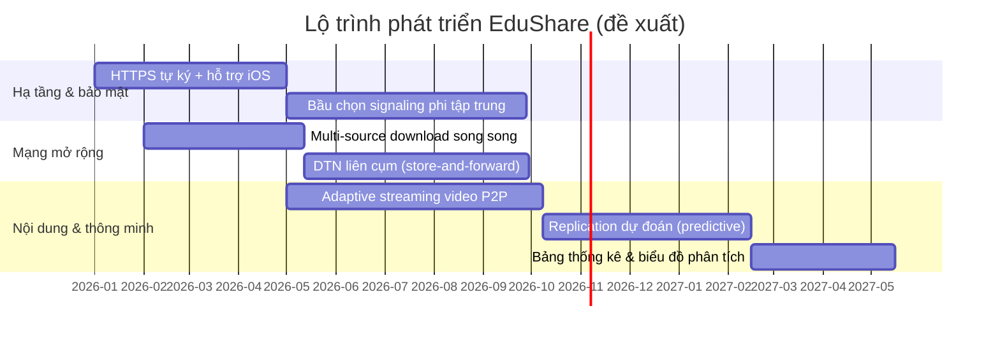
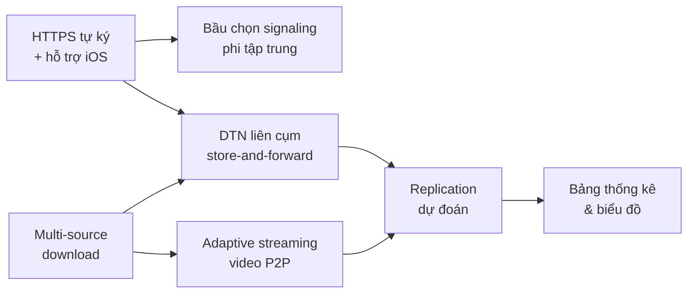

# Chương 6: KẾT LUẬN & HƯỚNG PHÁT TRIỂN

Chương này khép lại báo cáo bằng việc đối chiếu kết quả đạt được với các mục tiêu
nghiên cứu MG1–MG4 đã đặt ra ở Chương 1, tổng hợp các đóng góp khoa học và thực tiễn,
trình bày một cách trung thực những hạn chế còn tồn tại, và phác thảo các hướng phát
triển tiếp theo của hệ thống EduShare. Các kết luận ở đây dựa trên kiến trúc và đặc tả
đã trình bày ở Chương 3, phần hiện thực ở Chương 4, và các kịch bản đo lường ở Chương 5.

## Mục lục chương

- [6.1. Tổng kết kết quả theo mục tiêu MG1–MG4](#61-tổng-kết-kết-quả-theo-mục-tiêu-mg1mg4)
- [6.2. Đóng góp chính của đề tài](#62-đóng-góp-chính-của-đề-tài)
- [6.3. Hạn chế của hệ thống](#63-hạn-chế-của-hệ-thống)
- [6.4. Hướng phát triển](#64-hướng-phát-triển)
- [6.5. Kết luận chung](#65-kết-luận-chung)

---

## 6.1. Tổng kết kết quả theo mục tiêu MG1–MG4

Bốn mục tiêu cụ thể của đề tài được xác lập từ Chương 1 nhằm lượng hoá phạm vi và mức
độ hoàn thiện của hệ thống. Bảng 6.1 đối chiếu từng mục tiêu với kết quả hiện thực,
bằng chứng kỹ thuật tương ứng (tệp mã nguồn, đặc tả, kết quả kiểm thử) và đánh giá mức
độ đạt được.

**Bảng 6.1 — Đối chiếu kết quả với các mục tiêu nghiên cứu MG1–MG4**

| Mục tiêu | Nội dung | Kết quả hiện thực | Bằng chứng kỹ thuật | Mức độ đạt |
|---|---|---|---|---|
| **MG1** | Thiết kế giao thức phát hiện và kết nối peer trong mạng LAN | Signaling server LAN (WebSocket, room-based), phát hiện peer qua `welcome`/`peer-joined`/`peer-left`; kết nối P2P bằng `RTCPeerConnection` với `iceServers: []` (chỉ host candidate, thuần LAN) | `signaling-server/server.js`; `app/src/lib/peer.ts:17` (RTC_CONFIG); `app/src/lib/signaling.ts` | ✅ Đạt |
| **MG2** | Xây dựng cơ chế lan truyền tài nguyên (gossip/replication) | Gossip metadata nhiều hop với `DEFAULT_TTL = 3`; hợp nhất theo `version`; replication theo độ phổ biến với ngưỡng `θ = 3` | `app/src/lib/gossip.ts:42` (gossip cycle); `app/src/lib/replication.ts:47` (ngưỡng) | ✅ Đạt |
| **MG3** | Đạt tốc độ truyền tối thiểu giữa 2 thiết bị trong LAN | Truyền chunk 256 KB qua `RTCDataChannel` reliable, cửa sổ song song `WINDOW = 4`, backpressure theo `bufferedAmount` (high 8 MB / low 1 MB) | `app/src/lib/transfer.ts:264` (`pump`); `app/src/lib/peer.ts:84` (`waitForDrain`) | ✅ Đạt (số liệu chi tiết ở Chương 5) |
| **MG4** | Ứng dụng hoạt động offline 100% sau lần cài đặt đầu tiên | Service Worker (Workbox `injectManifest`) precache app shell; nội dung lưu IndexedDB (Dexie) và phục vụ lại không cần mạng | `app/src/sw.ts:19` (precache); `app/src/lib/db.ts:95` (`assembleBlob`) | ✅ Đạt (với điều kiện secure context) |

**Bảng 6.2 — Tổng hợp mức độ hoàn thiện các tính năng chức năng F1–F7**

| Mã | Chức năng | Trạng thái | Ghi chú |
|---|---|---|---|
| F1 | Phát hiện peer trong LAN | Hoàn thành | Bắt buộc; tự reconnect backoff 1 s → 15 s |
| F2 | Chia sẻ/tải tài nguyên P2P | Hoàn thành | Chunk 256 KB + kiểm chứng SHA-256 |
| F3 | Tìm kiếm tài nguyên qua nhiều hop | Hoàn thành | Gossip TTL = 3 qua cả WebSocket và DataChannel |
| F4 | Xem nội dung offline qua Service Worker | Hoàn thành | Phụ thuộc secure context (HTTPS/localhost) |
| F5 | Resume tải bị gián đoạn | Hoàn thành | Đọc lại chunk đã nhận từ IndexedDB |
| F6 | Đồng bộ hoá khi có Internet | Một phần | Hàng đợi `sync_queue`; background sync chưa đồng nhất giữa trình duyệt |
| F7 | Cơ chế kiểm chứng nội dung | Hoàn thành | Content-addressed + Merkle root + HMAC (Admin Node) |

Kết quả định tính cho thấy cả bốn mục tiêu bắt buộc (Must/Should) đều đã được hiện thực
ở mức nguyên mẫu hoạt động được (reference implementation), với F1–F5 và F7 hoàn thành,
riêng F6 mới ở mức một phần do phụ thuộc vào hỗ trợ không đồng nhất của trình duyệt đối
với Background Sync. Các số liệu định lượng đầy đủ (throughput, thời gian phủ sóng, tỉ
lệ thành công khi churn) được trình bày ở Chương 5 theo các bảng mẫu K1–K5 của
`docs/THUC-NGHIEM.md`.

Bên cạnh mục tiêu, ba câu hỏi nghiên cứu RQ1–RQ3 cũng đã được trả lời về mặt thiết kế và
hiện thực:

- **RQ1 — Phát hiện và duy trì kết nối khi không có server định danh:** hệ thống dùng
  signaling server LAN chỉ như một "máy môi giới" trao đổi SDP/ICE trong vài giây đầu;
  cơ chế chống glare bằng so sánh `peerId` tất định (`app/src/lib/peer.ts:44`) và heartbeat
  ping/pong 15 s (`signaling-server/server.js:24`) đảm bảo duy trì kết nối ổn định. Sau
  khi `RTCDataChannel` mở, dữ liệu đi trực tiếp giữa các peer, không phụ thuộc server [1][2][3].
- **RQ2 — Hiệu quả lan truyền tài nguyên:** gossip có giới hạn TTL và hợp nhất theo
  `version` giúp tránh bão gói tin; replication kích hoạt khi độ phổ biến vượt ngưỡng giúp
  tăng độ bền nội dung [13].
- **RQ3 — Toàn vẹn dữ liệu khi không có máy chủ kiểm chứng:** mỗi peer tự kiểm chứng bằng
  `resourceId = SHA-256(toàn tệp)` (content-addressed) và Merkle root từng chunk, kết hợp
  chữ ký HMAC-SHA256 của Admin Node (`app/src/lib/crypto.ts:97`).

---

## 6.2. Đóng góp chính của đề tài

### 6.2.1. Đóng góp khoa học

1. **Một thiết kế giao thức P2P ngoại tuyến hoàn chỉnh cho bối cảnh lớp học.** Đề tài đề
   xuất một ngăn xếp giao thức gồm hai lớp — lớp signaling (WebSocket, room-based) và lớp
   P2P (`RTCDataChannel`) — với 9 loại bản tin được đặc tả rõ ràng (`HELLO`, `PEER_LIST`,
   `RESOURCE_ADVERTISE`, `RESOURCE_QUERY`, `RESOURCE_RESPONSE`, `CHUNK_REQUEST`,
   `CHUNK_DATA`, `TRANSFER_COMPLETE`, `VERIFY`). Thiết kế này tách bạch vai trò môi giới
   nhất thời của server với kênh dữ liệu ngang hàng lâu dài [1][5].

2. **Cơ chế lan truyền metadata theo phong cách epidemic có kiểm soát.** Gossip TTL và
   replication theo độ phổ biến vận dụng tinh thần của lan truyền dịch tễ (epidemic)
   [13] và định tuyến dịch tễ cho mạng chịu trễ [14], nhưng được chuyển thể cho mạng LAN
   đồng bộ cao, có kiểm soát tải bằng ngưỡng TTL và hợp nhất phiên bản.

3. **Mô hình tin cậy không phụ thuộc máy chủ trung tâm.** Việc dùng content-addressing
   (SHA-256), Merkle root và chữ ký HMAC của Admin Node cho phép mọi peer tự kiểm chứng
   nguồn gốc và toàn vẹn tài nguyên mà không cần một máy chủ tin cậy thường trực. Đây là
   điểm khác biệt so với các mô hình server cục bộ như Kolibri [15], RACHEL [16] hay
   Internet-in-a-Box [17].

4. **Hiện thực tham chiếu có thể kiểm chứng.** Toàn bộ thiết kế được hiện thực bằng công
   nghệ web mở (React, Vite, TypeScript, Dexie, Workbox, Node.js + `ws`) và được kiểm thử,
   tạo tiền đề cho việc tái lập và mở rộng [9][10][11][12].

### 6.2.2. Đóng góp thực tiễn

1. **Chi phí triển khai gần như bằng không.** Chỉ cần một máy tính có Node.js ≥ 18 (thường
   là laptop sẵn có của giáo viên) và một router Wi-Fi nội bộ; không cần máy chủ riêng,
   cơ sở dữ liệu, tên miền hay chứng chỉ SSL trả phí. Signaling server trong kịch bản thử
   nghiệm chỉ chiếm dưới 50 MB RAM và phục vụ 50–100 kết nối WebSocket [11].

2. **Một codebase duy nhất cho mọi thiết bị.** PWA chạy trên cả điện thoại Android và
   laptop với giao diện responsive (tab dưới trên mobile, sidebar trên laptop), giảm chi
   phí phát triển và vận hành, đồng thời cho phép "Add to Home Screen" như ứng dụng gốc.

3. **Hoạt động bền bỉ khi máy giáo viên tắt.** Sau khi các peer đã bắt tay, dữ liệu truyền
   trực tiếp qua `RTCDataChannel`; tài nguyên đã ký vẫn hợp lệ vì chữ ký được lưu kèm
   metadata và lan truyền trong mạng. Đây là lợi thế rõ rệt so với mô hình client–server
   tập trung vốn phụ thuộc hoàn toàn vào máy chủ.

4. **Trải nghiệm người dùng hướng offline-first.** Giao diện tiếng Việt, ba trạng thái tài
   nguyên trực quan (🟢 có sẵn / 🟡 có trên mạng / ⚪ chưa có), preview PDF/video/ảnh không
   cần mạng, cùng cơ chế resume minh bạch khi mất kết nối giữa chừng.

**Bảng 6.3 — Tóm tắt đóng góp**

| Loại đóng góp | Nội dung cốt lõi |
|---|---|
| Khoa học | Giao thức P2P ngoại tuyến 2 lớp; gossip TTL + replication theo độ phổ biến; tin cậy phi tập trung (content-addressing + Merkle + HMAC) |
| Thực tiễn | Chi phí triển khai ≈ 0; một codebase responsive; bền bỉ khi server tắt; UI offline-first tiếng Việt |

---

## 6.3. Hạn chế của hệ thống

Báo cáo nêu trung thực các hạn chế kỹ thuật đã quan sát được trong quá trình hiện thực và
kiểm thử, nhằm phân định rõ phạm vi áp dụng của kết quả và định hướng công việc tiếp theo.

**Bảng 6.4 — Các hạn chế chính và mức độ ảnh hưởng**

| # | Hạn chế | Nguyên nhân gốc | Ảnh hưởng | Mức độ |
|---|---|---|---|---|
| 1 | **Secure context / Service Worker qua HTTP LAN** | `crypto.subtle` và Service Worker chỉ khả dụng trong secure context (HTTPS hoặc `localhost`). Khi phục vụ qua `http://<IP-LAN>:8787`, SW không đăng ký được | Chế độ offline đầy đủ chỉ hoạt động qua HTTPS hoặc `localhost`; trên HTTP LAN thuần chỉ DataChannel hoạt động nhờ fallback | Cao |
| 2 | **Background Sync không đồng nhất** | Các trình duyệt hỗ trợ Background Sync / Periodic Background Sync ở mức độ khác nhau; đôi khi bị tắt vì tiết kiệm pin | Hàng đợi `sync_queue` có thể không được xử lý nền như mong đợi; F6 mới đạt mức một phần | Trung bình |
| 3 | **iOS ngoài phạm vi** | Giới hạn của Safari/iOS đối với Service Worker, lưu trữ nền và một số API WebRTC DataChannel | Không hỗ trợ đầy đủ trên iPhone/iPad; hệ thống hướng tới Android + desktop | Cao (theo phạm vi) |
| 4 | **Giới hạn quota lưu trữ** | IndexedDB chịu quota của trình duyệt; cơ chế xin persistent storage chưa được đảm bảo trên mọi nền tảng | Có thể mất dữ liệu đã tải khi trình duyệt thu hồi dung lượng | Trung bình |
| 5 | **Chưa hỗ trợ tải đa nguồn (multi-source)** | Hiện tại mỗi phiên tải lấy chunk từ một nguồn được chọn tại một thời điểm (`pickSource`) | Chưa tận dụng hết băng thông tổng hợp khi có nhiều peer giữ cùng tài nguyên | Trung bình |
| 6 | **Chưa có TURN** | Thiết kế cố ý dùng `iceServers: []` để hoạt động thuần LAN, không phụ thuộc Internet | Không kết nối được khi hai peer nằm sau NAT khác mạng (ngoài LAN) | Thấp (trong phạm vi) |
| 7 | **mDNS chưa được khai thác triệt để** | Giới hạn hỗ trợ mDNS của trình duyệt | Phát hiện peer chủ yếu dựa vào signaling server; fallback QR/SDP thủ công chưa hiện thực đầy đủ | Thấp |

Cần nhấn mạnh rằng hạn chế số 1 (secure context) tác động đến **chế độ offline** và **mã
hoá Web Crypto**, nhưng phần cài đặt SHA-256/HMAC thuần JS dự phòng
(`app/src/lib/crypto.ts:169`, `app/src/lib/crypto.ts:215`) giúp hệ thống vẫn tính đúng
hash và chữ ký khi không có `crypto.subtle`, đã được đối chiếu khớp hoàn toàn với
`crypto` của Node.js trong bộ kiểm thử nội bộ (xem Phụ lục C).

---

## 6.4. Hướng phát triển

Trên cơ sở các hạn chế ở mục 6.3 và tiềm năng của ngăn xếp công nghệ, đề tài đề xuất các
hướng phát triển dài hạn. Hình 6.1 mô tả lộ trình phát triển được phân bổ theo quý, còn
Bảng 6.5 chi tiết hoá mục tiêu, giá trị kỳ vọng và công nghệ liên quan của từng hướng.

### 6.4.1. Lộ trình phát triển

**Hình 6.1 — Lộ trình phát triển đề xuất (Mermaid Gantt).**

### 6.4.2. Chi tiết các hướng phát triển

**Bảng 6.5 — Chi tiết các hướng phát triển**

| # | Hướng phát triển | Mục tiêu | Công nghệ / kỹ thuật | Ưu tiên |
|---|---|---|---|---|
| 1 | **HTTPS tự ký & hỗ trợ iOS** | Giải quyết secure context để Service Worker hoạt động qua IP LAN; mở rộng thử nghiệm sang iOS | `openssl` tạo cert nội bộ, `https.createServer`, cấu hình `wss://`; xử lý hạn chế Safari | Cao |
| 2 | **Multi-source download** | Tải các chunk khác nhau song song từ nhiều peer để tăng tổng throughput | Mở rộng `pump()` với nhiều `inflight` trên nhiều nguồn; chunk scheduling; `pickSource` chọn tập nguồn thay vì một nguồn | Cao |
| 3 | **Adaptive streaming video P2P** | Thích ứng chất lượng video theo băng thông/tải mạng khi chia sẻ P2P | Mã hoá phân lớp (SVC/ABR), điều chỉnh chunk/segment theo phản hồi `bufferedAmount` và tốc độ đo được | Trung bình |
| 4 | **Replication dự đoán** | Nhân bản chủ động dựa trên dự đoán nhu cầu thay vì chỉ đếm lượt yêu cầu quá khứ | Mô hình dự đoán nhu cầu theo mùa/vở/chủ đề; kết hợp lịch sử `stats`; có thể dùng học đơn giản tại biên | Trung bình |
| 5 | **DTN liên cụm (store-and-forward)** | Mang nội dung giữa các cụm mạng không kết nối đồng thời (ví dụ giữa các buổi học/địa điểm) | Chuyển thể mô hình store-and-forward và epidemic routing [14]; hàng đợi bàn giao khi đổi Wi-Fi | Trung bình |
| 6 | **Bầu chọn signaling phi tập trung** | Loại bỏ điểm phụ thuộc vào máy giáo viên khi chạy signaling server | Thuật toán bầu chọn đơn giản giữa các peer (ví dụ dựa trên `peerId`/uptime); mDNS và trao đổi SDP ngoài băng tần | Trung bình |
| 7 | **Bảng thống kê & biểu đồ** | Trực quan hoá KPI và độ phổ biến tài nguyên cho giáo viên | Chart.js/Recharts đọc từ `stats`; màn hình "Thống kê" dành cho Admin Node | Thấp |

### 6.4.3. Sơ đồ quan hệ giữa các hướng phát triển

**Hình 6.2 — Quan hệ phụ thuộc giữa các hướng phát triển.**

Hai hướng ưu tiên cao (1 và 2) giải quyết trực tiếp các hạn chế nặng nhất về secure
context và hiệu năng nhiều nguồn. Ba hướng tiếp theo (3, 4, 5) mở rộng bài toán từ "chia
sẻ trong một lớp" sang "chia sẻ nội dung số liên tục, thích ứng và xuyên cụm", tiếp cận
gần hơn mục tiêu của mạng chịu trễ [14] và lan truyền dịch tễ [13]. Hướng 6 củng cố tính
phi tập trung đúng tinh thần P2P, còn hướng 7 hỗ trợ giáo viên ra quyết định dựa trên dữ
liệu.

---

## 6.5. Kết luận chung

Đề tài đã xây dựng và kiểm chứng ở mức nguyên mẫu một hệ thống chia sẻ tài nguyên giáo dục
P2P ngoại tuyến mang tên EduShare, đáp ứng đầy đủ bốn mục tiêu nghiên cứu MG1–MG4 và trả
lời các câu hỏi nghiên cứu RQ1–RQ3. Hệ thống chứng minh rằng có thể tổ chức một mạng lưới
chia sẻ nội dung trong lớp học hoạt động hoàn toàn không cần Internet, với chi phí triển
khai gần như bằng không, nhờ kết hợp `WebRTC DataChannel` cho truyền dữ liệu ngang hàng
[1][3][5], `Service Worker` cho chế độ offline-first [9], và IndexedDB cho lưu trữ cục bộ
bền vững [10].

Những điểm cốt lõi làm nên giá trị của đề tài gồm: (i) một giao thức hai lớp có đặc tả rõ
ràng và chống glare; (ii) cơ chế gossip TTL và replication theo độ phổ biến có kiểm soát;
(iii) mô hình tin cậy phi tập trung dựa trên content-addressing, Merkle root và chữ ký HMAC;
và (iv) một giao diện tiếng Việt hướng offline-first, responsive trên cả điện thoại và
laptop. So với các hệ thống server cục bộ hiện có như Kolibri [15], RACHEL [16] và
Internet-in-a-Box [17], EduShare chuyển dịch trọng tâm từ một máy chủ trung tâm sang một
mạng lưới ngang hàng bền bỉ: máy giáo viên có thể tắt mà mạng vẫn tiếp tục chia sẻ.

Báo cáo cũng thẳng thắn ghi nhận các hạn chế cần khắc phục — secure context/Service Worker
qua HTTP LAN, hỗ trợ iOS ngoài phạm vi, quota lưu trữ, thiếu tải đa nguồn và chưa có TURN
— cùng lộ trình phát triển tương ứng. Nhìn về dài hạn, nền tảng này có tiềm năng mở rộng
thành một mạng phân phối nội dung giáo dục chịu trễ, thích ứng và phi tập trung hơn, hướng
tới các vùng có kết nối Internet không ổn định hoặc không có kết nối. Với thiết kế mở dựa
trên công nghệ web chuẩn, EduShare có thể được tái sử dụng, mở rộng và triển khai ở quy mô
lớn hơn trong tương lai gần.

---

*(Tài liệu tham khảo được đánh số trong chương này tương ứng với danh mục ở
`docs/bao-cao/tai-lieu-tham-khao.md`.)*
