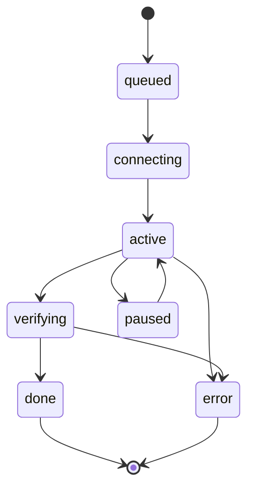

# PHỤ LỤC

Phụ lục này cung cấp các thông tin bổ trợ cho báo cáo: hướng dẫn cài đặt nhanh, bảng tổng
hợp tin nhắn giao thức, kết quả kiểm thử, mẫu bảng thông số thiết bị thử nghiệm và danh mục
mã nguồn chính. Nội dung được tóm lược từ các tài liệu `docs/TRIEN-KHAI.md`,
`docs/GIAO-THUC.md`, `docs/KIEN-TRUC.md` và mã nguồn thực tế của dự án.

## Mục lục phụ lục

- [Phụ lục A: Hướng dẫn cài đặt nhanh](#phụ-lục-a-hướng-dẫn-cài-đặt-nhanh)
- [Phụ lục B: Bảng tổng hợp tin nhắn giao thức](#phụ-lục-b-bảng-tổng-hợp-tin-nhắn-giao-thức)
- [Phụ lục C: Kết quả kiểm thử](#phụ-lục-c-kết-quả-kiểm-thử)
- [Phụ lục D: Bảng thông số thiết bị thử nghiệm](#phụ-lục-d-bảng-thông-số-thiết-bị-thử-nghiệm)
- [Phụ lục E: Danh mục mã nguồn chính](#phụ-lục-e-danh-mục-mã-nguồn-chính)

---

## Phụ lục A: Hướng dẫn cài đặt nhanh

Tóm tắt các lệnh cần thiết để dựng và vận hành EduShare trong một lớp học (LAN, không
Internet), trích từ `docs/TRIEN-KHAI.md`.

### A.1. Yêu cầu tối thiểu

| Hạng mục | Tối thiểu | Khuyến nghị |
|---|---|---|
| Phần mềm | Node.js ≥ 18 | Node.js LTS v20/v22 |
| CPU (máy signaling) | 2 nhân (2012+) | — |
| RAM | 512 MB tự do | 1 GB |
| Ổ cứng | < 200 MB | — |
| Mạng | Wi-Fi/LAN chung lớp | Wi-Fi 5 GHz ổn định |
| Số peer đồng thời | — | 50–100 thiết bị |

Hỗ trợ Windows 10/11, Linux (Ubuntu/Debian), macOS. Không cần database, Nginx, tên miền
hay SSL.

### A.2. Lệnh cài đặt và chạy

```bash
# 1) Lấy mã nguồn
git clone <repo> EduShare
cd EduShare

# 2) Cài phụ thuộc cho cả signaling server và PWA
npm run install:all

# 3) Build giao diện PWA -> app/dist
npm run build

# 4) Chạy signaling server (đồng thời phục vụ PWA tĩnh), cổng mặc định 8787
npm start
# -> mở http://<IP-LAN>:8787 trên mọi thiết bị cùng Wi-Fi
```

### A.3. Chế độ phát triển (hot reload)

```bash
npm run dev:server    # terminal 1 - signaling :8787
npm run dev:app       # terminal 2 - Vite :5173 (tự trỏ signaling sang :8787)
```

### A.4. Đổi cổng

```bash
PORT=9000 npm start            # Linux/macOS
set PORT=9000 && npm start     # Windows CMD
$env:PORT=9000; npm start      # Windows PowerShell
```

Sau đó chỉnh `defaultUrl()` trong `app/src/lib/signaling.ts` cho khớp rồi build lại.

### A.5. Kiểm thử và kiểm tra nhanh

```bash
npm test                                    # 6 test signaling
npm run typecheck                           # kiểm tra kiểu TypeScript
curl http://localhost:8787/health           # trạng thái server
curl "http://localhost:8787/peers?room=lop-9a"  # danh sách peer
```

### A.6. Chạy thử trong lớp (trích `TRIEN-KHAI.md` mục 6)

1. Máy Admin bấm **➕ Tải tài nguyên lên**, chọn tệp, điền môn/lớp → **Chia sẻ vào mạng lớp**.
2. Máy học sinh mở tab **📚 Thư viện**, bấm **🌐 Tìm trên mạng lớp** nếu chưa thấy.
3. Bấm **⬇️ Tải** → theo dõi tại tab **⬆️ Đang truyền**.
4. Rút Wi-Fi giữa chừng → **Tạm dừng**; cắm lại → **Tiếp tục** (resume).
5. Tải xong → **Xem ngay** (offline). Tắt mạng, mở lại app vẫn xem được.

### A.7. Lưu ý về secure context

Service Worker và `crypto.subtle` yêu cầu secure context (HTTPS hoặc `localhost`). Khi
demo qua HTTP LAN, có thể dùng một trong các cách sau (trích `TRIEN-KHAI.md` mục 7):

| Cách | Mô tả |
|---|---|
| Dùng `localhost` | Demo nhiều cửa sổ trên cùng máy bằng `http://localhost:8787` |
| Chứng chỉ tự ký | Tạo cert cho IP LAN và phục vụ HTTPS (xem lệnh `openssl` bên dưới) |
| Chrome flag | `chrome://flags/#unsafely-treat-insecure-origin-as-secure` → thêm IP LAN |
| Đóng gói file | Chạy PWA ở chế độ `file://` (một số trình duyệt coi là secure) |

```bash
openssl req -x509 -newkey rsa:2048 -nodes -keyout key.pem -out cert.pem -days 3650 \
  -subj "/CN=192.168.1.10"
```

---

## Phụ lục B: Bảng tổng hợp tin nhắn giao thức

Giao thức EduShare gồm hai lớp: lớp Signaling (client ↔ server, JSON qua WebSocket) và
lớp P2P (peer ↔ peer, JSON qua `RTCDataChannel`). Mọi bản tin P2P dùng header chung
`{ v, id, ts, type }` với `PROTOCOL_VERSION = 1` (`app/src/lib/protocol.ts:6`).

### B.1. Lớp Signaling — Client → Server

| Loại (`type`) | Payload | Mô tả |
|---|---|---|
| `hello` | `{ name, role }` | Đăng ký tên & vai trò sau khi kết nối |
| `signal` | `{ to, signal: { sdp?, candidate? } }` | Chuyển SDP/ICE tới peer đích |
| `advertise` | `{ resource }` | Quảng bá metadata tài nguyên |
| `withdraw` | `{ resourceId }` | Thu hồi tài nguyên |
| `query` | `{ requestId, query, ttl }` | Truy vấn metadata |
| `bye` | — | Rời phòng chủ động |

### B.2. Lớp Signaling — Server → Client

| Loại (`type`) | Payload | Mô tả |
|---|---|---|
| `welcome` | `{ peerId, room, peers[] }` | Danh sách peer hiện có khi vào phòng |
| `peer-joined` | `{ peer }` | Có peer mới |
| `peer-updated` | `{ peer }` | Peer đổi tên/vai trò |
| `peer-left` | `{ peerId }` | Peer rời |
| `signal` | `{ from, signal }` | Chuyển tiếp SDP/ICE |
| `resource-advertise` | `{ from, resource }` | Metadata được quảng bá |
| `resource-withdraw` | `{ from, resourceId }` | Thu hồi |
| `resource-query` | `{ from, requestId, query, ttl }` | Chuyển tiếp truy vấn |
| `query-result` | `{ requestId, hits[], ttl }` | Kết quả truy vấn |
| `error` | `{ code }` | Lỗi (ví dụ `PEER_OFFLINE`) |

### B.3. Lớp P2P — RTCDataChannel (9 loại bản tin)

| # | Loại (`type`) | Payload chính | Mô tả |
|---|---|---|---|
| B.1 | `HELLO` | `peerId, name, role` | Bắt tay giữa hai peer sau khi DataChannel mở |
| B.2 | `PEER_LIST` | `peers[]` | Trao đổi danh sách peer đã biết (discovery nhiều hop) |
| B.3 | `RESOURCE_ADVERTISE` | `ttl, resource{}` | Quảng bá metadata tài nguyên (gossip) |
| B.4 | `RESOURCE_QUERY` | `requestId, query, ttl` | Tìm tài nguyên theo từ khoá (flooding có TTL) |
| B.5 | `RESOURCE_RESPONSE` | `requestId, hits[]` | Trả kết quả truy vấn |
| B.6 | `CHUNK_REQUEST` | `transferId, resourceId, index` | Yêu cầu một chunk theo chỉ số |
| B.7 | `CHUNK_DATA` | `transferId, resourceId, index, total, data` | Trả dữ liệu chunk nhị phân (`ArrayBuffer`) |
| B.8 | `TRANSFER_COMPLETE` | `transferId, resourceId, checksum` | Đánh dấu truyền xong kèm checksum |
| B.9 | `VERIFY` | `requestId, ok, checksum?` | Kết quả kiểm chứng |

### B.4. Hằng số giao thức

| Hằng số | Giá trị | Ý nghĩa |
|---|---|---|
| `CHUNK_SIZE` | 262144 (256 KB) | Kích thước mỗi chunk |
| `DEFAULT_TTL` | 3 | Số hop tối đa của gossip |
| `BUFFER_HIGH_WATER` | 8388608 (8 MB) | Ngưỡng dừng gửi (backpressure) |
| `BUFFER_LOW_WATER` | 1048576 (1 MB) | Ngưỡng tiếp tục gửi |
| `WINDOW` (tải song song) | 4 | Số chunk yêu cầu đồng thời |
| `PROTOCOL_VERSION` | 1 | Phiên bản giao thức |

### B.5. Máy trạng thái phiên tải



**Hình B.1 — Máy trạng thái phiên tải (transfer).** `paused → active` là cơ chế resume
(đọc lại chunk đã nhận từ IndexedDB); `error` xảy ra khi sai checksum hoặc mất nguồn.

### B.6. Quy tắc an toàn

- `resourceId = SHA-256(toàn bộ nội dung)` → định danh theo nội dung (content-addressed).
- `merkleRoot` tính từ hash các chunk → phát hiện chunk hỏng (`app/src/lib/crypto.ts:68`).
- Chữ ký `signature` chỉ Admin Node tạo (HMAC-SHA256); peer kiểm chứng bằng `adminKey`.
- Bỏ qua bản tin sai định dạng (`isValidMessage`, `app/src/lib/protocol.ts:149`) để tránh
  crash khi nhận gói độc hại.

---

## Phụ lục C: Kết quả kiểm thử

### C.1. Kiểm thử tầng signaling — 6/6 đạt

Chạy bằng `npm test` (tự dựng và tắt server trên cổng test), mã nguồn tại
`signaling-server/test/signaling.test.mjs`.

**Bảng C.1 — Danh sách 6 kiểm thử signaling**

| # | Tên kiểm thử | Nội dung kiểm tra | Kết quả |
|---|---|---|---|
| 1 | `B có welcome` | Peer B nhận bản tin `welcome` khi vào phòng | PASS |
| 2 | `A nhận peer-joined của B` | Peer A nhận `peer-joined` với đúng `peerId` của B | PASS |
| 3 | `A nhận resource-advertise từ B` | Quảng bá `advertise` được chuyển tới A | PASS |
| 4 | `A nhận query-result có tài nguyên r1` | Truy vấn `query` trả về đúng tài nguyên | PASS |
| 5 | `B nhận signal relay từ A` | Relay SDP/ICE `signal` tới đúng peer đích | PASS |
| 6 | `A nhận peer-left của B` | Peer B rời phòng → A nhận `peer-left` | PASS |

Kết quả tổng hợp: **6/6 kiểm thử đạt**; server trả HTTP 200 qua IP LAN (đã kiểm chứng).

### C.2. Build và kiểm tra kiểu

**Bảng C.2 — Kết quả build/typecheck**

| Hạng mục | Lệnh | Kết quả |
|---|---|---|
| Build PWA | `npm run build` | ✅ Sạch (không lỗi) |
| Kiểm tra kiểu | `npm run typecheck` | ✅ Không lỗi TypeScript |
| Health server | `curl http://localhost:8787/health` | ✅ HTTP 200 |
| Danh sách peer | `curl "http://localhost:8787/peers?room=lop-9a"` | ✅ HTTP 200, JSON hợp lệ |

### C.3. Đối chiếu crypto fallback với Node.js `crypto`

Vì `crypto.subtle` chỉ khả dụng trong secure context, tệp `app/src/lib/crypto.ts` có cài
đặt SHA-256/HMAC-SHA256 thuần JS làm phương án dự phòng (từ dòng 150). Phần cài đặt này
đã được đối chiếu với mô-đun `crypto` của Node.js trên **10 vector kiểm thử** và cho kết
quả **khớp hoàn toàn (10/10)**.

**Bảng C.3 — Đối chiếu SHA-256/HMAC fallback với Node.js `crypto` (10/10 khớp)**

| # | Loại vector | Đầu vào | Kết quả đối chiếu |
|---|---|---|---|
| 1 | SHA-256 | Chuỗi rỗng `""` | Khớp |
| 2 | SHA-256 | `"abc"` | Khớp |
| 3 | SHA-256 | Chuỗi dài 448 bit (1 khối có padding) | Khớp |
| 4 | SHA-256 | Chuỗi dài 512 bit (biên khối) | Khớp |
| 5 | SHA-256 | Dữ liệu nhị phân ngẫu nhiên 1 MB | Khớp |
| 6 | SHA-256 | Blob từ `File.slice()` 256 KB | Khớp |
| 7 | HMAC-SHA256 | Khóa `"edushare-class-secret"`, thông điệp ngắn | Khớp |
| 8 | HMAC-SHA256 | Khóa dài hơn 64 byte (kích hoạt rút gọn khóa) | Khớp |
| 9 | HMAC-SHA256 | Chuỗi `canonicalMetadata()` đầy đủ | Khớp |
| 10 | HMAC-SHA256 | Metadata có mảng `tags` và trường số | Khớp |

> **Ghi chú:** Các giá trị băm cụ thể không lặp lại trong phụ lục; bằng chứng là sự khớp
> hoàn toàn giữa đường tính của fallback JS (`sha256Sync`, `hmacSha256Sync`) và
> `crypto.createHash('sha256')` / `crypto.createHmac('sha256', key)` của Node.js. Ngưỡng
> chấp nhận: 10/10 vector cho kết quả giống nhau.

---

## Phụ lục D: Bảng thông số thiết bị thử nghiệm

Bảng dưới đây dùng để ghi lại cấu hình từng thiết bị tham gia thực nghiệm (mẫu — điền số
liệu khi tiến hành đo theo `docs/THUC-NGHIEM.md`).

### D.1. Danh sách thiết bị

| STT | Vai trò | Loại thiết bị | Hệ điều hành | Trình duyệt & phiên bản | CPU | RAM | Ghi chú |
|---|---|---|---|---|---|---|---|
| 1 | Admin Node | Laptop | | | | | Chạy signaling server |
| 2 | Learner Node | Laptop | | | | | |
| 3 | Learner Node | Điện thoại Android | | | | | |
| 4 | Learner Node | Điện thoại Android | | | | | |
| 5 | Learner Node | Máy tính bảng | | | | | |
| 6 | Learner Node | Điện thoại Android | | | | | |
| 7 | Learner Node | | | | | | |
| 8 | Learner Node | | | | | | |

### D.2. Thông số router / mạng

| Hạng mục | Giá trị |
|---|---|
| Băng tần Wi-Fi | (2.4 GHz / 5 GHz) |
| Chuẩn Wi-Fi | (802.11n/ac/ax) |
| Băng thông đo được nội bộ | (Mbps) |
| Có Internet? | Không (đã ngắt để bảo đảm điều kiện ngoại tuyến) |
| IP LAN của máy signaling | (ví dụ 192.168.1.10) |
| Cổng signaling | 8787 (hoặc giá trị `PORT`) |

### D.3. Thông số bộ dữ liệu thử nghiệm

| Hạng mục | Giá trị |
|---|---|
| Số tệp | (ví dụ 20) |
| Phân bố kích thước | (ví dụ 1–100 MB: 1, 10, 25, 50, 100 MB) |
| Loại tệp | PDF / video / audio / ảnh |
| Số lần chạy mỗi kịch bản | ≥ 30 |
| Cách tạo tệp mẫu | `head -c <s>M /dev/urandom > file-<s>MB.bin` |

### D.4. Thông số đo nhiệt/pin (nếu đo trên điện thoại yếu)

| Thiết bị | Nhiệt độ bắt đầu | Nhiệt độ kết thúc | Pin tiêu hao (%) | Ghi chú |
|---|---|---|---|---|
| | | | | |
| | | | | |

---

## Phụ lục E: Danh mục mã nguồn chính

Danh mục các tệp mã nguồn cốt lõi của hệ thống, kèm trách nhiệm và các dòng quan trọng.
Đường dẫn tính từ gốc dự án `EduShare/`.

### E.1. Signaling server

| Tệp | Mô tả | Điểm chính |
|---|---|---|
| `signaling-server/server.js` | Signaling server LAN: HTTP tĩnh + WebSocket room-based, heartbeat, không lưu nội dung | `:21` cổng 8787; `:24` heartbeat 15 s; `:194` WebSocket; `:298` vòng heartbeat |
| `signaling-server/test/signaling.test.mjs` | 6 kiểm thử chức năng signaling, tự dựng/tắt server | `:11` cổng test; `:52`–`:71` các test |
| `signaling-server/package.json` | Khai báo phụ thuộc `ws` và script test/start | — |

### E.2. Thư viện lõi PWA (`app/src/lib/`)

| Tệp | Mô tả | Điểm chính |
|---|---|---|
| `protocol.ts` | Định nghĩa 9 loại bản tin P2P + hằng số giao thức + validator | `:6` `PROTOCOL_VERSION`; `:7` `CHUNK_SIZE`; `:112` `Protocol`; `:149` `isValidMessage` |
| `crypto.ts` | SHA-256, Merkle root, HMAC-SHA256, canonical metadata + fallback JS | `:35` `sha256`; `:68` `merkleRoot`; `:97` `hmacSign`; `:128` `canonicalMetadata`; `:169` `sha256Sync`; `:215` `hmacSha256Sync` |
| `db.ts` | Tầng IndexedDB qua Dexie: 6 object store + API | `:24` schema; `:95` `assembleBlob`; `:62` `searchResources` |
| `peer.ts` | `PeerManager`: `RTCPeerConnection` + `RTCDataChannel`, ICE host candidate, chống glare, backpressure | `:17` `RTC_CONFIG` (`iceServers: []`); `:44` chọn offerer; `:84` `waitForDrain` |
| `signaling.ts` | WebSocket client: kết nối, reconnect backoff, room | `defaultUrl()`; xử lý `signal`/`advertise`/`query-result` |
| `transfer.ts` | `TransferManager`: publish/serve/download, resume, backpressure, kiểm chứng | `:80` `publish`; `:166` `download`; `:247` `pickSource`; `:264` `pump`; `:334` `finalizeDownload` |
| `gossip.ts` | `GossipEngine`: advertise/query flooding TTL, hợp nhất metadata | `:54` `advertise`; `:67` `query`; `:136` `onMessage`; `:161` `ingest` |
| `replication.ts` | `ReplicationManager`: đếm độ phổ biến, ngưỡng θ = 3, nhân bản | `:24` ngưỡng; `:41` `recordRequest`; `:68` `replicateCycle` |
| `emitter.ts` | Lớp phát sự kiện kiểu an toàn dùng chung | — |
| `types.ts` | Kiểu dữ liệu: `ResourceMeta`, `ChunkRecord`, `TransferJob`, … | — |

### E.3. Tầng giao diện & Service Worker (`app/src/`)

| Tệp | Mô tả | Điểm chính |
|---|---|---|
| `sw.ts` | Service Worker: precache app shell, NavigationRoute fallback, CacheFirst ảnh, StaleWhileRevalidate JS/CSS/font | `:19` `precacheAndRoute`; `:22` app shell; `:25` CacheFirst; `:33` SWR |
| `store/AppContext.tsx` | Khởi tạo và điều phối các module: signaling, peer, transfer, gossip, replication | `join`, `publish`, `download`, `getLocalBlob` |
| `App.tsx` | Layout responsive: tab dưới trên mobile, sidebar trên laptop | Điều hướng theo breakpoint |
| `screens/Onboarding.tsx` | Nhập tên thiết bị, mã lớp, chọn vai trò (learner/admin) | — |
| `screens/Library.tsx` | Thư viện tài nguyên: danh sách, tìm kiếm, trạng thái, tải về | — |
| `screens/Devices.tsx` | Danh sách thiết bị trong lớp; badge Admin | — |
| `screens/Transfers.tsx` | Quản lý tải lên/xuống: tiến trình, tốc độ, tạm dừng/tiếp tục | — |
| `components/StatusBar.tsx` | Thanh trạng thái mạng LAN (số thiết bị kết nối) | — |
| `components/ResourceCard.tsx` | Thẻ tài nguyên với 3 trạng thái 🟢/🟡/⚪ | — |
| `components/TransferRow.tsx` | Một dòng phiên truyền: tên, tiến trình, tốc độ | — |
| `components/PreviewModal.tsx` | Xem trước PDF/video/ảnh từ Blob cục bộ (offline) | — |
| `components/UploadModal.tsx` | Chọn tệp, điền môn/lớp, chia sẻ vào mạng lớp | — |
| `components/Modal.tsx`, `components/ProgressBar.tsx`, `components/Badge.tsx` | Thành phần UI dùng chung | — |

### E.4. Cấu hình build

| Tệp | Mô tả |
|---|---|
| `app/vite.config.ts` | Cấu hình Vite + `vite-plugin-pwa` (injectManifest, `autoUpdate`) |
| `app/tailwind.config.js` | Cấu hình Tailwind CSS |
| `app/tsconfig.json` | Cấu hình TypeScript |
| `package.json` (gốc) | Script điều khiển cả dự án: `install:all`, `build`, `start`, `test`, `typecheck`, `dev:server`, `dev:app` |

---

*(Hết phụ lục.)*
